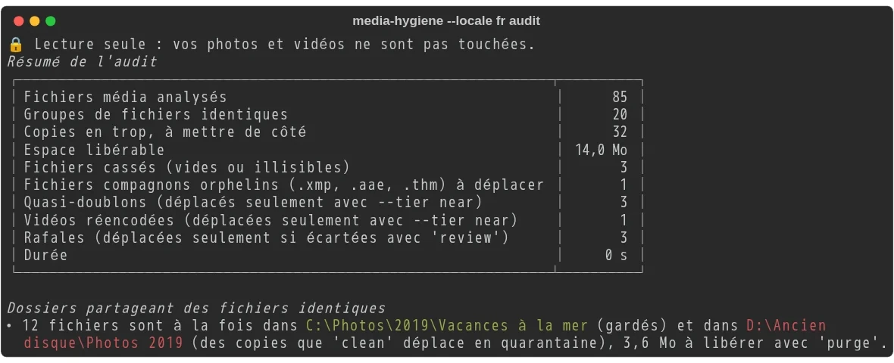

# media-hygiene

Nettoie, range et explore les photos et vidéos réparties sur plusieurs dossiers et plusieurs
disques — d'un seul `docker run`, sous Windows (PowerShell) ou WSL. Tout se passe sur votre
ordinateur, et chaque changement est journalisé et peut être annulé.

- **Nettoyer les doublons** : copies identiques, copies redimensionnées ou recompressées, rafales.
- **Ranger** : une arborescence proposée par date, événement, lieu (GPS, hors ligne) et sujet (un
  modèle de vision local), que vous corrigez avant que rien ne bouge.
- **Retrouver les personnes** : les visages sont trouvés et regroupés sur votre ordinateur, pour
  ranger les photos par personne, sans serveur photo comme Immich (première version : trouver
  et regrouper ; les nommer viendra ensuite).

[](https://hub.docker.com/r/cavo789/media-hygiene)
[](https://hub.docker.com/r/cavo789/media-hygiene)

L'image : [**cavo789/media-hygiene** sur Docker Hub](https://hub.docker.com/r/cavo789/media-hygiene) (amd64 et arm64).

🇬🇧 [English version](README.md)



## Démarrage rapide

Avec Docker installé, une seule commande audite un dossier. Dans **PowerShell** :

```powershell
docker run --rm -it -v "C:\Photos:/data/c/Photos:ro" cavo789/media-hygiene --locale fr audit
```

Dans un terminal **WSL** (ou Linux), le même dossier s'écrit `/mnt/c/Photos` :

```bash
docker run --rm -it -v "/mnt/c/Photos:/data/c/Photos:ro" cavo789/media-hygiene --locale fr audit
```

Elle liste les photos et vidéos en double ou cassées de `C:\Photos`, sans rien modifier : `:ro`
(lecture seule) fait interdire toute écriture par Docker lui-même. Le premier lancement
télécharge l'image [depuis Docker Hub](https://hub.docker.com/r/cavo789/media-hygiene) tout seul. [Votre premier audit](documentation/fr/start/01-first-audit.md) explique
cette commande et son résultat, morceau par morceau.

Ce qu'elle trouve :

- **Doublons exacts** : même taille et même SHA-256, entre dossiers *et* entre disques (`C:` et
  `D:` dans la même exécution).
- **Fichiers cassés** : fichiers vides, images et fichiers RAW impossibles à décoder (JPEG
  tronqué, …), vidéos impossibles à ouvrir.
- **Fichiers compagnons orphelins** : un fichier compagnon (`.xmp`, `.aae`, `.thm`) resté sans
  sa photo.
- **Rafales et quasi-doublons** (vidéos réencodées comprises) : montrés côte à côte dans un
  rapport HTML ; `review` vous fait ensuite choisir les meilleures photos de chaque rafale [au clavier, dans votre navigateur](documentation/fr/clean/10-review-bursts.md).

Ensuite, si vous le décidez, `clean` met de côté les copies en trop et les fichiers cassés ; les
rafales et les quasi-doublons seulement si vous le demandez.

## Vos photos sont en sécurité

**Nous le garantissons : ces commandes ne modifient, ne déplacent ni ne suppriment jamais une
photo ou une vidéo** — `audit`, `crosscheck`, `classify`, `review`, `review-sort`, `places`,
`inventory`, `tags`, `search`, `people`, `history`, `reports`, `config`, `status`, `launcher`. Elles n'écrivent que leurs propres fichiers
(rapports, cache, `config.toml`). Lancez-les avec vos dossiers montés en `:ro` : le système
lui-même interdit alors toute modification.

**Les commandes qui agissent n'effacent jamais rien.** `sort` déplace des fichiers (sur un même
disque, un simple renommage : aucune copie, aucune place prise), `album` ajoute des seconds noms,
`xmp` écrit de petits fichiers compagnons `.xmp` à côté des photos, `clean` déplace les copies en double en quarantaine après les avoir comparées octet par octet avec
la copie gardée, `undo` remet en place. Jamais par-dessus un autre fichier, chaque étape
journalisée, tout est annulable.

**Seul `purge` efface** : la quarantaine, pour de bon, après vous l'avoir demandé (et
`clean --delete`, si vous le demandez : la copie gardée reste). Plus de détails dans
[comment vos photos restent en sécurité](documentation/fr/reference-safety.md).

## Documentation

La [documentation](documentation/fr/README.md) vous accompagne pas à pas. Chaque étape ajoute une
seule chose à la commande de l'étape précédente.

**Pour commencer** — les trois mêmes premières étapes, quoi que vous fassiez ensuite :

1. [Votre premier audit](documentation/fr/start/01-first-audit.md) : un dossier, une commande, et
   comment lire le résultat.
2. [Garder le cache](documentation/fr/start/02-keep-the-cache.md) : les audits suivants prennent des
   secondes au lieu de minutes.
3. [Plusieurs dossiers et disques](documentation/fr/start/03-several-folders.md) : `C:` et `D:`
   ensemble, le dossier courant, WSL.

**Nettoyer les doublons** — pressé ? [Nettoyer en bref](documentation/fr/clean/quick-guide.md), toutes les commandes sur une page.

4. [Le rapport HTML](documentation/fr/clean/04-html-report.md) : les images, les paires de dossiers, la
   preuve.
5. [Choisir la copie gardée](documentation/fr/clean/05-choose-the-kept-copy.md) : `--prefer`,
   `--protect`, `--exclude`.
6. [Seulement certains types de fichiers](documentation/fr/clean/06-file-types.md) : `--ext`, et les
   fichiers autres que des photos.
7. [Le fichier de configuration](documentation/fr/clean/07-configuration-file.md) : écrire vos choix une
   fois pour toutes, dans `config.toml`.
8. [Nettoyer](documentation/fr/clean/08-clean.md) : mettre les copies en trop de côté en
   quarantaine, avec un journal.
9. [Annuler, historique, purge](documentation/fr/clean/09-undo-history-purge.md) : changer d'avis, voir
   ce qui a été fait, vider la quarantaine pour libérer la place.
10. [Trier les rafales dans le navigateur](documentation/fr/clean/10-review-bursts.md) : garder les
    meilleures photos de chaque rafale, au clavier.
11. [Les quasi-doublons](documentation/fr/clean/11-near-duplicates.md) : les copies réduites et
    recompressées (`--tier near`).
12. [Décider paire par paire](documentation/fr/clean/12-decide-pair-by-pair.md) : inverser une paire de
    dossiers ou ne pas y toucher, depuis le rapport.
13. [Un second avis](documentation/fr/clean/13-second-opinion.md) : comparer avec Czkawka, un outil
    indépendant.

**Trier les photos** (nettoyez d'abord les doublons) — pressé ? [Trier en bref](documentation/fr/sort/quick-guide.md), toutes les commandes sur une page.

4. [Proposer une arborescence](documentation/fr/sort/04-classify.md) — `classify` propose une
   place pour chaque fichier, et ne modifie rien.
5. [Revoir la proposition](documentation/fr/sort/05-review-the-proposal.md) — la corriger dans un
   classeur, regarder les photos dans le rapport.
6. [Écrire ce que vous savez](documentation/fr/sort/06-write-down-what-you-know.md) — des règles
   pour vos voyages, anniversaires, dossiers et appareils, appliquées à chaque exécution.
7. [Trier](documentation/fr/sort/07-sort.md) — `sort` déplace les fichiers comme le dit le
   classeur, journalisé et annulable.
8. [Nommer les sujets avec un modèle local](documentation/fr/sort/08-subjects-from-a-local-model.md) —
   un modèle de vision sur votre ordinateur dit ce que montrent les photos isolées (facultatif).
9. [Lieux et voyages grâce au GPS](documentation/fr/sort/09-places-from-gps.md) — nommer vos
   lieux sur une carte ; le GPS des téléphones récents trie maison, famille et voyages, hors
   ligne (facultatif).
10. [Nommer les événements dans le navigateur](documentation/fr/sort/10-name-events-in-the-browser.md) —
    un événement à la fois avec ses photos, nommé au clavier (facultatif).
11. [Albums](documentation/fr/sort/11-albums.md) — une photo dans plusieurs dossiers, en liens
    physiques : aucune copie, aucune place prise (facultatif).

**Chaque commande a sa page** : ce qu'elle fait, les dossiers dont elle a besoin, ses options, des
exemples : [`audit`](documentation/fr/commands/audit.md), [`status`](documentation/fr/commands/status.md),
[`clean`](documentation/fr/commands/clean.md), [`undo`](documentation/fr/commands/undo.md),
[`history`](documentation/fr/commands/history.md), [`purge`](documentation/fr/commands/purge.md),
[`review`](documentation/fr/commands/review.md), [`reports`](documentation/fr/commands/reports.md),
[`crosscheck`](documentation/fr/commands/crosscheck.md), [`config`](documentation/fr/commands/config.md),
[`launcher`](documentation/fr/commands/launcher.md), [`classify`](documentation/fr/commands/classify.md),
[`review-sort`](documentation/fr/commands/review-sort.md), [`sort`](documentation/fr/commands/sort.md),
[`album`](documentation/fr/commands/album.md), [`places`](documentation/fr/commands/places.md),
[`inventory`](documentation/fr/commands/inventory.md), [`tags`](documentation/fr/commands/tags.md),
[`search`](documentation/fr/commands/search.md), [`xmp`](documentation/fr/commands/xmp.md),
[`people`](documentation/fr/commands/people.md). Vous hésitez ?
[Quelle commande ?](documentation/fr/reference-commands.md#quelle-commande-)

**Référence** : [commandes et options](documentation/fr/reference-commands.md),
[points de montage](documentation/fr/reference-mount-points.md),
[comment vos photos restent en sécurité](documentation/fr/reference-safety.md),
[fichiers compagnons](documentation/fr/reference-sidecars.md),
[dépannage](documentation/fr/reference-troubleshooting.md),
[le classeur d'inventaire](documentation/fr/reference-inventory.md),
[les tags](documentation/fr/reference-tags.md),
[les personnes](documentation/fr/reference-people.md),
[utilisation avancée](documentation/fr/reference-advanced.md).

**Pour les développeurs** : [construire l'image, le devcontainer, les versions](documentation/fr/development.md).

## La commande complète

Une fois le guide parcouru, la plupart des gens arrivent à cette commande : deux dossiers, le
cache, les rapports, la configuration, le journal et la quarantaine. Elle nettoie ; pour un
audit, ajoutez `:ro` à vos dossiers et écrivez `audit` au lieu de `clean`.

```powershell
mkdir "$HOME\media-hygiene\reports", "$HOME\media-hygiene\config", "$HOME\media-hygiene\journal", "$HOME\media-hygiene\quarantine"
docker run --rm -it `
  -v "C:\Photos:/data/c/Photos" `
  -v "D:\Ancien disque:/data/d/Ancien disque" `
  -v media-hygiene-cache:/cache `
  -v "$HOME\media-hygiene\reports:/reports" `
  -v "$HOME\media-hygiene\config:/config" `
  -v "$HOME\media-hygiene\journal:/journal" `
  -v "$HOME\media-hygiene\quarantine:/quarantine" `
  cavo789/media-hygiene --locale fr clean
```

Depuis WSL, écrivez les chemins Linux et lancez le conteneur sous votre identité, pour que les
fichiers créés vous appartiennent :

```bash
mkdir -p ~/media-hygiene/{reports,config,journal,quarantine}
docker run --rm -it --user "$(id -u):$(id -g)" \
  -v "/mnt/c/Photos:/data/c/Photos" \
  -v "/mnt/d/Ancien disque:/data/d/Ancien disque" \
  -v media-hygiene-cache:/cache \
  -v ~/media-hygiene/reports:/reports \
  -v ~/media-hygiene/config:/config \
  -v ~/media-hygiene/journal:/journal \
  -v ~/media-hygiene/quarantine:/quarantine \
  cavo789/media-hygiene --locale fr clean
```

`undo` au lieu de `clean` remet tout en place.

## Mettre à jour

`docker pull cavo789/media-hygiene` récupère la dernière version ; un tag comme
`cavo789/media-hygiene:0.3.0` en fixe une.

### Vous veniez de media-dedup ?

Jusqu'à la version 0.2, l'outil s'appelait **media-dedup** (`cavo789/media-dedup`) ; il
s'appelle media-hygiene depuis la version 0.3.0. Rien de ce que vous avez n'est perdu :

- Écrivez `cavo789/media-hygiene` au lieu de `cavo789/media-dedup` dans vos commandes :
  l'ancienne image n'est plus sur Docker Hub (Docker répond alors *pull access denied*).
- Gardez vos dossiers et vos volumes : `$HOME\media-dedup\journal`, `media-dedup-cache` et
  les autres vous appartiennent, quel que soit leur nom. Continuez à les écrire dans vos
  options `-v` : `undo`, `history` et le cache y retrouvent tout.
- Les variables d'environnement `MEDIA_DEDUP_…` fonctionnent encore jusqu'à la version 0.4.0,
  avec un avertissement : renommez-les `MEDIA_HYGIENE_…`.
