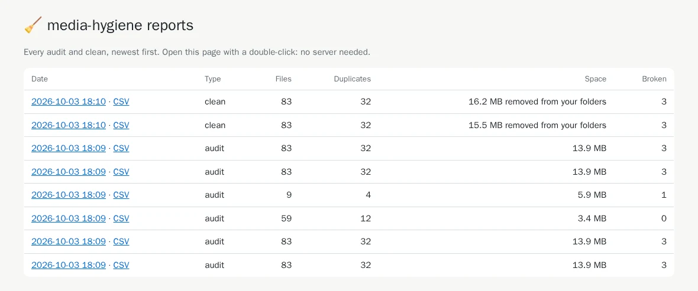
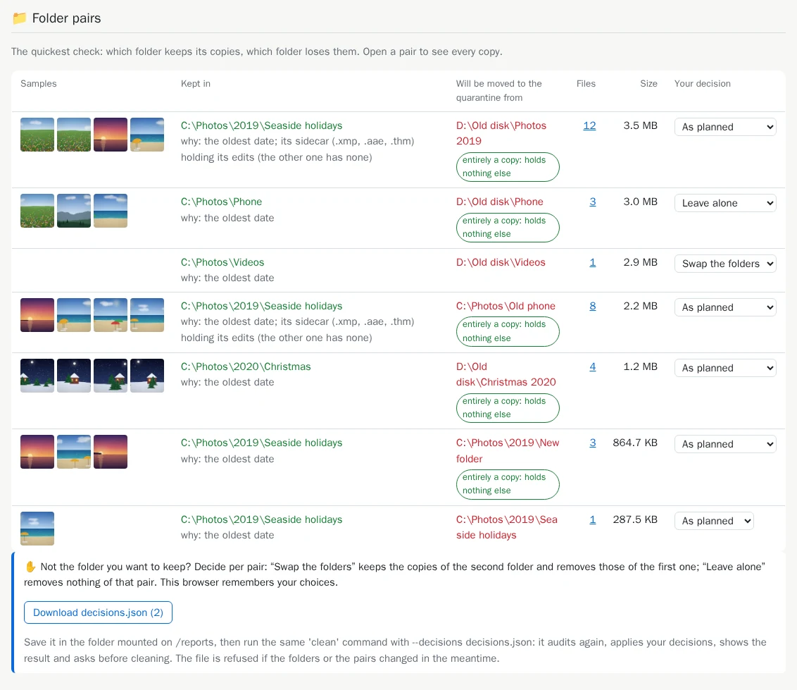
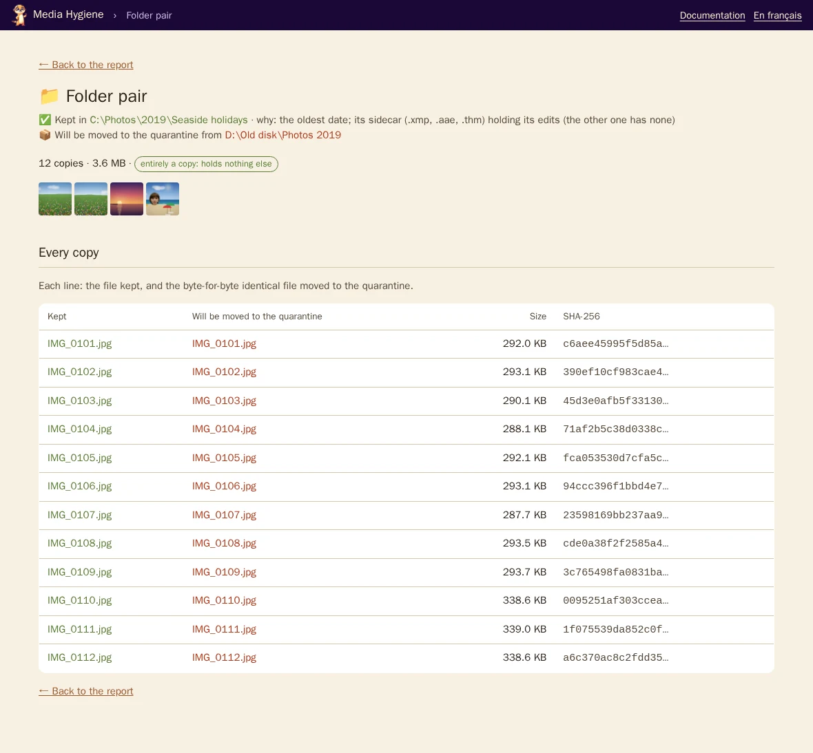
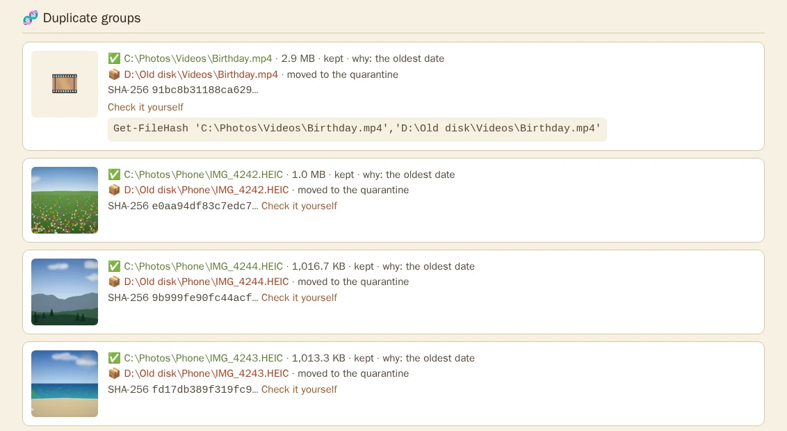
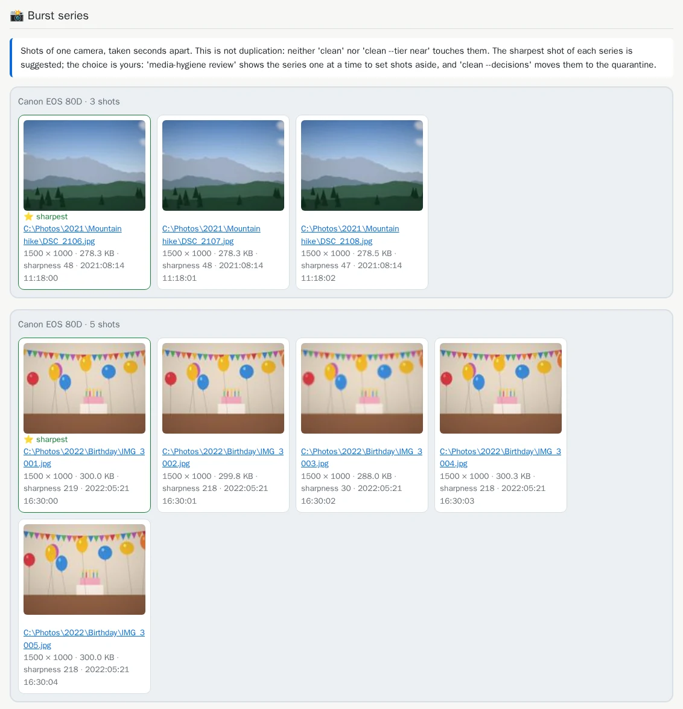
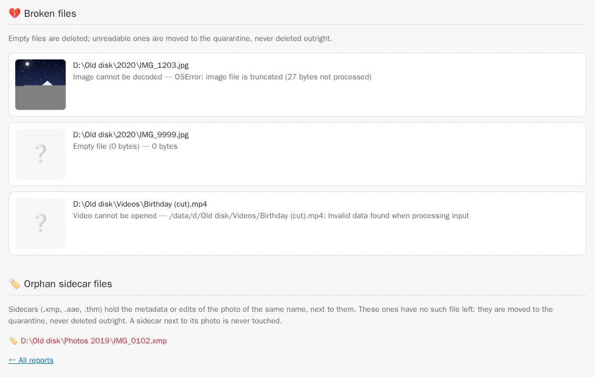

# 4. The HTML report

[Documentation](../README.md) › Cleaning, step 4 of 15 · 🇫🇷 [Français](../../fr/clean/04-html-report.md)

The terminal gives the totals and the folder pairs. The report shows the rest: the pictures
themselves, every copy line by line, and the proof that they are identical. It is a web page
that opens in your browser, with no server and no internet connection. Its dates are shown in
your computer's time zone.

## Give the tool a reports folder

`mh` mounts one already, `$HOME\media-hygiene\reports`, created the first time; the full command
creates it, then mounts it on `/reports`:

```powershell
mh audit
```

<details>
<summary>Without <code>mh</code>: the full command</summary>

```powershell
mkdir -Force "$HOME\media-hygiene\reports"
docker run --rm -it `
  -v "C:\Photos:/data/c/Photos:ro" `
  -v "D:\Old disk:/data/d/Old disk:ro" `
  -v media-hygiene-cache:/cache `
  -v "$HOME\media-hygiene\reports:/reports" `
  cavo789/media-hygiene audit
```

</details>

`$HOME` is your user folder (`C:\Users\<you>`): the reports land in
`C:\Users\<you>\media-hygiene\reports`. Without `mh`, create the folder **before** the first run: a folder
Docker creates by itself belongs to the administrator, and the tool could not write there
([why](../reference-troubleshooting.md#folders-the-tool-cannot-write-to)).

At the end of the audit, a new line:

<!-- capture: audit.txt|HTML report|. -->
```text
✅ HTML report:
```

With Docker Desktop (PowerShell), the tool knows the Windows folder behind `/reports` and shows
the full paths instead; in Windows Terminal, Ctrl+click opens them:

```text
✅ HTML report: C:\Users\<you>\media-hygiene\reports\20261003-180936-audit\report.html
```

With `--verbosity verbose`, a 💡 tip also names `index.html`, which lists every report.

## Open it

With `mh`, type `mh open` (the audit ends with that line): your browser opens `index.html`.
Without it, open `C:\Users\<you>\media-hygiene\reports` in the Explorer and double-click
`index.html`. It lists every audit and clean, newest first:



Click a date to open that report. Each run has its own folder, named after its date and kind
(`YYYYMMDD-HHMMSS-audit`), holding `report.html`, the previews and `plan.csv`, and `near.html`
when there are near duplicates. A *Contents* box at the top of `report.html` leads to each
section.

Each chapter of an audit report says what it asks of you:

- 🧹 **'clean' takes care of it**: identical copies, broken files, orphan sidecars;
- 👀 **Yours to decide**: near duplicates, re-encoded videos;
- ℹ️ **For your information, nothing to do**: burst series, folded, last.

A chapter shows a count line and its 5 largest examples, not the whole list: **The full list**
opens `near.html`, and `plan.csv` holds every file. Where there is something to decide, a ▶
button opens the review: **Decide in the browser** (`review --near`), **Sort the bursts**
(`review`). It works when the home page (`mh`) shows the report; opened from the disk or by
`mh reports`, the button gives way to the command to copy.

## The top: the totals


The same numbers as in the terminal, then a reminder: an audit changes nothing, and each copy
listed is byte-for-byte identical to the one kept.

## The folder pairs: the quickest check

Start here. Each line is a pair of folders: which one keeps its copies (green), which one loses
them (red), with a few sample pictures, the number of files and the space freed.



- **why:** the rule that chose the kept folder ([the rules](05-choose-the-kept-copy.md)).
- The badge **entirely a copy: holds nothing else** marks a folder with nothing of its own.
- **Your decision** lets you swap a pair or leave it alone: [step 12](12-decide-pair-by-pair.md)
  explains it. Until then, ignore it.

Click the number of files of a pair to see every copy, line by line:



## Groups of identical files

Further down, a random sample of photo groups (the same ones on every run), then the largest
groups first. Each group shows the copy kept ✅, the copies set aside 📦 (moved to the quarantine;
🗑️ with `--delete`), and the SHA-256
fingerprint they share.



**Check it yourself** gives a command for PowerShell. Paste it: Windows computes the fingerprint
of every copy itself, and they are all the same. You do not have to trust media-hygiene.

## Near duplicates and burst series

These sections show pictures and videos that are *not* identical files, side by side. Nothing
happens to them unless you ask:

- **Near duplicates**: the same photo saved again, smaller or recompressed ([step 11](11-near-duplicates.md)).

  

- **Re-encoded videos**: the same video saved again, smaller or recompressed, described by its
  resolution, length, codec and size, with a player ([step 11](11-near-duplicates.md#videos-too-re-encoded-copies)).

- **Burst series**: shots taken seconds apart, the sharpest one marked ⭐ ([step 10](10-review-bursts.md)).

  

## Broken files and orphan sidecars



Empty files will be deleted; unreadable ones moved to the quarantine, never deleted outright.
[Sidecars](../reference-sidecars.md) left without their photo are moved to the quarantine too.

## Every file in a spreadsheet: `plan.csv`

Next to each report, `plan.csv` lists **every** file of the plan, with no cap: group, SHA-256,
size, action, path, folder, date and the rule that chose the kept copy. The
[near duplicates](11-near-duplicates.md) follow, group by group, without SHA-256 (they are not
identical files), the kept version saying in the last column whether its group is sure or to
check. It opens directly in Excel, accents included:

<!-- capture: plan-csv.txt -->
```text
Group,SHA-256,Size (bytes),Action,File,Folder,Modified (UTC),Detail,Near-duplicate level
1,b5b448906b96309b77624c6a2833c38e4f03c50b4aa7fbfd706938748e1fbf93,3009124,keep,C:\Photos\Videos\Birthday.mp4,C:\Photos\Videos,2022-05-21 16:35:00,the oldest date,
1,b5b448906b96309b77624c6a2833c38e4f03c50b4aa7fbfd706938748e1fbf93,3009124,move to the quarantine,D:\Old disk\Videos\Birthday.mp4,D:\Old disk\Videos,2024-01-15 20:30:00,,
2,e0aa94df83c7edc7252a61e2d4ab4b275596554ddffdc109623b8492e3154a84,1073000,keep,C:\Photos\Phone\IMG_4242.HEIC,C:\Photos\Phone,2024-04-06 11:00:00,the oldest date,
2,e0aa94df83c7edc7252a61e2d4ab4b275596554ddffdc109623b8492e3154a84,1073000,move to the quarantine,D:\Old disk\Phone\IMG_4242.HEIC,D:\Old disk\Phone,2024-08-02 20:30:00,,
3,9b999fe90fc44acf6f2c5fb9d89e830321cabb631ae2ea1ad97449e4b78324c8,1041095,keep,C:\Photos\Phone\IMG_4244.HEIC,C:\Photos\Phone,2024-04-06 12:22:00,the oldest date,
```

## List and tidy the reports

`reports` lists the reports and refreshes `index.html`; `reports --prune 10` keeps the ten most
recent and deletes the others:

```powershell
mh reports
```

<details>
<summary>Without <code>mh</code>: the full command</summary>

```powershell
docker run --rm -it -v "$HOME\media-hygiene\reports:/reports" cavo789/media-hygiene reports
```

</details>

<!-- capture: reports.txt -->
```text
Reports (newest first)
┏━━━━━━━━━━━━━━━━━━━━━━━┳━━━━━━━┳━━━━━━━┳━━━━━━━━━━━━┳━━━━━━━━━┳━━━━━━━━┓
┃ Folder                ┃ Type  ┃ Files ┃ Duplicates ┃ Space   ┃ Broken ┃
┡━━━━━━━━━━━━━━━━━━━━━━━╇━━━━━━━╇━━━━━━━╇━━━━━━━━━━━━╇━━━━━━━━━╇━━━━━━━━┩
│ 20261025-084740-clean │ clean │ 89    │ 32         │ 16.4 MB │ 3      │
│ 20261025-084740-audit │ audit │ 89    │ 32         │ 14.0 MB │ 3      │
│ 20261025-084738-clean │ clean │ 89    │ 32         │ 15.6 MB │ 3      │
│ 20261025-084735-audit │ audit │ 89    │ 32         │ 14.0 MB │ 3      │
│ 20261025-084704-audit │ audit │ 89    │ 32         │ 14.0 MB │ 3      │
│ 20261025-084700-audit │ audit │ 89    │ 32         │ 14.0 MB │ 3      │
│ 20261025-084656-audit │ audit │ 10    │ 4          │ 5.9 MB  │ 1      │
│ 20261025-084655-audit │ audit │ 65    │ 12         │ 3.4 MB  │ 0      │
│ 20261025-084654-audit │ audit │ 89    │ 32         │ 14.0 MB │ 3      │
│ 20261025-084653-audit │ audit │ 89    │ 32         │ 14.0 MB │ 3      │
└───────────────────────┴───────┴───────┴────────────┴─────────┴────────┘
💡 Double-click index.html in the folder mounted on /reports.
```

---

← [3. Several folders and disks](../start/03-several-folders.md) · [Documentation](../README.md) · Next: **[5. Choose which copy stays](05-choose-the-kept-copy.md)** →
