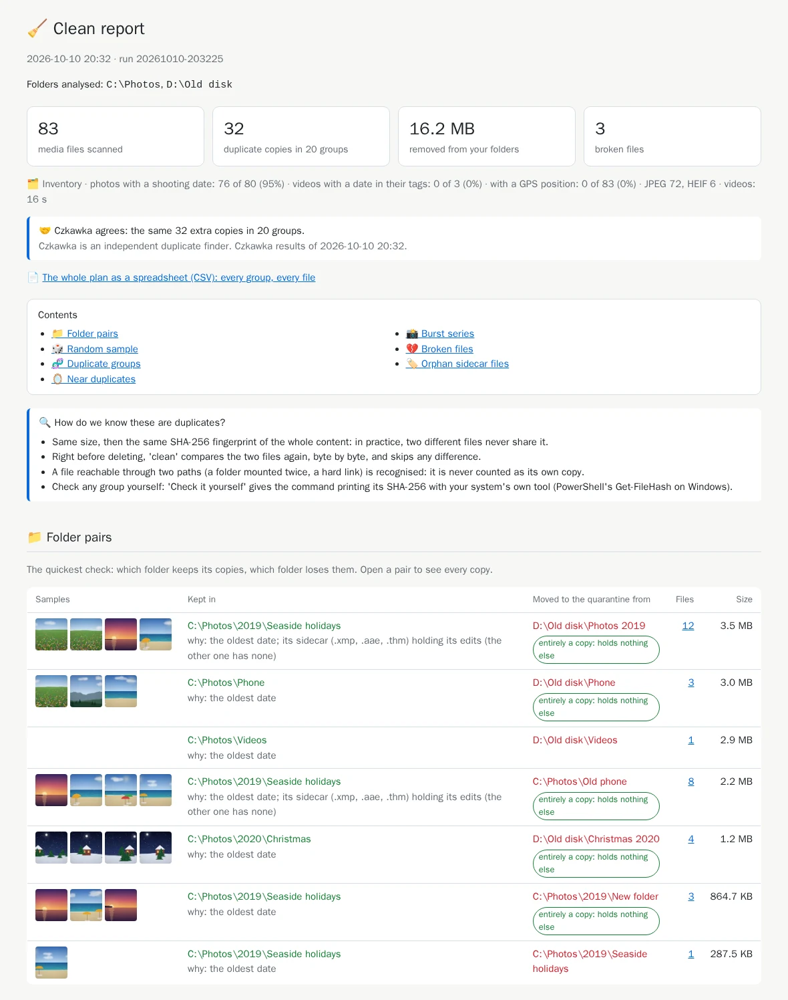

# 8. Clean

[Documentation](../README.md) › Cleaning, step 8 of 14 · 🇫🇷 [Français](../../fr/clean/08-clean.md)

You have audited, read the folder pairs, maybe chosen which folders stay. Time to free the
space. `clean` moves the extra copies to the quarantine — nothing is erased — and keeps a written
trace of everything so that you can change your mind. Once you have checked, `purge` frees the
space ([step 9](09-undo-history-purge.md)).

## Before the first clean

- **Start small**: clean one subfolder first, check the result, then widen.
- **Pause cloud synchronisation** (OneDrive, Google Drive, Dropbox, iCloud) while cleaning.
  Otherwise every change is copied to the cloud and to your other devices.
- **Audit just before**, with the same options, and read the folder pairs.
- If you can, a backup on an external disk is the extra net against what no software can
  prevent (a failing disk, a mistake outside the tool). Welcome, not required:
  [how your photos stay safe](../reference-safety.md).

## Two more folders: the journal and the quarantine

`clean` needs two folders of yours:

- **the journal** (`/journal`): one file per clean, listing every action. Without it, no `undo`,
  so `clean` refuses to run.
- **the quarantine** (`/quarantine`): where files are *moved* instead of deleted: the extra
  copies, unreadable files, orphan sidecars, and later near duplicates and burst shots. Without
  it, `clean` refuses to run (unless `--delete`, below).

`mh` creates both in `$HOME\media-hygiene` the first time. For the full command, create them
first:

```powershell
mkdir -Force "$HOME\media-hygiene\journal", "$HOME\media-hygiene\quarantine"
```

### Photos on another drive than the quarantine

With `mh`, each photo drive has its own quarantine: `E:\media-hygiene\quarantine` for the
photos of `E:` (mounted on `/quarantine/e`), `$HOME\media-hygiene\quarantine` for those of `C:`.
A file set aside stays on its drive: cleaning `E:` never fills `C:`. `mh` creates these folders
before each run, and `mh folders add` with a folder of a new drive gives that drive its own
quarantine too. With the full command, add one `-v` per drive:
`-v "E:\media-hygiene\quarantine:/quarantine/e"`.

A drive without a quarantine of its own (a photo folder that is a whole drive, `E:\`, which
would hold it; a folder given to one command with `mh --photos`) sends its files to
`/quarantine`: they are then *copied* to `C:`, the space comes back on `E:` and `C:` fills up by
as much. Before asking, `clean` says so in one line:

```text
⚠️ 32 files (14.0 GB) will be copied from E: to the quarantine on C: (40.2 GB free there).
```

When they would not fit, keeping 1 GB free on that drive ([`quarantine_headroom_gb`](07-configuration-file.md)), `clean` stops before moving anything
and says how much is missing. Free some space (`purge` erases the files of earlier cleans), or
give that drive its own quarantine. The line needs Docker Desktop, which tells the drive of each
folder; elsewhere (Linux, a Docker volume) nothing is said.

Keep a drive plugged in until its files are checked: `undo` and `purge <run>` refuse a run
whose files are in the quarantine of a drive not mounted now, and name the drive to plug in;
`purge` alone erases the other runs and says which ones it kept.
A drive plugged back under another letter (`E:` is now `F:`) is found: the run's folder in
`F:`'s quarantine is used and said, and each file comes back only if its folder is on `F:`.

## Run the clean

One word with `mh`: it mounts your folders **without `:ro`** for `clean` (the tool must be allowed
to move files) and adds the journal and the quarantine. The full command is the one of your
audit with these three changes, and `clean` instead of `audit`:

```powershell
mh clean
```

<details>
<summary>Without <code>mh</code>: the full command</summary>

```powershell
docker run --rm -it `
  -v "C:\Photos:/data/c/Photos" `
  -v "D:\Old disk:/data/d/Old disk" `
  -v media-hygiene-cache:/cache `
  -v "$HOME\media-hygiene\reports:/reports" `
  -v "$HOME\media-hygiene\config:/config" `
  -v "$HOME\media-hygiene\journal:/journal" `
  -v "$HOME\media-hygiene\quarantine:/quarantine" `
  cavo789/media-hygiene clean
```

</details>

`clean` audits again (quickly, thanks to the cache), shows the same summary and folder pairs,
then **asks before doing anything**:

<!-- capture: clean.txt|re:^🛟|❓ -->
```text
🛟 Nothing will be erased: each copy is first compared byte for byte with the
kept one, then moved to the quarantine (/quarantine). 'undo' puts it back;
'purge' erases it once you have checked.
1 orphan sidecar (.xmp, .aae, .thm) will be moved to the quarantine.
❓ Move 32 duplicate copies (14.0 MB) to the quarantine and handle 3 broken
files? [y/N] y
```

Anything but `y` stops here, and nothing changes. With `y`:

<!-- capture: clean.txt|re:^─+ Clean| -->
```text
──────────────────────────────────── Clean ─────────────────────────────────────
Clean 20261025-084738
┌──────────────────────────┬─────────┐
│ Files processed          │      36 │
│ Size                     │ 15.6 MB │
│ Moved to the quarantine  │      35 │
│ Skipped (left untouched) │       0 │
│ Failed                   │       0 │
│ Duration                 │     0 s │
└──────────────────────────┴─────────┘
7 folders left empty were removed.
✅ HTML report:
C:\Users\you\media-hygiene\reports\20261025-084738-clean\report.html
💡 Changed your mind? 'media-hygiene undo 20261025-084738' restores everything:
docker run --rm -it `
  -v "C:\Photos:/data/c/Photos" `
  -v "D:\Old disk:/data/d/Old disk" `
  -v "$HOME\media-hygiene\config:/config" `
  -v "media-hygiene-cache:/cache" `
  -v "$HOME\media-hygiene\reports:/reports" `
  -v "$HOME\media-hygiene\journal:/journal" `
  -v "$HOME\media-hygiene\quarantine:/quarantine" `
  cavo789/media-hygiene undo 20261025-084738
👉 What next: once you have checked, 'purge' frees the space of the files set
aside.
docker run --rm -it `
  -v "C:\Photos:/data/c/Photos" `
  -v "D:\Old disk:/data/d/Old disk" `
  -v "$HOME\media-hygiene\config:/config" `
  -v "media-hygiene-cache:/cache" `
  -v "$HOME\media-hygiene\reports:/reports" `
  -v "$HOME\media-hygiene\journal:/journal" `
  -v "$HOME\media-hygiene\quarantine:/quarantine" `
  cavo789/media-hygiene purge 20261025-084738
💡 Open index.html in the folder mounted on /reports: it lists every report.
```

| Line | What it means |
|---|---|
| Files processed | Every file acted upon: here 32 extra copies and 3 other files moved, 1 empty file deleted. |
| Size | Their total size. |
| Moved to the quarantine | The extra copies, unreadable files and orphan sidecars: set aside, not deleted. |
| Skipped (left untouched) | Files the last check refused (see below). Nothing is forced. |
| Failed | Files the system would not let the tool handle. The report lists them. |

## What happened to each file

| File | What `clean` did |
|---|---|
| Extra copy of a photo or video | **Moved** to the quarantine, right after comparing it byte for byte with the kept copy once more. Different in any way? Skipped. |
| Empty file (0 bytes) | Deleted: it holds nothing (`undo` recreates it). |
| Unreadable file (truncated, damaged) | **Moved** to the quarantine. |
| Orphan [sidecar](../reference-sidecars.md) | Moved to the quarantine. |
| Near duplicates, burst shots | **Untouched**: only if you ask ([step 10](10-review-bursts.md), [step 11](11-near-duplicates.md)). |
| Photos set aside in [`search`](../commands/search.md#set-photos-aside) or [`people`](../commands/people.md#remove-every-photo-of-someone) | **Moved** to the quarantine by `clean --decisions`, which applies them with the decisions of `review`; the question says how many and their size, apart from the duplicates. A photo changed since you chose it is skipped. |
| Files of a protected folder | Untouched, always. |
| A folder left empty | **Removed**, then its parent if empty in turn; `Thumbs.db`, `desktop.ini` or `.DS_Store` alone does not keep it (moved to the quarantine first). `undo` recreates it. Never a folder you mounted, a protected, backup or excluded one, nor one already empty before. [More](../commands/clean.md#what-happens-to-each-file) |

The quarantine holds one folder per clean, named after the run (its date and time), and keeps
the original paths below it: `quarantine\<run>\d\Old disk\2020\IMG_1203.jpg`.

**What a removed copy's folder said stays searchable on the kept photo.** When `clean` removes
a copy, the photo kept remembers the folder and the name that copy had (`Mariage Julie 2015`):
[`tags`](../reference-tags.md#where-the-words-come-from) turns them into words that
[`search`](../commands/search.md) finds (`former:julie`), and
[`classify`](../sort/04-classify.md) reads that folder when the photo's own folder says nothing
(`DCIM`). `undo` takes them back off: the copy has its own name again.

## The clean report

Each clean writes its own report, listed in `index.html` next to the audits: what was freed, the
folder pairs as they were cleaned, and the files left untouched, if any.



## Need the space at once? `--delete`

`clean --delete` deletes the extra copies for good instead of moving them, after the same byte
comparison with the kept copy. The copy kept stays: `undo` rebuilds each deleted copy from it.
It is, with `purge`, the only way the tool removes content, and it says so before asking. Copies
of other files than media (`--ext`) still go to the quarantine.

## Good to know

- **No question asked**: add `--yes` (`clean --yes`), or set `confirm = false` in the `[clean]`
  section of `config.toml`. Without `-it`, `clean` cannot ask and stops: use `--yes` then.
- **What is it doing?** A line under the bar names the file at hand and what happens to it.
  The bar and its estimate follow the bytes: the large videos come first.
- **A few files at once**: `clean` and `undo` handle 4 files at a time. On a slow USB hard disk,
  set `workers = 1` in the `[clean]` section of `config.toml`
  ([step 7](07-configuration-file.md#fill-it-in)).
- **Interrupted?** Ctrl+C, a power cut: every action is written to the journal *before* and
  *after* it happens, so `undo` still restores what was done. A file the run had not touched yet
  stays where it is.
- **Refusals that protect you**: `clean` stops before the analysis without a `/journal` or a
  `/quarantine`, with a `:ro` folder, with a folder it cannot write to, or with a tool folder
  (quarantine, journal, cache, reports) placed inside a photo folder. The message says which
  one. Just before the question, it also stops when the files copied from another drive would not
  fit in the quarantine ([above](#photos-on-another-drive-than-the-quarantine)).

---

← [7. The configuration file](07-configuration-file.md) · [Documentation](../README.md) · Next: **[9. Undo, history, purge](09-undo-history-purge.md)** →
