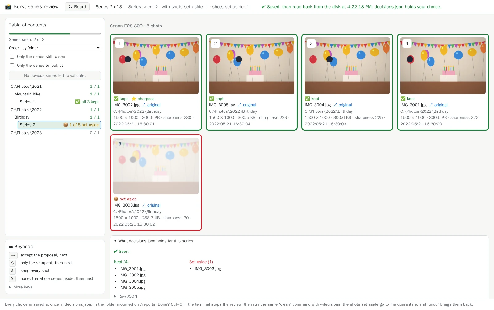

# 10. Sort burst series in your browser

[Documentation](../README.md) › Cleaning, step 10 of 13 · 🇫🇷 [Français](../../fr/clean/10-review-bursts.md)

Phones and cameras take photos in bursts: five, ten, twenty shots in a few seconds. Most are
nearly the same, a few are blurred, one or two are great. Sorting thousands of them file by file
is tedious. `review` shows them to you **one series at a time**, large, in your browser, and
you choose with the keyboard.

## What is a burst series?

Shots of the same camera, taken a few seconds apart, of the same scene. They are **not**
duplicates: each shot is different, and only you know which ones are worth keeping. So the tool
never decides on its own:

- the audit lists the series and marks the sharpest shot ⭐, as a suggestion;
- a plain `clean` never touches them;
- only the shots **you** set aside in `review` are moved, to the quarantine, never deleted.

## Step 1: start the review

`review` needs your folders (read-only is enough: the page never touches a photo) and the reports
folder, where it saves your choices:

```powershell
docker run --rm -it -p 127.0.0.1:8088:8088 `
  -v "C:\Photos:/data/c/Photos:ro" `
  -v "D:\Old disk:/data/d/Old disk:ro" `
  -v media-hygiene-cache:/cache `
  -v "$HOME\media-hygiene\reports:/reports" `
  cavo789/media-hygiene review
```

One new part, on the first line:

| Part | What it means |
|---|---|
| `-p 127.0.0.1:8088:8088` | Opens the page to your browser. `127.0.0.1`: your computer only, nobody else on the network. `8088`, twice: the same port on your computer and in the container, so the review knows its address and prints it. |

The review first audits (quickly, thanks to the cache), then waits for you:

<!-- capture: review.txt|Review ready|127.0.0.1:8088:8088 -->
```text
✅ Review ready, open http://127.0.0.1:8088/ in your browser. Each decision is
saved at once in decisions.json, in the folder mounted on /reports. Ctrl+C stops
the review.
💡 The page does not open? docker run must publish the same port on both sides:
-p 127.0.0.1:8088:8088.
```

Leave this window open: the review runs as long as it stays open.

## Step 2: open the page

Ctrl+click the address the review printed, `http://127.0.0.1:8088/`, or type it in your
browser.

Docker refuses to start with *port is already allocated*? Another program uses 8088: choose
another number, the same three times, e.g. `-p 127.0.0.1:9000:9000` and `review --port 9000`.

## Step 3: read the page

The first series appears. Here, the second one, a birthday: five shots taken one second apart.


- **At the top**: which series you are on (*Series 2 of 3*), how many series you have seen,
  and how many shots you have set aside so far, across all series; after a few choices,
  *⏱ about 2 h 10 left at your pace* (a long pause counts two minutes at most).
- **Above the shots**: the camera and the number of shots, then a dashed banner as long as
  you have not chosen: it says what moving on will save.
- **Each shot**: its number (the key to press), its state, its name, a **↗ original** link,
  its folder, its resolution, size and **sharpness**, and the moment it was taken.
- **⭐ sharpest**: always **the first shot**, framed in green. The others follow from the
  sharpest to the least sharp: the blurred ones come last. The higher the sharpness, the
  crisper the picture; it measures blur only, not a closed eye: the choice stays yours.
- **📦 proposed aside**, in red dashes: a shot far less sharp than the sharpest of its series
  (below 35 % of it, see [Good to know](#good-to-know)). Here, the last shot, at 30 against
  about 218 for the others: 14 %. The other shots are ⏳ *kept if you move on*.
- **↗ original** opens the file itself in a new tab, untouched, at full size: what you see is
  what lies on your disk, not a rendering of the page.
- **On the left, the table of contents**: every series, folder by folder, with its state in
  `decisions.json`: ⏳ *to see*, ✅ *all kept* (green), 📦 *1 of 3 set aside* (orange),
  🗑 *whole series set aside* (red). A bar shows how many series you have seen; a click on a
  series opens it, and *Only the series still to see* hides the others.
- **Below it, the keyboard**: the keys, always in sight.
- **Under the shots**: *What decisions.json holds for this series*, the names kept and set
  aside (and, folded, the raw JSON).

## Step 4: accept the proposal, or correct it

**Moving on accepts what is shown.** `→`, `←` or `N` without a choice saves the series as it
is on screen: the shots proposed aside are set aside, the others kept; without a proposal,
every shot is kept. With thousands of series, you only press a key where the proposal is
wrong. A click in the table of contents only opens a series: it saves nothing.

To correct, press the number of a shot: on a proposed shot, `5` takes it back (kept); on
another one, it sets it aside. A click on a shot does the same as its number. Each time, the
shot set aside fades and gets a solid red frame, the counter at the top goes up, and *✔ Saved,
then read back from the disk at 14:32:05* confirms that your choice is already written:



That message is a **proof**, not a promise: after each choice the review reads
`decisions.json` again from the disk, and the table of contents and the panel under the shots
show what it found there. If the file does not hold your choice, a red message says so.

## Step 5: go faster

| Key | Action |
|---|---|
| `→` or space | Next series (no choice: as shown) |
| `←` | Previous series (no choice: as shown) |
| `N` | Next series still to see |
| `1` … `9` | Set that shot aside, or take it back |
| `S` | Keep only the sharpest shot, then go to the next series |
| `A` | Keep every shot of the series |
| `X` | Set the whole series aside, then go to the next series (`X` again keeps them all) |
| `Z` or ← Backspace | Undo the last choice, and go back to its series |
| `C` | Compare the shots at 100 % (`C` or `Esc` closes) |
| `P` | Board ⇄ one series at a time |

On an AZERTY keyboard, the digits of the top row work **without** Shift.

**The board: eight series per screen.** `P`, or the **🗂 Board** button next to the title,
shows the series one per row, as small pictures, the sharpest first and the proposals marked.
You only correct what is wrong: a click on a picture sets it aside or takes it back (saved at
once), *✅ keep all*, *⭐ only the sharpest* or *🗑 keep nothing* decide a whole row. Hovering a picture shows it
large; `Space` pins that preview, so that it stays while the mouse moves on (`Space` again
closes it). Then `→` (or **Next page →**) validates the series still to see of the page as shown,
in one write, and opens the next page; `←` goes back the same way, `N` opens the next page
with a series still to see. The keys of one series (`A`, `S`, `X`, digits, `C`, `Z`) act on
the row framed in blue: click a row to choose it. **🖼 One series** comes back, on the same
series; the browser remembers your choice.

**Rough it out first**: the *Order* list above the table of contents sets the order of `→`,
`←` and `N`: *by folder* (the tree), *by date*, *largest sharpness gap first* (the series
where one shot is far blurrier come first, with their gap: *gap 84 %*; those whose shots are
all alike come last) or *still to see first*. The browser remembers it; the order stays as it
is while you review, so a series never jumps away under you.

**Check the sharpness at 100 %**: the previews are reduced and hide a slight blur. `C` shows
the originals of the series side by side, at their real size; move the mouse over one, the
same area shows in every one. Formats your browser cannot show (RAW, HEIC) are not compared:
open their original.

**A whole folder at once**: hover a folder of the table of contents, then **✔ validate**. Its
series still to see are saved as moving on would save them (the proposals accepted, the other
shots kept), after a confirmation that says how many series and shots. Handy for the folders
whose bursts do not matter to you; `Z` undoes it in one go.

`X` sets aside every shot of the series: they fade, and a red banner reminds you that the whole
series goes to the quarantine. Setting the shots aside one by one stops at the last one, so that
a whole series never goes by mistake: that takes `X`.

A shot in a [protected folder](05-choose-the-kept-copy.md#protect-a-folder) can never be set
aside, nor proposed: `X` sets the others aside, and the protected one stays.

## Step 6: stop, and come back later

`decisions.json`, in your reports folder, is written **as soon as the review starts**: it lists
every series, ⏳ *to see*, and each choice updates it at once. Stop whenever you like:
**Ctrl+C** in the review window, or just close the tab. The next `review` reads the same file
and opens the **first series still to see**: you can sort over several days, then clean.

The review says where the file lies, when it starts, on the page and when it stops:

- with Docker Desktop, as a Windows path:
  `C:\Users\<you>\media-hygiene\reports\decisions.json`;
- otherwise (a Docker volume, a Linux host), as *decisions.json, in the folder mounted on
  /reports*: the folder you gave after `-v` for `/reports`.

To open that folder from PowerShell:

```powershell
explorer "$HOME\media-hygiene\reports"
```

The file lists, series by series, its `status` (`todo` until you have seen it, then `done`),
the shots kept and the shots set aside (a series kept whole has an empty `discarded` list, a
series set aside with `X` an empty `kept` list). Accents look wrong with `type` in PowerShell? The file is
fine: see [troubleshooting](../reference-troubleshooting.md#accents-look-wrong-with-type-in-powershell).
The one of this example:

<!-- capture: decisions.json -->
```json
{
  "version": 1,
  "report": "",
  "roots": [
    "C:\\Photos",
    "D:\\Old disk"
  ],
  "pairs": [],
  "bursts": [
    {
      "status": "done",
      "kept": [
        "C:\\Photos\\2021\\Mountain hike\\DSC_2106.jpg",
        "C:\\Photos\\2021\\Mountain hike\\DSC_2107.jpg",
        "C:\\Photos\\2021\\Mountain hike\\DSC_2108.jpg"
      ],
      "discarded": []
    },
    {
      "status": "done",
      "kept": [
        "C:\\Photos\\2022\\Birthday\\IMG_3001.jpg",
        "C:\\Photos\\2022\\Birthday\\IMG_3002.jpg",
        "C:\\Photos\\2022\\Birthday\\IMG_3004.jpg",
        "C:\\Photos\\2022\\Birthday\\IMG_3005.jpg"
      ],
      "discarded": [
        "C:\\Photos\\2022\\Birthday\\IMG_3003.jpg"
      ]
    },
    {
      "status": "done",
      "kept": [
        "C:\\Photos\\2023\\Lake\\IMG_4001.jpg",
        "C:\\Photos\\2023\\Lake\\IMG_4003.jpg",
        "C:\\Photos\\2023\\Lake\\IMG_4004.jpg"
      ],
      "discarded": [
        "C:\\Photos\\2023\\Lake\\IMG_4002.jpg"
      ]
    }
  ]
}
```

## Step 7: apply your choices

The page itself never moves anything. Once done, run your `clean` command of
[step 8](08-clean.md) with `--decisions` (alone, it reads `decisions.json`). You do not have to
finish: only the series you have seen move something, those still to see stay as they are:

```powershell
docker run --rm -it `
  -v "C:\Photos:/data/c/Photos" `
  -v "D:\Old disk:/data/d/Old disk" `
  -v media-hygiene-cache:/cache `
  -v "$HOME\media-hygiene\reports:/reports" `
  -v "$HOME\media-hygiene\config:/config" `
  -v "$HOME\media-hygiene\journal:/journal" `
  -v "$HOME\media-hygiene\quarantine:/quarantine" `
  cavo789/media-hygiene clean --decisions
```

Before its question, `clean` announces the shots it will move:

<!-- capture: clean-near.txt|burst shots|. -->
```text
2 burst shots you set aside will be moved to the quarantine.
```

The shots set aside are **moved to the quarantine**, not deleted: they are not copies, nothing
could rebuild them. `undo` puts them back; `purge` deletes them for good
([step 9](09-undo-history-purge.md)).

Once the clean is done, `decisions.json` has served: it is **archived**, never deleted, renamed
`decisions.applied-<run>.json` next to itself (`<run>` is the clean's number, the one `undo`
takes). The next `review` starts from a fresh file. Changed your mind and ran `undo`? The
archive applies the same choices again: `clean --decisions decisions.applied-<run>.json`.

## Good to know

- **Same options for `review` and `clean`**: give both the same `--prefer`, `--protect` and
  `--exclude` (or keep them in `config.toml`). If a series changed between the review and the
  clean (a file added, moved or edited), `clean` refuses the file rather than guessing: review
  again.
- **The proposals** come from `[review] propose_aside_below` in `config.toml` (default
  `0.35`): a shot is proposed aside below that share of the sharpest shot's sharpness. Within a
  burst, every shot shows the same scene, so comparing their sharpness is meaningful; `0`
  never proposes anything. A shot at 616 next to one at 1017 is not proposed: it may be
  another pose.
- **Series still to see** (`todo`) move nothing: `clean` only says how many are left, and
  never refuses the file because of them.
- **Before moving a shot**, `clean` checks that it is the very file the review showed, and that
  the shots you kept, if any, are still there.
- **`review --decisions other.json`** saves the choices in another file of the reports folder.
- **`review --port 9000`** changes the port; publish the same one: `-p 127.0.0.1:9000:9000`.
- **The same `decisions.json`** can also hold your [folder-pair decisions](12-decide-pair-by-pair.md):
  `review` keeps them.

---

← [9. Undo, history, purge](09-undo-history-purge.md) · [Documentation](../README.md) · Next: **[11. Near duplicates](11-near-duplicates.md)** →
