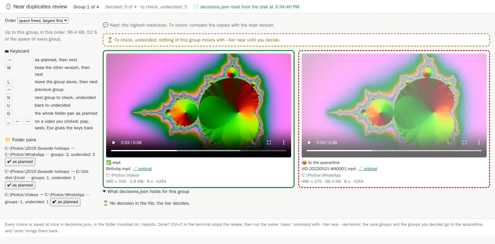

# 11. Near duplicates

[Documentation](../README.md) › Cleaning, step 11 of 13 · 🇫🇷 [Français](../../fr/clean/11-near-duplicates.md)

Some copies are not identical files, yet they are the same picture: the photo sent through
WhatsApp (smaller), the one "reduced for email", a copy saved again with another quality, turned
upright, or without its date. The audit finds them too, as **near duplicates**, and leaves them
alone unless you ask.

## How the tool recognises them

While it checks that each photo can be read, the audit also describes what it looks like
(perceptual fingerprints, sharpness, EXIF date and camera) and keeps it in the cache. Two photos
are near duplicates only if **every** test agrees:

- nearly identical perceptual fingerprints;
- the same shape (proportions);
- the same shot date, or no date at all on the smaller copy;
- the same colours: the fingerprints are computed in grey, so the photos they find alike are
  measured for colour; a black and white edit of a colour photo is a choice, not a copy.

Blank or black pictures never count, and a shot of a [burst series](10-review-bursts.md) is
never taken for a near duplicate.

## Videos too: re-encoded copies

A video shared through a messaging app, converted or recompressed is not identical to its
original either. The first audit decodes a few frames of each video (at 10, 30, 50, 70 and 90 %
of its length) and fingerprints them like photos; this takes a fraction of a second to a few
seconds per video, and the cache keeps the result: later audits only decode the new or changed
videos. Two videos are near duplicates only if **every** test agrees:

- the same length (within half a second, or 1 % of a long video);
- the same shape (proportions);
- the frames at the same moments look alike (one frame may differ, for a cut);
- the same recording date, or no date at all on the copy;
- the same colours, as for photos (a black and white edit is not a copy).

The report lists them in their own section, *Re-encoded videos*, with the resolution, length,
codec and size of each copy, and a player: click ▶ to watch each one in the browser, or the path
to open it in your own player. The audit summary counts them on the line
*Re-encoded videos (moved only with --tier near)*. `clean --tier near` moves the sure ones to
the quarantine with the photos ([below](#sure-groups-and-groups-to-check)). A video the image
cannot decode (AV1, rare) is simply not compared.

## Which version is kept, and why

Photos and videos alike:

1. the **highest resolution**;
2. at the same resolution, a file **larger by 1 % or more**: it is the less compressed one;
3. sizes closer than that say nothing of the quality (two exports of one clip, a copy whose
   metadata alone changed): the [usual rules](05-choose-the-kept-copy.md) choose, as for
   identical files: a protected or preferred folder, a name or a folder someone chose, the
   oldest date… A folder or a name someone chose wins over `Novembre 2015\162.mp4`.

Each group of the report starts with a 💬 line saying which of these decided, with the size gap
when it is small; `plan.csv` says it too. A video copy whose metadata alone was rewritten (a
rating set in Windows, a tag) is marked 🟰: the very same picture and sound as the kept one,
checked with a SHA-256 of both. Such copies are not identical files all the same: they are
moved to the quarantine with `--tier near`, never deleted.

## Sure groups, and groups to check

On a real collection, the audit can find hundreds of groups. Most of them leave no doubt; a few
deserve a look. Each group therefore gets a level:

- **sure**, when every copy it moves is, for one of these reasons:
  - 🟰 a video with the very same picture and sound as the kept one (its metadata alone differ);
  - the same perceptual fingerprints (distance 0) and the same camera as the kept photo;
  - a smaller copy in a messaging or e-mail folder (`WhatsApp Images`, `Telegram`, `Signal`,
    `Email`, `Attachments`, `Pièces jointes`…), taken at the same moment (same EXIF date);
    WhatsApp strips the EXIF of the pictures it sends, so a copy without an EXIF date counts
    when its name is dated the same day as the kept photo (`IMG-20190712-WA0003.jpg`,
    `VID-20190712-WA0001.mp4`, the names `classify` reads);
- **to check**: every other group.

The 💬 line of each group says it (*Sure: identical fingerprints, from the same camera.* or
*To check: compare the copies with the kept version.*), and so does the column
*Near-duplicate level* of `plan.csv`. The audit sums it up in its *What you can do* block:

```text
👀 500 groups of near duplicates: 480 sure, 20 to look at (~10 min in 'review
--near'); 'clean --tier near' moves the sure ones.
```

The effort counts only the groups to look at. `--tier near` moves the sure groups and those you
decided ([below](#decide-in-your-browser-review---near)); `--tier near-all` moves every group,
as before.

## Look at them first

The *Near duplicates* section of the [HTML report](04-html-report.md) shows each group side by
side, with the resolution, size and sharpness of every copy:


Compare each copy with the kept one: click a picture or its path to open the original in a new
tab. The audit summary counts them on the line
*Near duplicates (moved only with --tier near)*. The section lists **every** group, however
many there are, in the order that pays off soonest:

- the groups **to check** first, then the **sure** groups, folded (*✔️ 480 sure groups: show
  them*): nothing to look at there unless you want to;
- in each list, the **space freed, largest first**: a few re-encoded videos often weigh more
  than hundreds of shrunk photos;
- under each group, a 💾 line gives the space its copies free and the running total:
  *1.2 GB freed; with the groups above: 90 % of the space*. Short of time? Stop once the share
  is high enough.

`plan.csv` names each file too ([step 4](04-html-report.md#every-file-in-a-spreadsheet-plancsv)):
action *move with --tier near* for a sure group, *move with --tier near-all* for a group to
check, and the level in the column *Near-duplicate level*.

## Decide in your browser: `review --near`

The groups to check are best decided one at a time, with the keyboard, on the same kind of page
as the [burst series](10-review-bursts.md). Add `--near` to the `review` command of step 10:

```powershell
mh review --near
```

<details>
<summary>Without <code>mh</code>: the full command</summary>

```powershell
docker run --rm -it -p 127.0.0.1:8088:8088 `
  -v "C:\Photos:/data/c/Photos:ro" `
  -v "D:\Old disk:/data/d/Old disk:ro" `
  -v media-hygiene-cache:/cache `
  -v "$HOME\media-hygiene\reports:/reports" `
  cavo789/media-hygiene review --near
```

</details>

It says what there is to decide, then waits for you, as `review` does:

<!-- capture: review-near.txt|near duplicates:|127.0.0.1:8088:8088 -->
```text
4 groups of near duplicates: 1 sure, 3 to check (shown first).
✅ Review ready, open http://127.0.0.1:8088/ in your browser. Each decision is
saved at once in decisions.json, in the folder mounted on /reports. Ctrl+C stops
the review.
💡 The page does not open? docker run must publish the same port on both sides:
-p 127.0.0.1:8088:8088.
```

The page shows one group at a time, the kept version framed in green, the copies in red dashes,
with the 💬 line:


The keys:

| Key | What it does |
|---|---|
| `→` | as planned: the copies go to the quarantine, then the next group |
| `W` | keep the other version: the first copy stays, the version the audit kept goes (refused when it lies in a protected folder) |
| `L` | leave the group alone: nothing of it moves |
| `←` / `N` | previous group / next group to check still undecided |
| `U` | back to undecided: the tier decides again |
| `G` | the whole folder pair as planned |

A group of re-encoded videos shows both versions side by side, ready to play: muted, nothing
is loaded beyond their length until you press play, and you can seek in each. Once you have
clicked a video, space and the arrows play and seek in it; `Esc` gives the keys back to the
page. A format your browser cannot play (AVI, FLV…) keeps its *↗ original* link only.



**Decide once per folder pair**: the left panel lists the folder pairs (*the kept version's
folder → the copies' folder*) with their number of groups. *✔ as planned* (or `G` on a group
of that pair) decides every undecided group of the pair in one write, after a confirmation:
*WhatsApp Images → DCIM — undecided groups: 312*. Each group can still be decided again.

The *Order* list sets the order of `→`, `←` and `N`: *to check first*, *space freed, largest
first* or *by folder pair*; below it, the running total up to the current group
(*Up to this group, in this order: 3.4 GB, 90 % of the space of every group*).

Each choice is saved at once in `decisions.json`, under the key `near` (next to the folder pairs
of [step 12](12-decide-pair-by-pair.md) and the burst shots of step 10), then read back from
the disk: the panel under the group shows what the file holds. Groups left undecided are not
listed: the tier decides for them. Stop with Ctrl+C; reopened on the same folders, the review
resumes, and a decided group that changed since is set back to undecided.

## Move them: `clean --tier near` or `--tier near-all`

- `clean --tier near` moves the **sure** groups and the groups **you decided** with `--decisions`
  (as planned, or the other version kept); a group left alone never moves. The groups to check
  still undecided stay in place, and `clean` says how many.
- `clean --tier near-all` moves **every** group, as the report shows it; your decisions still
  apply.

Before applying them, `clean` checks your decisions against the audit it has just run: a decided
group whose files changed since the review, or a swap that would move a file of a protected
folder, refuses the whole file. Decisions in the file without a near tier wait: a plain `clean
--decisions` says so and moves none of them.

### The command

Add the tier to your `clean` command of [step 8](08-clean.md). Here it is `--tier near-all`,
every group as the report shows them, combined with the burst decisions of step 10; each option
works on its own too:

```powershell
mh clean --tier near-all --decisions
```

<details>
<summary>Without <code>mh</code>: the full command</summary>

```powershell
docker run --rm -it `
  -v "C:\Photos:/data/c/Photos" `
  -v "D:\Old disk:/data/d/Old disk" `
  -v media-hygiene-cache:/cache `
  -v "$HOME\media-hygiene\reports:/reports" `
  -v "$HOME\media-hygiene\config:/config" `
  -v "$HOME\media-hygiene\journal:/journal" `
  -v "$HOME\media-hygiene\quarantine:/quarantine" `
  cavo789/media-hygiene clean --tier near-all --decisions
```

</details>

Before asking, `clean` writes the report of this very audit and links, on a line starting with
👀, its `near.html` page: the near duplicates and re-encoded videos alone, without the burst
series that `--tier near` never touches. Look at it before answering. Nothing is written when
nothing is asked (`--yes`).

The question now mentions the near duplicates:

<!-- capture: clean-near.txt|re:^2 |❓ -->
```text
2 burst shots you set aside will be moved to the quarantine.
1 orphan sidecar (.xmp, .aae, .thm) will be moved to the quarantine.
❓ Move 32 duplicate copies (14.0 MB) and 4 near duplicates to the quarantine
and handle 3 broken files? [y/N] y
```

<!-- capture: clean-near.txt|re:^─+ Clean| -->
```text
──────────────────────────────────── Clean ─────────────────────────────────────
Clean 20261015-153452
┌──────────────────────────┬─────────┐
│ Files processed          │      42 │
│ Size                     │ 16.4 MB │
│ Moved to the quarantine  │      41 │
│ Skipped (left untouched) │       0 │
│ Failed                   │       0 │
│ Duration                 │     0 s │
└──────────────────────────┴─────────┘
✅ HTML report: /reports/20261015-153452-clean/report.html
📦 decisions.json is applied: archived as
decisions.applied-20261015-153452.json, in the folder mounted on /reports, the
next 'review' starts afresh.
💡 After an undo, 'media-hygiene clean --decisions
decisions.applied-20261015-153452.json' applies it again.
💡 Changed your mind? 'media-hygiene undo 20261015-153452' restores everything:
docker run --rm -it `
  -v "C:\Photos:/data/c/Photos" `
  -v "D:\Old disk:/data/d/Old disk" `
  -v "$HOME\media-hygiene\config:/config" `
  -v "media-hygiene-cache:/cache" `
  -v "$HOME\media-hygiene\reports:/reports" `
  -v "$HOME\media-hygiene\journal:/journal" `
  -v "$HOME\media-hygiene\quarantine:/quarantine" `
  cavo789/media-hygiene undo 20261015-153452
👉 What next: once you have checked, 'purge' frees the space of the files set
aside.
docker run --rm -it `
  -v "C:\Photos:/data/c/Photos" `
  -v "D:\Old disk:/data/d/Old disk" `
  -v "$HOME\media-hygiene\config:/config" `
  -v "media-hygiene-cache:/cache" `
  -v "$HOME\media-hygiene\reports:/reports" `
  -v "$HOME\media-hygiene\journal:/journal" `
  -v "$HOME\media-hygiene\quarantine:/quarantine" `
  cavo789/media-hygiene purge 20261015-153452
💡 Open index.html in the folder mounted on /reports: it lists every report.
```

Near duplicates are **moved to the quarantine**, never deleted: they are not identical to the
kept photo, so nothing could rebuild them. The quarantine now holds, below the folder of this
clean, the near duplicates, the burst shots set aside, the unreadable files and the orphan
sidecar:

<!-- capture: quarantine.txt -->
```text
./20261015-153452/c/Photos/2019/New folder/IMG_0105 - Copy.jpg
./20261015-153452/c/Photos/2019/New folder/IMG_0106 - Copy.jpg
./20261015-153452/c/Photos/2019/New folder/IMG_0107 - Copy.jpg
./20261015-153452/c/Photos/2019/Seaside holidays/IMG_0101 (1).jpg
./20261015-153452/c/Photos/2022/Birthday/IMG_3003.jpg
./20261015-153452/c/Photos/2023/Lake/IMG_4002.jpg
./20261015-153452/c/Photos/Old phone/IMG_0101.jpg
./20261015-153452/c/Photos/Old phone/IMG_0102.jpg
./20261015-153452/c/Photos/Old phone/IMG_0103.jpg
./20261015-153452/c/Photos/Old phone/IMG_0104.jpg
./20261015-153452/c/Photos/Old phone/IMG_0105.jpg
./20261015-153452/c/Photos/Old phone/IMG_0106.jpg
./20261015-153452/c/Photos/Old phone/IMG_0107.jpg
./20261015-153452/c/Photos/Old phone/IMG_0108.jpg
./20261015-153452/c/Photos/WhatsApp/IMG-20190712-WA0003.jpg
./20261015-153452/c/Photos/WhatsApp/IMG-20190712-WA0005.jpg
./20261015-153452/c/Photos/WhatsApp/VID-20220521-WA0001.mp4
./20261015-153452/d/Old disk/2020/IMG_1203.jpg
./20261015-153452/d/Old disk/Christmas 2020/IMG_1201.jpg
./20261015-153452/d/Old disk/Christmas 2020/IMG_1202.jpg
./20261015-153452/d/Old disk/Christmas 2020/IMG_1203.jpg
./20261015-153452/d/Old disk/Christmas 2020/IMG_1204.jpg
./20261015-153452/d/Old disk/Email/IMG_0110 small.jpg
./20261015-153452/d/Old disk/Phone/IMG_4242.HEIC
./20261015-153452/d/Old disk/Phone/IMG_4243.HEIC
./20261015-153452/d/Old disk/Phone/IMG_4244.HEIC
./20261015-153452/d/Old disk/Photos 2019/IMG_0101.jpg
./20261015-153452/d/Old disk/Photos 2019/IMG_0102.jpg
./20261015-153452/d/Old disk/Photos 2019/IMG_0102.xmp
./20261015-153452/d/Old disk/Photos 2019/IMG_0103.jpg
./20261015-153452/d/Old disk/Photos 2019/IMG_0104.jpg
./20261015-153452/d/Old disk/Photos 2019/IMG_0105.jpg
./20261015-153452/d/Old disk/Photos 2019/IMG_0106.jpg
./20261015-153452/d/Old disk/Photos 2019/IMG_0107.jpg
./20261015-153452/d/Old disk/Photos 2019/IMG_0108.jpg
./20261015-153452/d/Old disk/Photos 2019/IMG_0109.jpg
./20261015-153452/d/Old disk/Photos 2019/IMG_0110.jpg
./20261015-153452/d/Old disk/Photos 2019/IMG_0111.jpg
./20261015-153452/d/Old disk/Photos 2019/IMG_0112.jpg
./20261015-153452/d/Old disk/Videos/Birthday (cut).mp4
./20261015-153452/d/Old disk/Videos/Birthday.mp4
```

Before moving each copy, `clean` checks that the kept photo still exists and that the copy is
the very file the audit saw. `undo` puts them back; `purge` deletes them for good
([step 9](09-undo-history-purge.md)).

---

← [10. Sort burst series in your browser](10-review-bursts.md) · [Documentation](../README.md) · Next: **[12. Decide pair by pair](12-decide-pair-by-pair.md)** →
