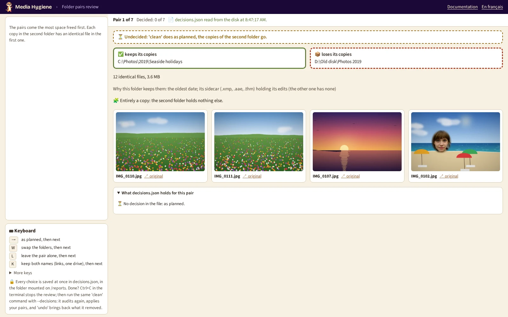

# 12. Decide pair by pair

[Documentation](../README.md) › Cleaning, step 12 of 14 · 🇫🇷 [Français](../../fr/clean/12-decide-pair-by-pair.md)

[`--prefer`](05-choose-the-kept-copy.md) changes the choice for a whole folder, everywhere. Sometimes
you only disagree with one pair: keep the other side, leave that pair alone, or keep both folders
whole while freeing the space. You decide pair by pair, in your browser.

| Choice | What `clean` will do with that pair |
|---|---|
| As planned | Keep the copies of the first folder, set those of the second one aside. |
| Swap the folders | Keep the copies of the **second** folder, set those of the first one aside. |
| Leave alone | Touch nothing of that pair. |
| Keep both names (link) | Each copy of the second folder becomes a **hard link** to its file in the first one: both folders still show the photo, the copy's space is freed. Offered only when both folders are on the same drive. [Details](#keep-both-names-a-link) |

## Step 1: open the pairs in your browser

```powershell
mh review --pairs
```

(without `mh`: the `docker run … -p 127.0.0.1:8088:8088 … review --pairs` command of
[`review`](../commands/review.md#run-it))

It audits first, then prints the number of pairs and *✅ Review ready, open
http://127.0.0.1:8088/ in your browser*:

<!-- capture: review-pairs.txt|folder pair|127.0.0.1:8088:8088 -->
```text
7 folder pairs, the most space freed first: 0 decided already.
✅ Review ready, open http://127.0.0.1:8088/ in your browser. Each decision is
saved at once in decisions.json, in the folder mounted on /reports. Ctrl+C stops
the review.
💡 The page does not open? docker run must publish the same port on both sides:
-p 127.0.0.1:8088:8088.
```



The page shows one pair at a time, the most space freed first: the folder that keeps its copies
framed in green, the one that loses them in red dashes, the number of identical files, why the
first folder keeps them, *Entirely a copy* when the second folder holds nothing else, and a few
sample pictures (↗ opens the original).

| Key | What it does |
|---|---|
| `→` | As planned, then the next pair |
| `W` | Swap the folders, then the next pair (not offered for a protected folder, nor for copies inside one folder) |
| `L` | Leave the pair alone, then the next pair |
| `K` | Keep both names (links), then the next pair (only for two folders of one drive, the first one not protected) |
| `←` / `N` | Previous pair / next undecided pair |
| `U` | Back to undecided |

Each choice is saved at once in `decisions.json` (in your reports folder), then read back from the
disk and shown: *✔ Saved, then read back from the disk at 14:32:05*. Stop whenever you like with
Ctrl+C: the next `review --pairs` opens on the first undecided pair.

## Step 2: clean with your decisions

Run your `clean` command of [step 8](08-clean.md) with `--decisions`: alone, it reads
`decisions.json` from the reports folder (another file: `--decisions other.json`):

```powershell
mh clean --decisions
```

(with the same `docker run … -v …` part as in step 8)

The page itself never deletes anything. `clean` audits again, applies your decisions, shows the
folder pairs that result, and asks before cleaning, with every safeguard: byte comparison, journal,
`undo`. Once the clean is done, the file is archived as `decisions.applied-<run>.json`, next to
itself: after an `undo`, `--decisions` with that name applies it again.

## Offline: from the report

A report opened alone, without the tool running, decides too. In the *Folder pairs* table of an
**audit** report, each pair has a *Your decision* list. Here, the videos are left alone and the
`Old phone` pair is swapped:


Your browser remembers the choices, even if you close the page. Click **Download decisions.json**;
the number between brackets counts your decisions. Save the file in your reports folder
(`C:\Users\<you>\media-hygiene\reports`), next to `index.html`, then run the `clean` of step 2.

## Keep both names: a link

For two folders that both mean something (`Best of 2019` and `2019\07`), *Keep both names (link)*
frees the space of the copies without emptying either folder. `clean` compares each copy byte for
byte with the kept file, as before setting it aside, then puts in its place a **hard link**: a
second name for the kept file. The name of the copy is never missing, even if the clean is
interrupted: it holds the copy, then the link. Each one is written in the journal.

A link is **one photo under two names**:

- an edit saved in place (a photo editor that writes into the file) shows under both names;
- deleting one name frees nothing while the other remains;
- a backup tool may count the photo twice.

Not offered when the two folders are on two drives (a hard link cannot cross them; refused by
`clean` too, and said), nor when the first folder is protected (an edit through the other name
would change it). The next audit sees the two names as one file and says so (*reachable through
two paths*). `undo` makes each name an independent file again: a copy of the photo, its own date
back.

## When the file is refused

To stay safe, `clean` refuses the file rather than guessing when:

- other folders are mounted than for the report;
- a decided pair no longer exists (files changed since the report): audit again, decide again;
- a swap would set aside the copies of a protected folder;
- a pair keeping both names (links) lies on two drives, or its first folder is protected.

## One file for everything

The same `decisions.json` can hold the folder pairs, the burst shots of
[step 10](10-review-bursts.md) **and** the near-duplicate groups of
[step 11](11-near-duplicates.md#decide-in-your-browser-review---near): `review`,
`review --near` and `review --pairs` keep what is already in the file, and one
`clean --tier near --decisions` applies all three.

---

← [11. Near duplicates](11-near-duplicates.md) · [Documentation](../README.md) · Next: **[13. A second opinion](13-second-opinion.md)** →
