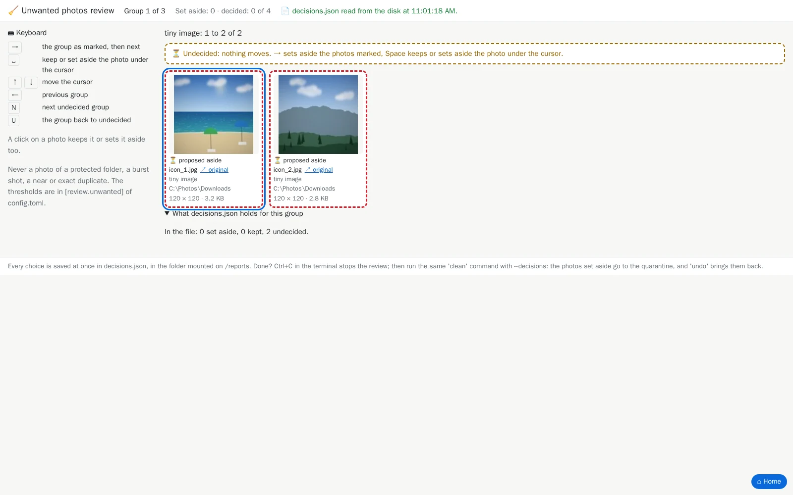

# 14. Unwanted photos

[Documentation](../README.md) › Cleaning, step 14 of 14 · 🇫🇷 [Français](../../fr/clean/14-unwanted-photos.md)

Beyond duplicates, a collection keeps photos nobody wants: icons and thumbnails, screenshots,
a shot taken in the pocket (all black), a shaken one. `review --junk` shows you those most
likely unwanted, one group per reason. **Nothing is set aside until you say so**: you look,
you choose, and `clean --decisions` moves what you set aside to the quarantine, where `undo`
finds it again.

## The reasons

Each photo is shown for one reason, the first that holds, in this order:

| Reason | What it means | Setting of `[review.unwanted]` |
|---|---|---|
| Screenshot or document | A screenshot name, or a PNG or tiny image without any camera trace: the same test as `classify`'s `kind = "screenshot"`. | `screenshots = true` |
| Tiny image | Under 0.16 megapixels (400 × 400 pixels): icons, stickers, thumbnails. | `tiny_megapixels = 0.16` |
| Nearly black | Mean brightness under 25 (of 255), with at least 70 % of the pixels black. | `dark_mean = 25`, `dark_share = 0.7` |
| Nearly white | Mean brightness over 230, with at least 70 % of the pixels white. | `white_mean = 230`, `white_share = 0.7` |
| Among the blurriest | Sharpness under the 2 % least sharp of **your own** photos: the threshold follows your cameras. | `blur_percentile = 2` |

Never listed: a photo of a [protected folder](05-choose-the-kept-copy.md), a burst shot
([step 10](10-review-bursts.md) handles them), a near duplicate ([step 11](11-near-duplicates.md))
or an exact duplicate's other copy. Videos are not listed.

Each threshold is a setting of `config.toml` ([step 7](07-configuration-file.md)); `0` (or
`false`) disables its reason:

```toml
[review.unwanted]
tiny_megapixels = 0.16
screenshots = true
dark_mean = 25
dark_share = 0.7
white_mean = 230
white_share = 0.7
blur_percentile = 2
```

## Step 1: open the page

```powershell
mh review --junk
```

(without `mh`: the `docker run … -p 127.0.0.1:8088:8088 … review --junk` command of
[`review`](../commands/review.md#run-it))

It audits first, then counts the photos by reason and prints *✅ Review ready, open
http://127.0.0.1:8088/ in your browser*:

<!-- capture: review-junk.txt|look unwanted|127.0.0.1:8088:8088 -->
```text
4 photos look unwanted (tiny image: 2, nearly black: 1, screenshot or document:
1); nothing is set aside without you.
✅ Review ready, open http://127.0.0.1:8088/ in your browser. Each decision is
saved at once in decisions.json, in the folder mounted on /reports. Ctrl+C stops
the review.
💡 The page does not open? docker run must publish the same port on both sides:
-p 127.0.0.1:8088:8088.
```



## Step 2: choose

The page shows one group at a time, the reason with the most photos first (a reason with
thousands of photos comes in pages of 40). Every photo is **proposed** aside (red dashes) until
you decide; the reason is written under each one.

| Key | What it does |
|---|---|
| `→` | The group as marked: the photos still proposed go aside, then the next group |
| `Space` | Keep, or set aside, the framed photo |
| `↑` / `↓` | Move the frame |
| `Delete` | Set the picked photos aside: a click picks one, Ctrl+click, Shift+click, a rectangle, Ctrl+A, I as in [`browse`](../commands/browse.md) |
| Enter or a double click | See the photo large (`Delete` there sets it aside, `⌫` takes it back) |
| `←` / `N` | Previous group / next undecided group |
| `U` | The whole group back to undecided |

Each choice is saved at once in `decisions.json`, then read back from the disk and shown. Stop
whenever you like with Ctrl+C: the next `review --junk` opens on the first undecided group.

## Step 3: clean with your decisions

```powershell
mh clean --decisions
```

(with the same `docker run … -v …` part as in [step 8](08-clean.md))

`clean` audits again and moves **only** the photos you set aside to the quarantine, each one
only while it is still the very file you saw (same size, same date). The photos you kept stay,
and stay kept the next time you open the page. `history` counts them apart (*Of which
unwanted*), `undo` brings them back, and `purge` alone erases the quarantine.

The same `decisions.json` holds the choices of the other reviews: `review --junk` keeps them.

---

← [13. A second opinion](13-second-opinion.md) · [Documentation](../README.md)
