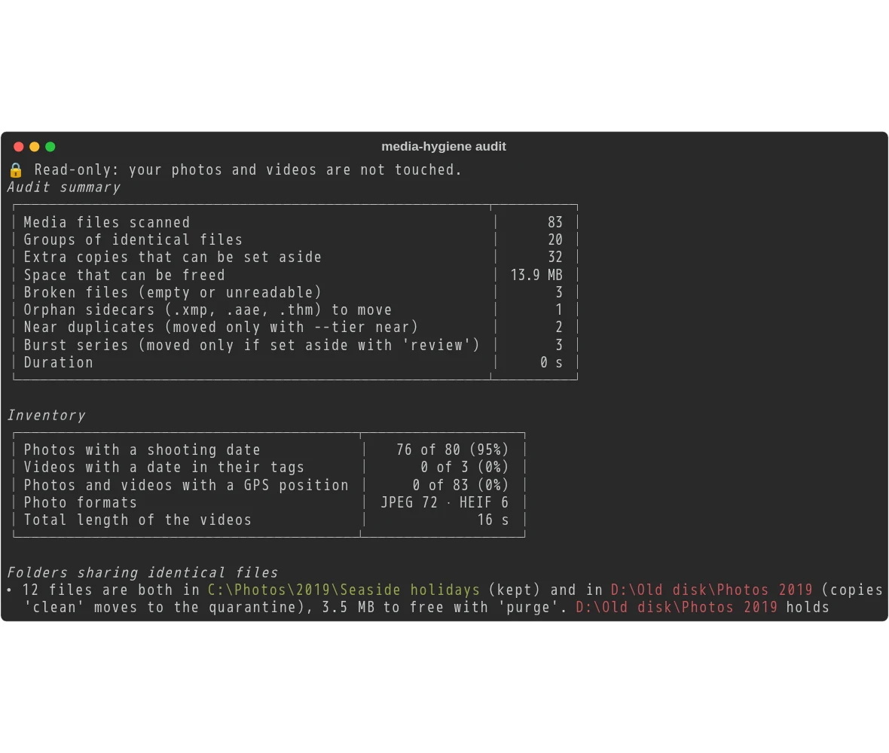

# Clean in short: the whole path

[Documentation](../README.md) › Clean in short · 🇫🇷 [Français](../../fr/clean/quick-guide.md)

Free the space your duplicate photos and videos take, safely: one command per step, to paste into
**PowerShell**. Nothing is erased before the last step, and until then everything can be undone.
No AI needed: Docker is enough.

<div class="mh-path" markdown>

**The strict minimum**, for a first clean: five steps. The others are optional.

- [0 · Write `mh`](#0-once-write-the-mh-command)
- [1 · Audit](#1-audit)
- [2 · Read the report](#2-read-the-report)
- [7 · Set aside](#7-set-the-exact-duplicates-aside)
- [11 · Free the space](#11-free-the-space-for-good)

</div>

Each step says what it risks: <span class="mh-badge mh-safe">🔒 Photos untouched</span>
<span class="mh-badge mh-undo">↩️ Can be undone</span> <span class="mh-badge mh-final">⚠️ For
good</span>. Back after a few days? `mh status` says where you are and what comes next.

## 0. Once: write the `mh` command

<span class="mh-badge mh-once">⏱ Once</span>

No Docker yet? [Install Docker](../start/00-install-docker.md) first: a few minutes, once.

**First**, let PowerShell run the scripts written on your computer, `mh` included: Windows
forbids it by default (*running scripts is disabled on this system*). For your account only; the
scripts downloaded from the internet must still be signed:

```powershell
Set-ExecutionPolicy -Scope CurrentUser RemoteSigned -Force
```

**Then** write `mh`, with your folder instead of `C:\Photos`, as Explorer shows it:

```powershell
New-Item -ItemType Directory -Force "$HOME\media-hygiene", (Split-Path $PROFILE) | Out-Null
docker run --rm cavo789/media-hygiene launcher --photos "C:\Photos" > "$HOME\media-hygiene\mh.ps1"
Add-Content $PROFILE '. "$HOME\media-hygiene\mh.ps1"'
. "$HOME\media-hygiene\mh.ps1"
```

The third line writes `mh` into your PowerShell profile: every new terminal knows it, tomorrow
too. The last one loads it in this terminal. Later, `mh folders add "D:\Old disk"` adds a folder
and `mh update` brings a new version: both write `mh` again for you.

**Rather click than type?** `mh shortcut` puts a *Media Hygiene* icon on your Desktop and in the
Start menu: a double-click opens the `mh` menu. `mh explorer` adds *Media Hygiene* to the
right-click of every folder: the menu opens on that folder. More: [`launcher`](../commands/launcher.md#what-mh-does-by-itself).

??? question "Several folders? A quarantine on another disk?"

    One `--photos` per folder: `--photos "C:\Photos" --photos "D:\Images\Family"`. Not a folder
    inside another one: each of its files would be seen twice. One more folder later?
    `mh folders add "D:\Old disk"`.

    The copies set aside go to `$HOME\media-hygiene\quarantine`. Your photos are on another disk
    than `C:`? Add `--quarantine "D:\quarantine"`: on the photos' disk, setting aside is a simple
    rename, instant; to another disk, every file is copied.

??? info "What this command does"

    This is the only long command: it writes `mh`, a short command that remembers your folders
    and mounts, for each step, exactly what it needs, in your local time (`mh` asks Windows for
    your time zone at each run). Its folders, in `$HOME\media-hygiene`, are created by `mh`
    itself the first time:

    | Folder | What it receives |
    |---|---|
    | `reports` | The HTML reports, to open in your browser. |
    | `config` | `config.toml`, your settings. |
    | `journal` | The journal of each clean: what makes `undo` possible. |
    | `quarantine` | The files set aside, until you erase them. |

**Lost?** Type `mh` alone: every step of the guides with its command, the next one proposed;
Enter runs it. More: [`menu`](../commands/menu.md).

## 1. Audit

<span class="mh-badge mh-safe">🔒 Photos untouched</span>

Find the duplicate copies and the broken files:

```powershell
mh audit
```



??? info "Details"

    Nothing is modified: `mh` mounts your folders read-only (`:ro`) for every command that does
    not change them. The first audit reads everything; thanks to the cache, the next ones take
    seconds. The console sums up what it found: duplicate copies, the space they take, broken
    files. More: [your first audit](../start/01-first-audit.md), [keep the
    cache](../start/02-keep-the-cache.md).

## 2. Read the report

<span class="mh-badge mh-safe">🔒 Photos untouched</span>

At the end of the audit, type `mh open`: your browser shows the list of the reports, the newest
at its top (or Ctrl+click the path of `report.html`):


Read it in this order:

1. **The folder pairs**: for each one, which folder keeps its copies. This is the quickest
   check.
2. **The groups of identical files**: each copy, and why that one stays.
3. **Broken files and orphan sidecars**: an unreadable photo, an `.xmp` or `.aae` whose photo is
   gone ([sidecar files](../reference-sidecars.md)); `clean` sets them aside too.
4. **Near duplicates and burst series**: nothing is done with them yet, they come at steps 9 and
   10.

??? info "Details"

    The report closed? `mh open` opens it again: `index.html`, in `$HOME\media-hygiene\reports`,
    lists every report.
    Each file, with what will happen to it, is also in `plan.csv`, next to the report, to open in
    Excel. More: [the HTML report](04-html-report.md).

## 3. Choose which copy stays

<span class="mh-badge mh-optional">Optional</span> <span class="mh-badge mh-safe">🔒 Photos untouched</span>

The tool chooses the kept copy of each group by itself (a folder you named rather than a `DCIM`,
the original rather than `IMG_0001 (1).jpg`, the oldest…). You disagree for **a whole folder**?
Say so, then read the report again:

```powershell
mh audit --prefer "C:\Photos\Family"
```

| Option | The folder… |
|---|---|
| `--prefer "C:\Photos\Family"` | keeps its copies first. |
| `--protect "C:\Photos\Family"` | is **never** modified and always keeps the copy: identical copies elsewhere go. |
| `--exclude "D:\Backup"` | is not analysed at all: a real backup is not a duplicate. |
| `--exclude-name "Thumbnails,*.lrdata"` | is ignored by its name, on every disk (thumbnails, catalogues). |

Each option can be repeated. Give the same ones to `mh clean` (step 7), or write them down once
and for all (step 5).

??? question "You disagree with a single pair only?"

    In the report, the *Your decision* list of that pair offers *Swap the folders* or *Leave
    alone*. Then click **Download decisions.json** and save the file in
    `$HOME\media-hygiene\reports`, next to `index.html`: `mh clean --decisions` applies it at
    step 7.

    

    More: [choose which copy stays](05-choose-the-kept-copy.md), [decide pair by
    pair](12-decide-pair-by-pair.md).

## 4. Only some file types (optional)

<span class="mh-badge mh-optional">Optional</span> <span class="mh-badge mh-safe">🔒 Photos untouched</span>

By default, the audit looks at photos, RAW images and videos. `--ext` narrows the analysis to a
few types, or widens it to other files:

```powershell
mh audit --ext heic,video
```

??? info "Details"

    `--ext video` looks at the videos only; `--ext pdf` also looks for duplicate PDFs. Your own
    lists of types are named in `[scan.categories]` of `config.toml`. More: [only some file
    types](06-file-types.md).

## 5. Write your choices down once (optional)

<span class="mh-badge mh-optional">Optional</span> <span class="mh-badge mh-safe">🔒 Photos untouched</span>

Rather than repeating `--prefer`, `--protect`, `--exclude` with every command, write them in
`config.toml`. The first time, `config` creates a commented file:

```powershell
mh config
notepad "$HOME\media-hygiene\config\config.toml"
```

The settings most people change, Windows paths between **single quotes**:

```toml
[folders]
preferred = ['C:\Photos\Family']
protected = []
excluded = ['D:\Backup']
```

??? info "Details"

    Each setting is explained in the file itself. Run `mh config` again: it shows each setting,
    where it comes from (the file, an environment variable, the command line, which one wins) and
    the state of each mounted folder. More: [the configuration file](07-configuration-file.md).

## 6. A second opinion, before cleaning (optional)

<span class="mh-badge mh-optional">Optional</span> <span class="mh-badge mh-safe">🔒 Photos untouched</span>

Before setting family photos aside, you want independent proof? Czkawka, another open-source
duplicate finder, checks the same folders:

```powershell
mh crosscheck
```

??? info "Details"

    Czkawka ships in the image: `crosscheck` runs it on your folders (a few minutes on a large
    collection the first time), then compares both results group by group and says where they
    differ. More: [a second opinion](13-second-opinion.md).

## 7. Set the exact duplicates aside

<span class="mh-badge mh-undo">↩️ Can be undone</span>

Move the extra copies, the unreadable files and the orphan sidecars to the quarantine:

```powershell
mh clean
```

`clean` says what it will do and asks for confirmation: answer `y`. A clean report then says what
happened to each file:


- You downloaded `decisions.json` at step 3? `mh clean --decisions`.
- Need the space at once? `mh clean --delete` deletes the copies instead of moving them; `undo`
  can still rebuild them from the kept copy. Keep it for when you trust the tool.

??? info "Details"

    For `clean`, `mh` mounts your folders writable (`clean` moves files) and adds the journal and
    the quarantine. `clean` audits again before acting. Nothing goes over another file, and each
    copy is first compared byte by byte with the one that stays. More: [clean](08-clean.md), [how
    your photos stay safe](../reference-safety.md).

## 8. Check, see what was done, undo

<span class="mh-badge mh-safe">🔒 Photos untouched</span> <span class="mh-badge mh-undo">↩️ undo puts back</span>

```powershell
explorer "$HOME\media-hygiene\quarantine"
mh history
```

The quarantine mirrors your folders, under one folder per clean. You change your mind?

```powershell
mh undo
```

Everything goes back to its place.

??? info "Details"

    `history` lists each run: its command, the files set aside or deleted, the space freed, what
    was restored. `mh undo <run>` undoes an older run, by the name `history` gives it. More:
    [undo, history, purge](09-undo-history-purge.md).

## 9. Near duplicates (optional)

<span class="mh-badge mh-optional">Optional</span> <span class="mh-badge mh-undo">↩️ Can be undone</span>

Shrunk or recompressed copies (WhatsApp, e-mail…) and re-encoded videos: not identical to the
original, so they wait for your word. Look at them in the report of step 2 (*Near duplicates*,
*Re-encoded videos*), then move the sure ones:

```powershell
mh clean --tier near
```

The others, decide them one at a time in your browser, then apply your choices:

```powershell
mh review --near
mh clean --tier near --decisions
```


??? info "Details"

    *Sure* means: same picture and sound, identical fingerprints, a smaller copy in a messaging
    folder; `--tier near` says how many groups to check stay in place. `--tier near-all` moves
    them all without asking. The highest resolution stays, everything goes to the quarantine:
    `undo` if a group does not suit you. More: [near duplicates](11-near-duplicates.md).

## 10. Bursts (optional)

<span class="mh-badge mh-optional">Optional</span> <span class="mh-badge mh-undo">↩️ Can be undone</span>

Series of photos taken seconds apart: choose which ones to keep, in your browser, with the
keyboard.

```powershell
mh review
```

Open `http://127.0.0.1:8088/` (Ctrl+click):


**Ctrl+C** in the terminal when you are done, then move the discarded photos to the quarantine:

```powershell
mh clean --decisions
```

??? info "Details"

    The obvious series are all accepted in one click. Each choice is saved at once in
    `decisions.json`, in your reports folder; the next `review` resumes where you were. The same
    `decisions.json` also keeps your folder pairs (step 3) and your near duplicates (step 9): a
    single `mh clean --tier near --decisions` applies all three. More: [sort burst series in your
    browser](10-review-bursts.md).

## 11. Free the space, for good

<span class="mh-badge mh-final">⚠️ For good</span>

So far, nothing is erased: the quarantine still takes the space. Once you have checked:

```powershell
mh purge
```

It asks for confirmation. After `purge`, `undo` can no longer bring these files back.
`mh purge <run>` empties the quarantine of that run only.

## 12. Check the result, and come back later

<span class="mh-badge mh-safe">🔒 Photos untouched</span>

`mh audit` again: it should say *Nothing to clean*. Its remaining near duplicates and bursts are
the ones you chose to keep. In the weeks that follow:

- **Where am I?** `mh status`: the last audit, what is in the quarantine and since when, what
  `undo` can still restore, the decisions not yet applied, then the next step as a full command.
- **New photos?** Start again at step 1: thanks to the cache, only the new ones are read.
- **A new version?** `mh update`, once a month or when a guide shows a command your `mh` does
  not know: it downloads the image and writes `mh` again with your folders.
- **Too many reports?** `mh reports --prune 10` keeps the ten most recent and rebuilds
  `index.html`.

More: [where am I?](09-undo-history-purge.md#where-am-i-status), [list and tidy the
reports](04-html-report.md#list-and-tidy-the-reports).

## You have seen it all

Each command of the clean, and the step of this page that shows it:

| Command | Step | What it does |
|---|---|---|
| [`launcher`](../commands/launcher.md) | 0 | Writes `mh`, which remembers your folders. |
| [`audit`](../commands/audit.md) | 1 to 4 | Finds duplicates and broken files, without modifying anything; `--prefer`, `--protect`, `--exclude`, `--exclude-name`, `--ext`. |
| [`config`](../commands/config.md) | 5 | Creates `config.toml`, then shows each setting and where it comes from. |
| [`crosscheck`](../commands/crosscheck.md) | 6 | Compares the audit with Czkawka. |
| [`clean`](../commands/clean.md) | 7, 9, 10 | Sets aside copies, broken files, orphan sidecars; `--decisions`, `--tier near`, `--delete`. |
| [`history`](../commands/history.md) | 8 | Lists what each run did. |
| [`undo`](../commands/undo.md) | 8 | Puts each file of a run back in its place. |
| [`review`](../commands/review.md) | 9, 10 | Decides bursts and near duplicates in the browser. |
| [`purge`](../commands/purge.md) | 11 | Empties the quarantine: the space is freed. |
| [`status`](../commands/status.md) | 12 | Says where you are and the next step. |
| [`menu`](../commands/menu.md) | 12 | Lists every step with its command; Enter runs the next one. |
| [`reports`](../commands/reports.md) | 12 | Lists the reports, deletes the old ones. |

The other commands have their own path: to give your photos a tidy tree, by year, event, place
or person (`classify`, `sort`, `album`): **[sort in short](../sort/quick-guide.md)**; to find a
photo by a word ("Chloé in the mountains": `people`, `tags`, `search`, `xmp`, `inventory`):
**[find in short](../find/quick-guide.md)**. A word escapes you? [Words of this
guide](../reference-glossary.md). An error message? [Troubleshooting](../reference-troubleshooting.md).

??? note "Without `mh`: the full commands"

    Each `mh` command is a `docker run` with the same folders. For the ones that modify nothing
    (`audit`, `config`, `crosscheck`, `history`, `status`, `reports`), read-only:

    ```powershell
    docker run --rm -it `
      -v "C:\Photos:/data/c/Photos:ro" `
      -v media-hygiene-cache:/cache `
      -v "$HOME\media-hygiene\reports:/reports" `
      -v "$HOME\media-hygiene\config:/config" `
      cavo789/media-hygiene audit
    ```

    For `clean`, `undo` and `purge`: `:ro` is gone, `/journal` and `/quarantine` are added;
    replace `clean` with the command of the step:

    ```powershell
    docker run --rm -it `
      -v "C:\Photos:/data/c/Photos" `
      -v media-hygiene-cache:/cache `
      -v "$HOME\media-hygiene\reports:/reports" `
      -v "$HOME\media-hygiene\config:/config" `
      -v "$HOME\media-hygiene\journal:/journal" `
      -v "$HOME\media-hygiene\quarantine:/quarantine" `
      cavo789/media-hygiene clean
    ```

    For `review`: the first command with `-p 127.0.0.1:8088:8088` after `-it`. Create the four
    folders before the first run (`mkdir -Force "$HOME\media-hygiene\reports", …`): a folder
    Docker creates by itself belongs to the administrator, and the tool could not write there.

---

[Documentation](../README.md) · Step by step: **[4. The HTML report](04-html-report.md)** →
