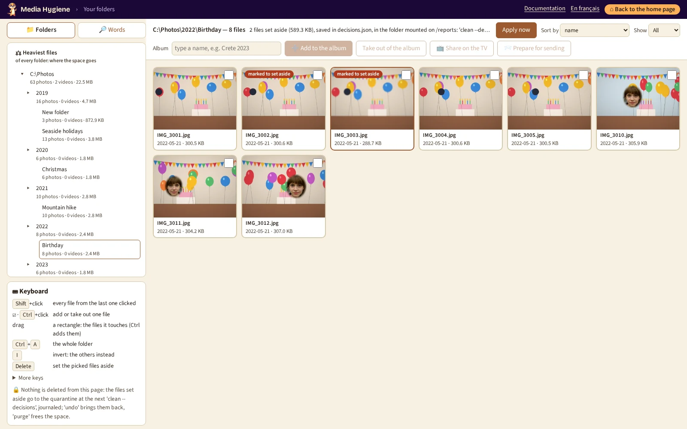

# `browse`: walk through your folders and set photos aside

[Documentation](../README.md) › [Commands](../reference-commands.md) › `browse` · 🇫🇷 [Français](../../fr/commands/browse.md)

> The page's button on the [home page](home.md) (`mh` alone) opens it; the command is still there for a script or without the home page, but `mh --help` no longer lists it.

## In short

**Look through your folders as in Explorer, and set aside the photos you no longer want.**

`browse` opens your library in your browser: the tree of your folders on the left (each with
its number of photos and videos and its size), the photos and videos of the folder chosen on the
right. Pick some and set them aside: the next [`clean --decisions`](clean.md) moves them to the
quarantine, journaled and undoable. Deleting in Explorer leaves no trace; here, every removal can
be undone.

> **One page now**: `browse` opens [`search`](search.md) with its folders open (`/browse` is the
> same page). Everything below is on that page: the tree under *In a folder* (a click lists the
> folder and its subfolders), *⚖ Heaviest files*, **Sort by** (*bit rate* included) and **Show**.

**When**: after an [`audit`](audit.md): the page shows what the audit has read. No
[`tags`](tags.md) needed.

**Try it**:

```powershell
docker run --rm -it `
  -p 127.0.0.1:8088:8088 `
  -v "C:\Photos:/data/c/Photos:ro" `
  -v media-hygiene-cache:/[cache](../reference-glossary.md#cache) `
  -v "$HOME\media-hygiene\reports:/reports" `
  -v "$HOME\media-hygiene\config:/config" `
  cavo789/media-hygiene browse
```

## At a glance

| | |
|---|---|
| Your photos | 🔒 Nothing moves without your GO (the 🔎 tab sorts the files of a rule checked there, [`search`](search.md#make-a-period-a-rule)), journaled: `undo` puts them back. `mh browse` mounts them writable; mounted `:ro`, the page stays read-only. |
| Needs | `/cache` (the files of the last audit), your folders (to show the photos), `/reports` (to keep what you set aside), and `-p 127.0.0.1:8088:8088` for the page. |
| Writes | The small previews of the grid, in the cache; the photos you set aside, in `decisions.json` of the reports; your albums, in `albums.json` next to it. |
| Undo | Nothing to undo on the page: [`clean --decisions`](clean.md) moves the photos set aside, [`undo`](undo.md) brings them back. |
| With `mh` | `mh browse`. |

## Run it

```powershell
mh browse
```

Your browser opens on the page (if not: `http://127.0.0.1:8088/`).



- **The bar above the grid**: the folder shown, how many files it holds and what is set aside,
  with **Sort by**, **Show** and the album field. As soon as a file is picked, it shows what to do with
  the picking: **✕** picks none, **Set aside the picked files**, **Invert the picking**.
- **The tree**: your mounted folders, open; the folders below them, closed (▸ opens one). Click a
  folder: its photos and videos appear, sorted by name, by date or by size, the largest first
  (**Sort by**; *bit rate* is for the heaviest files, below: a folder sorts by size then). **Show** keeps the photos or the videos only: the heavy videos of a folder come
  first with *Videos* and *size*. Ctrl+A, Shift+click and ← → work on the files shown only. Both
  choices are kept, in this browser, for the next folder.
- **⚖ Heaviest files**, above the folders: the heaviest files of every mounted folder, the videos
  first (**Show** changes it), 200 at a time (**Show more** adds as many). The bar says what the
  list weighs: *200 files, 61.4 GB, 25 % of your library*. Each tile gives its folder and, for a
  video, its length, bit rate, codec and size in pixels: `12 min · 12.7 Mb/s · mjpeg · 1280×720`.
  **Sort by** *bit rate* puts first the videos worst compressed for their length (old cameras,
  MJPEG): the ones that gain the most once lightened. Set aside, the viewer and the keys work
  as in a folder.
- **Look**: Enter or a double click shows a picture large, a video plays; ← and → go to the
  previous and next ones, as in the Photos app; Escape closes. **Delete sets the one shown aside,
  then the next one opens**: sort a folder without leaving the large view. The save is read back
  first; the photo shown carries the red *marked to set aside* label. Opened large, too:

  | Key | What it does |
  |---|---|
  | Home, End | the first or last file |
  | Backspace | take the one shown back out of the set aside |
  | Space | play or pause a video |
  | **F** | full screen (F again, or Esc, to leave it) |
  | I | its date, size and folder, under the picture (in the grid, I inverts the picking) |
  | A | add it to the album typed in **Album** |
  | ? | every key of the large view, under the picture |

  A line under the picture recalls the main keys; the panel under the tree lists them all.
  **👤 Set a person aside**, next to the link to the original, finds every photo of someone on
  the one shown: see [`people`](people.md#from-any-page-set-a-person-aside).
- **Pick**: a click picks one file; the ☑ box of each thumbnail (or Ctrl+click) adds or removes
  one; Shift+click picks every file from the last one clicked; a rectangle dragged with the mouse
  over the grid picks what it touches, over several rows (with Ctrl, it adds to the picking);
  Ctrl+A the whole folder. **Invert the picking** (or I) picks the others: when a folder holds
  mostly failed shots, pick the good ones, invert, then Delete. The keys are listed under the
  tree, always in sight, with the 🔒 line reminding that nothing moves without your GO.
- **Set aside**: Delete, or **Set aside the picked files**. The choice is saved at once in
  `decisions.json` of your reports, read back from the disk and shown with its count and size:
  *37 files set aside (412 MB), saved in …: 'clean --decisions' moves them to the quarantine,
  and remembers them: if one comes back (a new copy from the phone), the audit proposes it
  again.* (See [What you set aside stays set aside](../clean/09-undo-history-purge.md#what-you-set-aside-stays-set-aside).)
  Those files carry a red *marked to set aside* label; once one of them is picked, **Take out
  of the set aside** appears in the bar and takes the picked files back out.
- **🔎 Words**, the tab above the tree, opens the [`search`](search.md) page, on the same server: what you set
  aside there and here goes to the same file.
- **➕ Add to the album** puts the picked photos in the album typed in **Album**, apart from the
  set aside; **📺 Share on the TV** gives the command that shows it. See
  [Put photos in an album](search.md#put-photos-in-an-album).

Ctrl+C, or closing its tab, stops the page; when files are set aside, `browse` proposes the next step:

```powershell
mh clean --decisions
```

It says how many files and bytes go (apart from the duplicates), asks, then moves them to the
quarantine, journaled: `mh undo` brings them back, `mh purge` frees the space.

**Opened from the [home page](home.md)** (`mh` alone, then the *Walk through your folders* step):
once something is set aside, an **Apply now** button appears in the bar, next to the saved line. `mh` runs
the home page's step that applies your choices (`mh clean --decisions`,
with `--tier near` when you also reviewed near duplicates), with its usual question, in the
window where `mh` runs (PowerShell on Windows); the page stays open, then says *Done* (or the
code it stopped on) and shows the folder again without the files moved away. Opened by `mh browse` alone, there is no
button: type the command above. The button needs an `mh` written by this version (`mh update`
writes it again).

## Options

| Option | What it does |
|---|---|
| `--port PORT` | Port of the page, 8088 by default; publish the same one. |

## Good to know

- **Opened from the home page** (`mh` alone): the page opens at once, in the same tab, served by
  the home page itself: no other container starts, the index stays open for the session.
  *⌂ Back to the home page* is a plain link (the browser's Back works too). Typed alone
  (`mh browse`), it still starts its own page.
- Nothing is deleted from the page, and nothing moves until `clean --decisions`. A file changed
  since you picked it is left where it is and listed in the clean report; a file of a protected
  folder refuses the whole file, as everywhere.
- The page lists what the last [`audit`](audit.md) has read: audit again to see new files.
- Without `/reports` (or with a folder the tool cannot write to), setting aside says why and
  saves nothing; looking still works.
- A video shows its first images in the grid when your browser can play its format (MP4, MOV);
  the others show "No preview" and open as originals.

## Go further

- [Find in short](../find/quick-guide.md)
- [`search`: set photos aside found by a word, a person, a year](search.md#set-photos-aside)

## The built-in help

<details>
<summary><code>browse --help</code></summary>

<!-- capture: help-browse.txt -->
```text
 Usage: media-hygiene browse [OPTIONS]

 🔒 Read-only: never changes your photos. Walk through your folders in your
 browser, as in Explorer, and set photos aside; 'clean --decisions' then moves
 them.

╭─ Options ────────────────────────────────────────────────────────────────────╮
│ --port          <int range> [x>=1]  Port of the page. docker run publishes   │
│                                     it under the same number on your         │
│                                     computer: -p 127.0.0.1:9000:9000 for     │
│                                     --port 9000. Default:  port in           │
│                                     config.toml, 8088.                       │
│ --help  -h                          Show this message and exit.              │
╰──────────────────────────────────────────────────────────────────────────────╯
```

</details>

---

← [All commands](../reference-commands.md) · [Documentation](../README.md)
