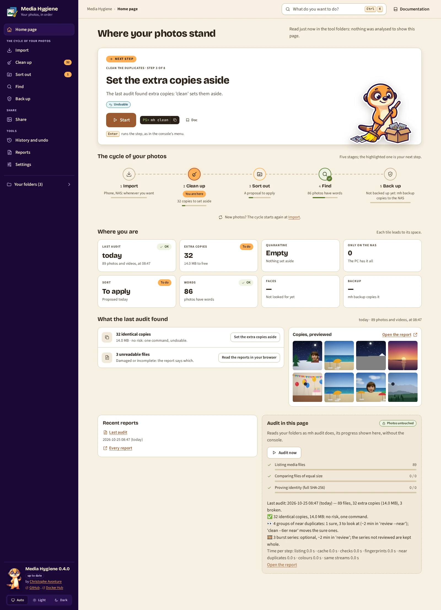

# `home`: the home page, in your browser

[Documentation](../README.md) › [Commands](../reference-commands.md) › `home` · 🇫🇷 [Français](../../fr/commands/home.md)

## In short

**One page in your browser: where your photos stand, the next step as a big button, every
action of the tool a click or <kbd>Ctrl</kbd>+<kbd>K</kbd> away.**

`home` shows in your browser what [`status`](status.md) and [`menu`](menu.md) show in the
terminal, laid out as the cycle of your photos: **Import** (a phone, your NAS or an old disk),
**Clean**, **Sort**, **Find**, **Back up** (planned), then three tools: **History and undo**,
**Reports**, **Settings**. Each space has its page: its guide, numbered, then "Go further". Every
action shows its `mh` command, copyable, and links to its chapter of this documentation. The
page can also run the audit itself, its progress shown in the page.

**When**: whenever you prefer clicking to typing, or no longer know what comes next.

**Try it**:

```powershell
docker run --rm -it `
  -p 127.0.0.1:8088:8088 `
  -v "C:\Photos:/data/c/Photos:ro" `
  -v media-hygiene-cache:/[cache](../reference-glossary.md#cache) `
  -v "$HOME\media-hygiene\reports:/reports" `
  -v "$HOME\media-hygiene\journal:/journal" `
  -v "$HOME\media-hygiene\quarantine:/quarantine" `
  -v "$HOME\media-hygiene\config:/config" `
  cavo789/media-hygiene home
```



## At a glance

| | |
|---|---|
| Your photos | 🔒 Never changed by the page: mount them `:ro`. The audit run from the page only reads them. |
| Needs | The tool's folders (`/reports`, `/journal`, `/quarantine`, `/cache`), as `status` does; your folders for the audit; `-p 127.0.0.1:8088:8088` for the page. |
| Writes | Nothing by itself; the audit run from the page writes its cache and its report, as `audit` does. |
| Undo | Nothing to undo; each step keeps its own undo. |
| With `mh` | `mh home`. |

## What the page shows

- **The sidebar**: the five stages of the cycle and the tools, each with its count (*9* extra
  copies to set aside, *214* files only the NAS keeps), *Your folders* (each found or not), the
  version (*0.5.0 available* when a newer one is published, [`mh update`](launcher.md#a-new-version-mh-update)),
  the theme switch and **Quit Media Hygiene**.
- **The top bar**: *What do you want to do?* (the palette), **Undo the last run** while a run is
  undoable, and **Documentation**: the chapter of the page you are on, and its English twin.
- **The next step**: why, what it risks in words (*Undoable*), the button that runs it and its
  command: *the last audit found extra copies: 'clean' sets them aside*, **mh clean**. Its
  button has the focus when the page opens: <kbd>Enter</kbd> runs it, as in `mh menu`. When
  everything is applied, the page says so.
- **The cycle of your photos**: the five stages, the next one highlighted (*You are here*), each
  with one line (*9 copies to set aside*, *A proposal to apply*) and how many steps of its
  guide are done.
- **Where you are**: one tile per fact (the last audit, the extra copies, the quarantine, the
  files only on the NAS, the sort, the words, the faces), each leading to its space.
- **What the last audit found**: each finding with its button (*9 identical copies*: **Set the
  extra copies aside**; *3 unreadable files*: the report), and a few previews of its report.
  Before any audit: three things to know (nothing moves without you, everything that moves can
  be undone, one thing only is for good).
- **Recent reports**, and **Audit in this page** 🔒: **Audit now** reads your folders as
  `mh audit` does, with the same settings. Each step shows with its counts as it goes; at the
  end, the audit's figures, the time each step took, *What you can do*, and a link to the new
  report. One audit at a time; **Stop the audit** stops it between two files: the cache keeps
  what it has read, and the next audit starts from there.
- **One page per space**: its guide, numbered, then "Go further" as cards. Each action says what
  it risks (🔒 *Photos untouched*, ↩️ *Undoable*, ⚠️ *For good*), *Optional*, *Windows*, *Local
  AI* (🤖), *Planned*; **Done** when the tool's folders prove it; when it cannot run yet, why
  instead of its text (*Nothing to undo yet.*). *History and undo* shows the run still undoable
  and the quarantine run by run; *Settings* your folders, the update, Windows, the local AI,
  privacy, the advanced actions and *About*.

Opened by a right-click on a folder (or `mh --photos "E:\Folder"`), the page names that folder
first: *This page also analyses: E:\Folder*; the audit of the page and every step run from it
analyse it too.

## Run a step

The page never changes your photos itself. What a step's button does depends on the `mh` that
opened the page:

- **`mh` alone** (and so the Desktop shortcut and the right-click of a folder) runs the steps of
  the page: **Start** (or the big button) closes the page and hands the step to `mh`, in the
  window where `mh` runs (PowerShell on Windows), with the folders that step needs. The page
  says where: *mh clean runs in the PowerShell window of mh (in the taskbar): answer it if it
  asks something, then this page comes back by itself*, and at once, in bold, *Switch to the
  PowerShell window of mh (in the taskbar) now (Alt+Tab, or its button in the taskbar): it may
  ask you something*. `mh` also rings the terminal's bell and plays Windows' sound, often
  unheard (speakers off). What you can see: Windows Terminal makes its taskbar button flash on
  that bell once its settings say so (its default is the sound only): *Settings* → *Open JSON
  file*, then `"bellStyle": "taskbar"` in `profiles` → `defaults` (`["audible", "taskbar"]` to
  keep the sound). With the classic console, `mh` also brings its window forward when Windows
  allows it (a minimised window stays minimised). After 30 seconds the page adds
  *Nothing moves? Look at the PowerShell window of mh (in the taskbar) (Alt+Tab)*. The step
  chosen is the
  command's exit code, `20 + n` for step `n` of `mh menu`: that is how `mh` knows what to run.
  Ctrl+C during a step (or on a page it opened) gives the prompt back: the home page does not
  come back, and no other step runs.
- **A step that takes words** (an album's name and category, your NAS's folder, a folder to
  remove, how many reports to keep): **Fill in** opens its form, the example filled in. The
  server checks each value and says why it refuses one (*no double quote*, *no control
  character*, *it cannot start with '-'*, *a folder as the Explorer shows it*); then it writes
  the words into `.mh-step.json` of your reports folder and ends with `199`. `mh` reads that file
  once, removes it, and runs those words: `Christmas 2025` stays one word. With reports in a
  named volume, or an older `mh`, the page gives the command to copy instead.
- **⚠️ For good** (`purge`, `clean --delete`, `phone --free`): the page asks first; `mh` asks
  again in its window before touching anything.
- **Otherwise** (`mh home` typed, an older `mh`, or `docker run` alone): the button copies the
  command (*Command copied*) and the page keeps running; stop it with Ctrl+C in the window where
  `mh` runs, paste the command there (right click) and press Enter. When the browser refuses to
  copy (an address other than `127.0.0.1` or `localhost`), the command is selected: press Ctrl+C.

Every other page ([`review`](review.md), [`review-sort`](review-sort.md),
[`places`](places.md), [`search`](search.md), [`browse`](browse.md), [`people`](people.md))
wears the home page's look and theme, under a bar: **Documentation** opens that page's chapter,
next to its French twin (*En français*). When the home page opened it, the page shows in the
**same tab** (no new tab), and **⌂ Back to the home page** closes it (what you decided there is
already saved) and brings that tab back to the home page, on the space you left (*Clean*,
*Sort*…). Closing the tab instead ends the page and `mh` with it: the prompt comes back.

The documentation itself is inside the image: every **Doc** and **Documentation** link of these
pages opens its chapter served by the tool, in the same look, offline, and written for the version
you run (the website may already describe a newer one). Its sidebar lists every chapter, its top
bar switches to the other language (**FR**), each page lists its sections and ends on the previous
and next ones. The links the terminal prints, and the HTML reports opened from the disk, still
lead to the [website](https://cavo789.github.io/media-hygiene/): no page of the tool answers there.

## The keyboard, the palette, the theme

| Key | What it does |
|---|---|
| <kbd>Enter</kbd> | When the page opens, runs the next step: its button has the focus. |
| <kbd>Ctrl</kbd>+<kbd>K</kbd> or <kbd>/</kbd> | *What do you want to do?*: every action and every space, found by everyday words (*phone*, *NAS*, *undo*), then the sections of the documentation (opened in a new tab); <kbd>↑</kbd> <kbd>↓</kbd> choose, <kbd>Enter</kbd> runs. |
| <kbd>↑</kbd> <kbd>↓</kbd> | In the sidebar, from one space to the next (one <kbd>Tab</kbd> stop for the whole sidebar). |
| <kbd>?</kbd> | The keys. |
| <kbd>Esc</kbd> | Closes what is open. |

A keyboard-only walk: <kbd>Tab</kbd> once shows *Skip to the content*; <kbd>Enter</kbd> on it
jumps over the sidebar. <kbd>Shift</kbd>+<kbd>Tab</kbd> back to the sidebar, <kbd>↓</kbd> to
*Clean*, <kbd>Enter</kbd> opens its page. <kbd>Ctrl</kbd>+<kbd>K</kbd>, type *phone*,
<kbd>Enter</kbd>: the phone's step runs. Reload the page: <kbd>Enter</kbd> runs the next step.
The focus ring shows only for the keyboard; the toasts are read by screen readers.

The theme follows Windows (light or dark); **Auto**, **Light** and **Dark** at the bottom of the
sidebar choose for this browser. Animations stop when Windows asks for reduced motion. The
fonts and pictures come from the image itself: the page asks nothing of any other site.

## Options

| Option | What it does |
|---|---|
| `--port PORT` | Port of the page, 8088 by default; publish the same one. |

## Good to know

- The page answers only at `127.0.0.1` or `localhost`, and only to its own buttons: another
  site cannot choose a step for you.
- **Quit Media Hygiene** (bottom of the sidebar), closing the page's browser tab, or Ctrl+C in the terminal stops the page
  and gives the prompt back; an audit running stops between two files. A closed tab is noticed
  about 10 seconds later (*The home page's tab was closed: the home page stopped.*); a reload, or
  a tab left in the background, never stops it.
- The steps are read again from the tool's folders each time the page loads: what another
  window did shows at the next reload. A button of a page drawn before such a change is refused
  (*The steps changed since the page was shown*) and the page shows the steps again.

## Go further

- [`menu`: the same steps in the terminal](menu.md)
- [`status`: where you are, in one second](status.md)

## The built-in help

<details>
<summary><code>home --help</code></summary>

<!-- capture: help-home.txt -->
```text
 Usage: media-hygiene home [OPTIONS]

 🔒 Read-only: never changes your photos. The home page in your browser: where
 you are, the next step as a button, every step of the guides, the reports.

╭─ Options ────────────────────────────────────────────────────────────────────╮
│ --port          <int range> [x>=1]  Port of the page. docker run publishes   │
│                                     it under the same number on your         │
│                                     computer: -p 127.0.0.1:9000:9000 for     │
│                                     --port 9000. Default:  port in           │
│                                     config.toml, 8088.                       │
│ --help  -h                          Show this message and exit.              │
╰──────────────────────────────────────────────────────────────────────────────╯
```

</details>

---

← [All commands](../reference-commands.md) · [Documentation](../README.md)
