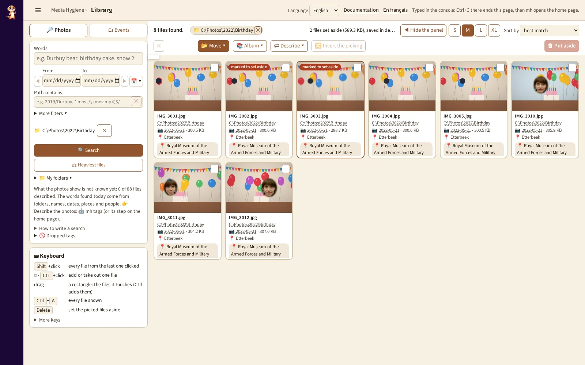

# `library`: find a photo by its words

[Documentation](../README.md) › [Commands](../reference-commands.md) › `library` · 🇫🇷 [Français](../../fr/commands/library.md)

## What are you looking for?

- 📱 [Find a photo from the phone: what to type](#what-you-can-type)
- 🖼 [Put photos in an album](#put-photos-in-an-album)
- 📂 [Walk through your folders](#walk-through-your-folders)
- 💻 [I'm on the PC and start from zero](#run-it)

Photos with a GPS position are also found by their landmark, town and regions, shown as `📍` under the date: see [`spots`](spots.md).

## In short

**Find a photo by what you remember of it: a word, a place, a year, a person.** This page is the
**Library**, once called `search`; that name still works.

`library` finds photos by the words [`tags`](tags.md) gave them and the names given in
[`people`](people.md), in a page of your browser: one field, a grid of the photos found, best
first, each with its folder, date and words. With words after the command, it prints the first
matches as a table instead. Photos you pick on the page can be **set aside**: the next
[`clean --decisions`](clean.md) moves them to the quarantine, journaled and undoable.

**When**: after [`tags`](tags.md) (and [`people`](people.md) for the names); again after the new
photos are tagged.

**Try it**:

```powershell
docker run --rm -it `
  -p 127.0.0.1:8088:8088 `
  -v "C:\Photos:/data/c/Photos:ro" `
  -v media-hygiene-cache:/[cache](../reference-glossary.md#cache) `
  -v "$HOME\media-hygiene\reports:/reports" `
  -v "$HOME\media-hygiene\config:/config" `
  cavo789/media-hygiene library
```

## At a glance

| | |
|---|---|
| Your photos | 🔒 Nothing moves without your GO: *I checked: sort these N files* moves the files of a rule checked on the page, journaled; `undo` puts them back. `mh library` mounts them writable, with `/journal`; mounted `:ro`, the page stays read-only and the GO is refused. |
| Needs | `/cache` (the words of `tags`), your folders (to show the photos), and `-p 127.0.0.1:8088:8088` for the page; `/reports` to set photos aside. |
| Writes | The small previews of the grid, in the cache; the photos you set aside, in `decisions.json` of the reports; your albums, in `albums.json` next to it. |
| Undo | Nothing to undo on the page: [`clean --decisions`](clean.md) moves the photos set aside, [`undo`](undo.md) brings them back. |
| With `mh` | `mh library`, `mh library durbuy ours`. |

## Run it

```powershell
docker run --rm -it -p 127.0.0.1:8088:8088 `
  -v "C:\Photos:/data/c/Photos:ro" `
  -v media-hygiene-cache:/cache `
  -v "$HOME\media-hygiene\reports:/reports" `
  -v "$HOME\media-hygiene\config:/config" `
  cavo789/media-hygiene library
```

Open <http://127.0.0.1:8088/>; on the home server, the page's own address is `/library` (`/search`, its former one, leads to it: your favourites keep working). The page shows the search
field and its filters (a period, a part of the path, the words of one source only) in the left
column, the ⌨ keys under them, one bar above the grid, then the photos found. **🔎 Words** comes
first, **📁 Folders** second: it opens [your folders](#walk-through-your-folders). Ctrl+C, or closing its tab,
stops the page.

**Path contains** takes a part of the path, case-insensitive. `*` stands for any characters and
`?` for one: `*.mov` finds every `.mov` file (`.MOV` too). Between two slashes it is a regular
expression: `/\.(mov|mp4)$/`. Anything else is read as typed, so `Vacances (2019)` or `a+b` need
no escaping. A regular expression that does not compile is told under the field. A click on
the empty field lists your folders, the latest first (2026/2026-10 before 2026/2026-09) with their count; typing narrows the list.
↓/↑ move in it, Enter (or a click) picks a folder and searches, Esc closes it. The list only
helps: `*.mp4` or a regular expression are still searched as typed.

- **⚖ Heaviest files** (above the folders): every folder, no word, the videos first unless
  **Show** says otherwise, the largest first — or **Sort by: bit rate**, the videos worst
  compressed for their length (the best to lighten with [`shrink`](shrink.md)). A video's tile
  says its length, bit rate and codec. Scrolled to the end of the grid, the next files load by themselves.
- **📁 My folders ▸**: one line under the form; a click opens the tree of your folders over the
  page (nothing below moves), Esc closes it. A click narrows the search to that folder and below, **without typing any word**:
  empty words list the whole folder; ✕ next to its name searches every folder again.
  Each folder shows its role (🛡️ protected, ⭐ preferred, 💾 backup, 🚫 excluded; hover for
  what it means); **⋯** next to a folder, *Role of this folder*, gives it one or none. The
  choice is written in `[folders]` of `config.toml` (your comments kept), read back from the
  disk and shown; a role clashing with another (a backup inside a protected folder, a protected folder inside an
  excluded one or the reverse) is refused
  with the reason. Run the audit again afterwards: its proposals used the former roles. A folder
  with a role that was renamed or deleted in Explorer is listed under the tree, with **Remove**;
  renamed, and the next audit not run yet, the folder now holding the same files is found in the
  cache and offered: **Carry the role to …** moves the role there (two such folders: both offered).

- **Search**: type the words, then Enter; the keys then go to the grid, `/` comes back to the
  field. *How to write a search* recalls the phrases ("bord de mer"), the starts of words
  (anniv\*) and the words of one source (place:durbuy).
- **Follow a word**: a click on a word under a photo (*Mechelen*, *2026*, a person's name)
  searches it as a phrase in every source, the filters emptied: from one photo to all the others
  with that word. It never picks the photo. **Ctrl+click** adds the word to the search instead,
  the other filters kept: *Manon*, then Ctrl+click on *2015*.
- **Follow a day or a folder**: a click on a photo's day or folder, under it or in the large view,
  shows the files of that day (*From* and *To* take it) or of that folder (*Path contains*). The
  browser's **Back** (Alt+←) gives the search before each of these clicks. **Shift+click** on a
  second day searches from the day clicked before to this one (put in order): a weekend, a trip,
  a party past midnight.
- **Pick**, as on every page of photos: a click picks one file; the ☑ box (or Ctrl+click) adds or removes one;
  Shift+click picks every file from the last one clicked; a rectangle dragged with the mouse picks
  what it touches (with Ctrl, it adds); Ctrl+A every file shown, then **Pick all N files found**
  in the bar takes every file the search finds, not only the 240 shown; **🔀 Invert the picking**
  (or I) picks the others.
- **The bar** has two lines that never move, whatever is picked or found: on top, where you are
  (the count, then each active filter as a chip — a word, the period, the path, the folder,
  *not yet*, 📷 — whose **✕** removes it and searches again; those that do not fit fold into
  **+N**, a click lists them under the bar), **📺 On the TV**, **Sort by** and the thumbnail size **S** (photos only), **M**,
  **L** (every word), kept for this browser; below, what to do with the files picked — greyed
  while none is: first **📂 Move to an event…** (filled: the main action), **🗓 Move to their month…**, **🔀 Invert**, two small panels, **🏷 Describe** (tag, date, place)
  and **📚 Album**, then, at the far right as on every page of tiles, **🗑 Put aside** in red and
  **✅ Apply**. Point at a button for its
  whole name and its key. **✅ Apply** says it too: 🔒 nothing moves without your GO; every move
  is journaled, `undo` puts it back. A file set aside counts as gone for every action but
  *Take back*: picked with the others (Ctrl+A, Shift, the rectangle), it stays out of the
  album, the share, the TV and the event move, and the answer says so (*3 files set aside
  ignored*). It also leaves the albums it was put in (their page, their TV, `slideshow
  --album`), and the photos of an event sent elsewhere from 🗂 *Events* leave it in place;
  the same goes for a shot set aside in the burst review. On a tile, the name, folder and caption keep one line each
  (point at them for the whole text), the words two lines then *+N*.
- **⌨ Keyboard**: the panel lists the main gestures; **More keys** opens over the page (Esc
  closes it), so the form above never leaves the screen.
- **Look**: Enter or a double click shows the photo large (with a link to the original); ← → (on a
  phone, a swipe) the previous or next one not set aside, Delete sets it aside then shows the previous one (the next one at the start), F full screen, ? every key,
  Escape closes it. **👤 Set a person aside** finds every photo of someone on the one shown
  ([`people`](people.md#from-any-page-set-a-person-aside)).

- **A period**: *From* and *To* are calendars, a day each, both included; one alone is a period
  of one day. The day is the one the photo was taken, as `classify` dates it. *From* chosen,
  *To* takes the same day when it is empty or earlier. Next to them, the **📅 ▾** menu searches
  **📍 Today**, **🗓️ Month** (this month), **📆 Year** (this year); **✕ Clear** empties both. **◀ ▶** on
  each side move the period by its own length, then search: one day → the day before or after,
  a month of 📅 → the month before or after (greyed while both dates are empty).
  **🔍 Search** stays in sight at the bottom of the form.
- **Sort by**, in the bar as on the [folder view](#walk-through-your-folders): *best match* (the
  default; the newest first without words), *name*, *date* (the oldest first), *size* (the
  largest first) or *length, shortest first* (the videos by duration, the photos after: the failed
  videos of a second or two come first); **Show**, in the left column, keeps **📷** the photos or **🎬** the videos only. The search sorts and filters
  before it shows its first files: *Show: videos*, *Sort by: size* gives the largest videos found.
  Each tile says its date and size.
- **🗑 set aside**, the fourth choice of **Show** (or a click on the *🗑 N set aside* counter of
  the bar): the same grid lists only the files set aside, before `clean --decisions` sends them
  to the quarantine. Pick one or several, then *Take out of the set aside* puts them back: the
  decisions file is read back from the disk before the counter changes, and the tiles stay in
  place. **✕** next to 🗑 leaves this view.
- **Which date**: `📷 2023-07-14` is the day the photo was **taken**, written in the photo
  itself (EXIF *DateTimeOriginal*; a video's recording date): what *From*, *To* and the years
  find. It is not the *Date modified* Windows Explorer shows by default: point at the date for
  both, with the time taken. Explorer shows the date taken in the file's **Properties ›
  Details › Date taken**, or as the *Date taken* column (right-click the column headers). A file
  that does not say it (a scan, a screenshot) reads *no date taken*: a search by date does not
  find it.
- **The photo's EXIF**: in the large view, **I** lists what the photo says of itself: when it was
  taken, the camera, the lens, the exposure, its size in pixels and its GPS position, with the
  nearest town and its country (*Brussels, Belgium*, found offline: no position leaves your PC). Read only:
  the photo is never changed.
- **A video's length** is on its preview's corner, as on video sites: `▶ 1:45`. Under 3 seconds,
  the badge is red: a clip that short is rarely worth keeping (setting it aside stays your
  choice).
- **Sorted**: *All*, *not yet* or *sorted* (year, then year-month), read from the
  folders alone ([the convention](../sort/04-classify.md#the-convention-year-month-event)): a
  photo in `2009\2009-11\…` is sorted, wherever that pair of folders lies and whoever put it
  there. *Not yet*, then pick and **📂 Move to an event…**: the page becomes the way to sort
  what is left, folder after folder.

Without a browser (WSL, a script), give the words: `search durbuy ours` prints the first 20 files
as a table.

## The events of the latest classify

The **Group the photos into more or fewer events** section of that tab (PC only) sets `merge_gap_hours`, `min_event_size` and `trip_min_km` of `[classify]`: saved in `config.toml`, shown as read back from the disk, applied by the next [`classify`](classify.md) (the list does not change before).

The **🗂 Events** tab, on top of the left column next to **🔎 Photos**, needs no
[`classify`](classify.md) run: it groups **the files not sorted yet** of the period of the
search (*From* / *To*; none: every date) by the time they were taken, a new event wherever
no photo was taken for `classify`'s longest gap (18 hours by default), without rules nor AI.
*Not sorted yet* means exactly the search's *Not yet*: neither in a `YYYY\YYYY-MM\<name>` folder nor directly in
`YYYY\YYYY-MM`, whoever put it there; a file you sort leaves the list at the next search. Click an event: its
photos fill the grid (never the Photos tab's: on an error the grid stays empty and the bar says
why); pick them, then **📂 Move to an event…** or **🗓 Move to their month…** moves them. The address `/events` opens the page on this
tab; ← and → move between the two tabs once one has the focus.

**The card of an event** says first, in one sentence, where its files go: *These 10 files will
go to C:\Photos\2019\2019-07\Juillet* (the folder of yours holding most of them, under the
year and month of the earliest; the files set aside are never counted nor moved). Then three
buttons:

- **Sort here now** moves them there, journaled (`undo` puts them back), then shows the next
  event to decide;
- **Another folder…** opens the bar's **📂 Move to an event…** dialog on the photos picked, or
  on the whole event when none is picked: another name, a source folder unticked. To leave
  some photos where they are, pick only the others (or set them aside);
- **Do not sort this event**: its files stay where they are, the event counted as decided
  (⏸ in the list), saved by content id in `events/left.toml` and read back. Skipping an event
  with → is not this: a skipped event stays to decide.

**Undo my choice** shows once a choice is saved: the event is to decide again. *📌 Remember as
a rule*, a link under the buttons, opens the rule dialog on the event's days (it moves
nothing).

| Key | What it does |
|---|---|
| **N** / **P**, **U** | next or previous event (skipped: it stays to decide), next one to decide |
| **M** | *Sort here now* |
| **O** | *Another folder…* |
| **Shift+S** | *Do not sort this event* |
| **T** | *Undo my choice* |
| **Delete**, **⌫** | set the picked photos aside, take them back out (as on every page of photos) |

**📌 Your rules** lists every rule of `config.toml` with the files it decided: remove the ones that
decide nothing, turn a folder-name rule into dates.

**📐 Where and how to sort** chooses, on your photos, what the next `classify` proposes: the folder
receiving the tree (`[classify] target`; empty: each folder is sorted in place) and its shape,
*Year / Year-month / Event* or *Year / Month only*, each with the tree it gives (from your latest
`classify`, else from the dates of your photos, without the names of the events). The files the sort
is less sure of stay where they are unless you choose a shape for them too. Saved in `config.toml`
(your comments kept), read back and shown; nothing moves. A layout of your own stays offered.
*Sort here now* and *Move to an event…* use these two choices at once: the files go below that folder
(empty: below their own), in that shape, and always in a folder named after the event, even with
*Year / Month only*: you named it.

The **⋯** of a folder (📁 My folders) adds, beside its role, *Never sorted* (`[classify] leave`) and
the name of the person whose photos it holds (`person_folders`): the folder's name must hold it.
A folder left out, then renamed in Explorer, is listed as gone with *Remove*, in the dialog above.

## Move photos to their month, without an event

Some photos have no event worth naming. Pick them, on the 🔎 Photos or 🗂 Events tab, then
**🗓 Move to their month…**: no name asked, no event folder. **Each photo goes to its own month**
(*C:\Photos\2016\2016-07*), where an event takes the earliest photo's month for all, below
the folder chosen in **📐 Where and how to sort** or the photo's root. A file directly in its month counts as sorted: it leaves
*Not sorted yet*. The dialog first shows the photos month by month, with those that stay, and
the button states how many move:

- a photo **without a date** stays where it is, never guessed, and the result counts it;
- a photo **already in its month** is counted and not moved. A photo in an event of that month
  (*2016\2016-07\Kermesse*) is not: it moves out of the event, since you picked it.

The move is journaled and read back: `undo` puts them back. 🔒 Nothing moves before **Move these
N files now**.

## Move photos to an event, without a rule

For a one-off event, a rule is not needed: search its days (or words), **pick** the photos (as
everywhere: click, Ctrl, Shift, a rectangle, Ctrl+A), then **📂 Move to an event…** in the bar.
Type the event's name, or pick one of your event folders the field lists (those already in the
month the photos go to, sub-folders written `France\Morzine`); `\` makes sub-folders of a new name too.
The line under it shows the folder made, as
Explorer will show it, under the year and month of the earliest photo picked
(*→ C:\Photos\2009\2009-11\Anniversaire de Tom*,
[the convention](../sort/04-classify.md#the-convention-year-month-event)). The name proposed is
that of **your folder holding most of the photos picked**: its photos go to the folder of the
same name under the convention, never to a second one beside it. When every photo picked comes
from one folder with a real name (*Anniversaire Chloé*, not *Juin 2012*), that name is proposed,
even if it names a person or spans several days.

Before the move, the photos are listed **by source folder**, one tick box each, with their
count. A folder you named after **another** event (`Saint Nicolas 2009`: a name, one evening) is
**unticked**: its photos stay where they are, unless you tick it. A folder of dates, a family
member's folder, a phone's `DCIM` are ticked. **Move these N files now** moves exactly the ticked
ones, journaled, checked at their new place, said as read back (*'mh undo …' puts them back*).
Nothing else is written: no rule in `config.toml`, no event in `events/`, the next `classify`
finds them in place. Only when you tick **Also remember it as an event (events/)**, unticked
at each opening (a filing is not an event; ticked for *new photos during an event*, which widen
it), is the event remembered too: its name, its days and
its cameras, read back and shown after the move. `undo` puts the files back but keeps that event:
remove it from `events/` by hand. Photos added since the
latest `classify` (a phone imported, then audited) move too: no new `classify` is needed.

## Make a period a rule

Once a period is searched, **📌 Make it a rule** opens, beside the grid, the dialog of
the Events tab's *Remember as a rule*, filled with the period: type its name
and its folder (*keep my folders below it* is on). As you type, the grid shows **the photos the
rule would take, each with where it would go** (*→ 2017\Parties\Weddings\Hervé and Magda's
wedding*), computed by the `classify` engine with your rules and the one typed (nothing is
written, nothing moves); then the photos of those days it leaves to another rule (a screenshot,
a photo of another event), greyed, and said in words above the grid (*30 photos of these days
stay with the rule 'Anniversaire de Tom 2009'*). Seeing them, correct the days
(only 5 August) or the folder, then **Save the rule**: it is written into `events/<year>.toml` (the
year it starts; `config.toml` stays as you wrote it), applied above *Existing folders*, read back from the disk and said. The next `classify` applies it.

**Update a rule…** in the same dialog lists the date rules of `config.toml`, the latest first:
one chosen fills the dialog, and saving replaces it in place (its place in the list, which
decides, is kept). Escape or *Cancel* closes the dialog and shows the search again.

A file the search does not know yet (no words at all: run `mh tags --no-describe` once) is
missing from the grid.

**Sort them now, little by little.** Once you checked them, **I checked: sort these N files**
moves exactly the photos the rule takes, each to the folder shown. To leave some out, pick them
and press **Leave the picked files where they are** (greyed, crossed out). When the photos come
from several folders, they are listed by source folder, one tick box each, a folder you named
after another event unticked. **Once a photo is left out, *Save the rule* is off**: a selection
with exceptions is a move, not a rule (saved, the rule would take them again at every
`classify`); the dialog says how many were left. It asks nothing first: it writes them as your choices of the latest `classify`
run (`sort-decisions.json`) and runs `sort` cut to those files: journaled, checked at their new
place, said as read back from the disk (*14 moved, 14 checked at their new place (run …):
'mh undo …' puts them back*); the tiles then show their new place, and a toast offers
**↶ Undo** for 8 seconds: the page runs `mh undo` of that run itself and says how many files it
found back where they were. *Apply now* on this page offers the same Undo once its step ended. A photo the latest
`classify` run does not know (added since) is left where it is and counted: run `classify`
again. Nothing moves without that GO.

*These folders are mounted read-only*: your `mh` was written before the pages could sort (it
mounts them `:ro`). Type `mh update` once: it writes `mh` again, from your image, with the same
folders.

## Walk through your folders

**📁 Folders**, on top of the left column, opens the page on your folders, as in Explorer (the
old `browse` command did only this; `/browse` still opens the same page).



- **The tree**: your mounted folders, open; the folders below them, closed (▸ opens one). Click a
  folder: its photos and videos appear, sorted by name, by date or by size, the largest first
  (**Sort by**). **Show** keeps the photos or the videos only. Both choices are kept, in this
  browser, for the next folder.
- **⚖ Heaviest files**, above the folders: the heaviest files of every mounted folder, the videos
  first, 200 at a time (**Show more** adds as many). The bar says what the list weighs: *200
  files, 61.4 GB, 25 % of your library*. **Sort by** *bit rate* puts first the videos worst
  compressed for their length (old cameras, MJPEG): the ones that gain the most once lightened.
- Look, pick and set aside work as everywhere on this page; opened from the
  [home page](home.md), **Apply now** runs `clean --decisions` for you.

## Set photos aside

To remove every photo of someone, the [`people`](people.md#remove-every-photo-of-someone) page
does it from their group of faces. To remove those of an event, or any other choice: search them
(`person:"Ann"`, a year, a word), pick them (Ctrl+A, then **Pick all N files found**: every file
the search finds, not only the 240 shown), then Delete or **🗑 Put aside**.

- Nothing is deleted from the page. The choice is saved at once in `decisions.json` of your
  reports, read back from the disk and shown with its count and size: *37 files set aside
  (412 MB), saved in …: 'clean --decisions' moves them to the quarantine, and remembers them: if
  one comes back (a new copy from the phone), the audit proposes it again.* The photos set aside
  carry a red *marked to set aside* label.
- **Take out of the set aside**, shown once a picked file is set aside, takes the files picked
  back out of it.
- When you stop the page, `library` proposes the next step: `mh clean --decisions`. It asks first
  how many files and how many bytes go (apart from the duplicates), moves them to the
  quarantine, journaled; [`undo`](undo.md) brings them back, [`purge`](purge.md) frees the
  space.
- A file changed since you chose it (another size or date) is left where it is and listed in the
  clean report; a file of a protected folder refuses the whole file, as everywhere.
- The same `decisions.json` holds what [`review`](review.md) decided: both are kept, and one
  `clean --decisions` applies them all.

## A wrong name under a photo

A person's name under a photo has a **×**: click it when that person is not on the photo. The
faces of the photo that gave the name go into the person's `rejected` list (in their file under
`/config/people/`, linked from `config.toml`), exactly as the × of the [`people`](people.md) page
does; a face you had confirmed leaves their `faces` too. The file is read back and the bar says
what it holds now (*Saved in config.toml, read back: 1 face of this photo is not Chloé.*), with
**Put back** to undo it. The × never picks the photo, and the card stays where it is. The large
view shows the same names, with the same ×, under its facts (`I`).

`W` in the large view opens **Why this name?**: the face of the
photo cut out and outlined on the whole photo (useful when it holds several faces), how it got the name (*confirmed by you*, or *close to a face you confirmed*, with
that face, its file, and the score against `[people] similarity`), and the next person when they
come close too. **Yes, it is …** confirms that face, **Not …** takes the name off that face
only; both are saved, read back and said the same way. Esc closes the panel and leaves the large
view open. How to read the score: [People](../reference-people.md#find-them-library).

Only this photo loses the name in this search. Other photos named because they look like a face
you just took out keep theirs until you take it off them too; `classify`, the inventory and the
XMP sidecars read the names again at their next run. Without a writable `/config`, nothing is
saved and the bar says why.

## Give photos a word of yours

Some words no file name nor model will ever give: *anniversaire Léa*, *first day at school*. Pick
the photos (the same gestures as everywhere: click, Ctrl, Shift, a rectangle, Ctrl+A), then
**🏷 Tag…** in the bar. Type the word, or choose one you gave before from the list under the
field, then **Tag them**. The word is a decision of yours, like a name or a place: it is kept in
your settings, never in the cache, so nothing recomputed loses it. Each word has its own file,
`/config/tags/<word>.toml` (`C:\Users\<you>\media-hygiene\config\tags\` on Windows), linked
from `config.toml` by a `[[tags.hand]]` entry; each photo is written as its path and an id of its
content. The file is read back and the bar says what it holds now (*“anniversaire Léa” given to
12 photos, read back from the disk.*); the cards show the word at once, and the search finds it
(`hand:anniversaire`).

The photos an audit has not analysed yet are read from the disk while the page waits, so at most
200 of them at a time: above that nothing is saved, and the dialog says how many, and what to do
(an audit first, or fewer photos).

A word typed by hand under a photo has a **×**, on its card and in the large view's facts (`I`):
click it to take the word off that photo, saved and read back the same way. A word left on no
photo goes, with its file.

The paths follow your photos: `sort`, `undo`, the quarantine and **📂 Move to an event…** rewrite them at
once; a folder renamed in Explorer is found again by the content id at the end of the next
`audit`. [`xmp`](xmp.md) writes these words into the `.xmp` sidecars with the others (`hand` in
`[tags] xmp_sources`, on by default). Without a writable `/config`, nothing is saved and the bar
says why.

## Drop a tag you do not need

Hover a word the model, a folder or a file name gave a photo, on its card or in the large view's
facts (`I`): a **⊘** appears. Click it (it never picks the photo): a dialog shows how many photos
carry the word and the first ones. Nothing has changed yet. **Drop it from these photos (100)**
then takes it off every photo and off its `.xmp` sidecar, and adds it to `[tags] stop_words` in
`config.toml` (your comments kept), so the next [`tags`](tags.md) does not bring it back. The bar
says what the disk holds afterwards (*“panneau de signalisation” dropped, read back from the disk:
in the stop words, still on 0 photos.*) and the cards lose the word where they are.

- **Sidecars**: written like those of [`xmp`](xmp.md), journaled; the bar gives the `mh undo` line.
  Only what this tool wrote is taken out: the same word written by another application stays, and
  a protected folder is never touched. Without a journal or on read-only folders, the next
  `xmp --apply` takes it out.
- **What stays**: the model's sentence (a search in quotes can still find the photo through it),
  a word you typed by hand, a name, a date, a place.
- **Restore**: **🚫 Dropped tags**, at the bottom of the left column, lists them; **Restore** takes
  the word out of the stop words. Its photos get it again at the next `tags`, without asking the
  model again (the answers are kept), and in their sidecars at the next `xmp --apply`.

One tag at a time.

## Photos without a date or a place

**Without** in the left column keeps the files the index knows no date (📅) or no position (📍)
for; the tiles come **grouped** by folder, then by close names (`IMG_00…`), each group with
**Pick this group**. The other gestures stay the same.

**📅 Date…** in the bar proposes the day the folder's name says and the days of the
neighbouring photos; choose one or type another, then **Write this day**. The day goes into each
photo's `.xmp` sidecar (`photoshop:DateCreated`), never into the photo, journaled like
[`xmp`](xmp.md): `mh undo <run>`, given in the line, takes it back. The sidecars are read back: the
bar says how many hold the day, the tiles show it and the count drops. A photo with its own date,
in a protected folder, or with a date from another application is left, and said. The day
counts everywhere: *Move to an event…* uses it at once, `classify` at its next run, then `sort`. It
follows the photo as long as its `.xmp` lies beside it (`sort` moves both; in Explorer, move both).

**Place** in the left column lists your places with their number of photos: a photo is in a place
by its GPS (the circle or area drawn on [`places`](places.md)) or because you put it there.
**📍 Place…** in the bar writes the photos picked into `/config/places/<name>.toml`, reads the file
back and says how many it holds. A photo already there by its GPS is not written; a photo of another
place leaves it; identical copies count as one photo, by their content. A new place is
drawn on [`places`](places.md). A word like `place:Durbuy` follows at the next [`tags`](tags.md).

Once the place is given, the dialog offers the other photos of the same day and folder, when
some have no position and no place yet. **See them** shows them as tiles, all picked: take out the
exceptions, then **📍 Place…**, the same place already chosen. Nothing is placed without it; **No**
leaves them as they are. A photo without a known day ties to nothing and offers nothing.

## Put photos in an album

To show photos to others (on the TV with [`slideshow`](slideshow.md)), gather them in an
**album**: a named list, *Crete 2023*, of photos from any folders. Open the bar's **📚 Album** panel, type its name
(the albums already made are proposed), pick the photos (or **Pick all N files found**), then **➕ Add
to the album**. The album named then shows on the button, and **➕** beside it adds more photos in one
click; the panel also offers **📺 Share on the TV** and **📨 Prepare for sending**.

- An album is a list of references, nothing else: no photo is copied, moved or changed. It is
  saved at once in `albums.json` of your reports, next to `decisions.json` (not in the cache:
  deleting the cache keeps your albums), read back from the disk and shown: *Crete 2023: 42
  files, saved in …. Only this file changed: no photo was copied or moved.*
- It is **not** the set aside: *Set aside* prepares a removal, *Add to the album* a share. Neither
  ever touches the other's list.
- **In one click**: on a card of the 🗂 *Events* tab, **📚 Make an album** makes an album of the
  event's files, under the name proposed from its place and day, read back and opened in a new
  tab. After a search, **📚 Make an album of these N results** does the same with every file
  found, under the words typed (files set aside stay out; at most 3 000 at once, else narrow the
  search; not offered when a filter narrows the tiles shown). A name already used adds to that
  album. With a [paired TV](slideshow.md), the card also has **📺 On the TV**.
- **Where the album folders go** is on [the albums page](album.md#from-the-albums-page).
- **Take out of the album** takes the picked photos out of the album typed; an album left empty
  is removed.
- **Album** in the left column, once an album is typed: *In the album* shows only its files, *Not
  in the album* the others; either way, a file already in it says **✓ in the album** on its tile,
  so adding twice shows (adding twice changes nothing anyway). *Pick all N found* counts and
  takes the files the filter shows, never those it hides.
- **➕ Add photos** of an album opened on the [albums page](../reference-albums.md) opens this
  page with the album typed, the period around its dates and **← the album** to go back to it.
- A photo moved since, by [`sort`](sort.md), by [`undo`](undo.md), or in a folder renamed in the
  Explorer (once an audit has seen it), is found again by its content: the album follows it. One
  found nowhere (deleted, or in the quarantine) stays in the album, listed as missing, until it
  comes back.
- **📺 Share on the TV** gives the command that shows the album typed, copied for you: stop the
  page, then `mh slideshow --album "Crete 2023" --lan` ([`slideshow`](slideshow.md)). To show
  photos once, no album is needed: **📺 On the TV** in the bar (search opened from the home page)
  shows the picked files, or every file found when nothing is picked (at most 3000), and opens
  the remote.
- **📨 Prepare for sending** gives the command that makes the album ready to send by mail:
  resized copies without the GPS position, a folder and a zip, `mh share --album "Crete 2023"`
  ([`share`](share.md)). With photos picked, no album to make first: they are added to the album
  typed, or, when the field is empty, to a single *Last sent* album, replaced at each send.
- At most 3,000 photos added at once: narrow a search that finds more.

An album can also become a folder of the Explorer: [`album "Crete 2023"`](album.md) makes it, as
second names (hard links), without a copy.

## What you can type

| You type | It finds |
|---|---|
| `Durbuy ours` | The photos with both words, whatever their source. |
| `noel`, `gateau` | `Noël`, `gâteau`: case and accents do not matter. |
| `bougies` | `bougie` too: the words are kept in the singular. |
| `anniv*` | Every word starting so. |
| `"bord de mer"` | The phrase, its words in that order. |
| `place:durbuy` | The word among the places only; also `vision`, `caption`, `folder`, `name` (the file name), `date`, `person`. |
| `anniversaire` | Also `Anniversaire Léa.mp4`: the words of a file name you chose count too (`IMG_1234` gives none). |
| `neige 2008` | The year is a word of the date: the snow of 2008. |
| `Papy dans le jardin` | A sentence: the little words go (`dans`, `le`, the stop words of `[tags]`, as in the index), and a name someone has on a photo is looked for among the people: read as `Papy (person) + jardin`, said under the search. A phrase in quotes is kept as typed. |
| `Chloé montagne` | The photos of Chloé with "montagne" from any source, once her group is named in [`people`](people.md). |
| `person:chloe`, `person:"Mamie Jeanne"` | The name among the people only. A name nobody has yet is said in one line. |
| `un chat sur un canapé` | After [`tags --meaning`](tags.md): the photos that show it first, even without any of these words ([search by meaning](../reference-tags.md#find-a-photo-by-what-it-shows---meaning)). |
| `Chloé cuisine` | After `tags --meaning`: the photos of Chloé only, the kitchens first. |

## Where each word comes from

Its prefix before a word narrows the search to one source: `place:durbuy`, `folder:durbuy`,
`name:anniv*`. A source without any word yet says *— none yet* in *How to write a search*.

| Source | Prefix | What it holds |
|---|---|---|
| every source | | Any of them (the default). |
| seen by the model | `vision:` | The words the vision model gave to what the photo shows (🤖 [`tags`](tags.md)). |
| the model's sentence | `caption:` | Its whole sentence: for a phrase in quotes. |
| folder | `folder:` | The meaningful words of the folders' names. |
| file name | `name:` | The words of a name someone chose (none for `IMG_1234`). |
| name of a removed copy | `former:` | The folders and name a duplicate had before [`clean`](clean.md) removed it, kept on the copy that stayed. |
| date | `date:` | The year, month, season and holidays of the date taken. |
| place | `place:` | The town and your own places where the photo was taken. |
| person | `person:` | The names given to the faces on the [`people`](people.md) page. |
| Google Photos description | `takeout:` | The description typed in Google Photos (a Takeout export). |
| typed by hand | `hand:` | The words you gave the photos with **🏷 Tag…**, kept in your settings. |

## Tips for finding a photo

While hardly any photo is described, a line under the field says it: *What the photos show is
not known yet: 0 of 44,488 files described…*, with the step that fills it (🤖 `tags`). Before
`tags`, a search finds the words of the folders, names, dates, places and people only.

| Searched | Finds nothing because | Try instead |
|---|---|---|
| `an old man` | **Every word must be found**: `an` and `old` and `man`; a small word counts too. | `man`, then fewer words. |
| `old man`, `grandmother`, `woman` | **The model never writes an age, a sex or a relationship**: for people it writes *adult*, *child*, *baby* or *group* only. | `person:` and the person's name (named on the [`people`](people.md) page), or `child`. |
| `an old man in a garden` | **A whole sentence needs search by meaning** (`tags --meaning`); without it, words only. | `garden`; or run 🤖 `tags --meaning` once: then sentences work. |
| `beach` during a `tags` run | **The model's words reach the search at the end of the run** (or after one Ctrl+C, which writes those of the photos described so far). | Wait for the end of `tags`, or Ctrl+C once. |

Nothing found? Fewer words, the start of a word (`anniv*`), another source's prefix (`folder:`), or
search by meaning. The page keeps these tips short, in *How to write a search*.

## Options

| Option | What it does |
|---|---|
| `WORDS` | Words to find, printed as a table instead of opening the page. |
| `--limit N` | With words: how many files the table lists at most (20 by default). |
| `--folder FOLDER` | Without words: the page opens on this folder, as *Path contains* takes it (a folder `status` lists as left to sort). |
| `--port PORT` | Port of the page, 8088 by default; publish the same one. |

## Good to know

- **During a `tags` run**, a photo described a moment ago shows at a search about 20 seconds later
  (the page reads the new words at most that often while the model writes; a move made from the
  page itself shows at once).
- **Opened from the home page** (`mh` alone): the page opens at once, in the same tab, served by
  the home page itself: no other container starts, the index stays open for the session.
  *⌂ Back to the home page* is a plain link (the browser's Back works too). Typed alone
  (`mh library`), it still starts its own page.
- Without `/reports` (or with a folder the tool cannot write to), **🗑 Put aside** says why and
  saves nothing; the search itself works.
- The search reads the cache only: run [`audit`](audit.md) then [`tags`](tags.md) again to find
  the new photos.
- Without `/cache`, or with a cache no audit has filled yet, it stops and says why.
- **By meaning**: once [`tags --meaning`](tags.md) gave the photos their vectors, the search
  ranks them by what they show too, and says so at start (*Search by meaning: 52,318 photos can
  be found by what they show.*). The model is read from the cache, never downloaded by `library`.
- The names of the people come from the faces of the cache and the names of `config.toml`, at
  each start: mount `/config` too to find them. Nothing else to run after naming a group.

## Go further

- [Find in short](../find/quick-guide.md)
- [Tags: find a photo by its words](../reference-tags.md#find-a-photo-by-its-words-library)

## The built-in help

<details>
<summary><code>search --help</code></summary>

<!-- capture: help-library.txt -->
```text
 Usage: media-hygiene library [OPTIONS] [words]...

 🔒 Read-only: never changes your photos. Find photos by their words in your
 browser (or as a table): the words 'tags' gave them.

╭─ Arguments ──────────────────────────────────────────────────────────────────╮
│   words      <str>  Words to find, printed as a table instead of opening the │
│                     page: "bord de mer" a phrase, anniv* a start of word,    │
│                     place:durbuy among the places only (also vision,         │
│                     caption, folder, name, date, person).                    │
╰──────────────────────────────────────────────────────────────────────────────╯
╭─ Options ────────────────────────────────────────────────────────────────────╮
│ --limit          <int range> [x>=1]  How many files the table lists at most. │
│                                      Default: 20.                            │
│ --port           <int range> [x>=1]  Port of the page. docker run publishes  │
│                                      it under the same number on your        │
│                                      computer: -p 127.0.0.1:9000:9000 for    │
│                                      --port 9000. Default:  port in          │
│                                      config.toml, 8088.                      │
│ --help   -h                          Show this message and exit.             │
╰──────────────────────────────────────────────────────────────────────────────╯
```

</details>

---

← [All commands](../reference-commands.md) · [Documentation](../README.md)
