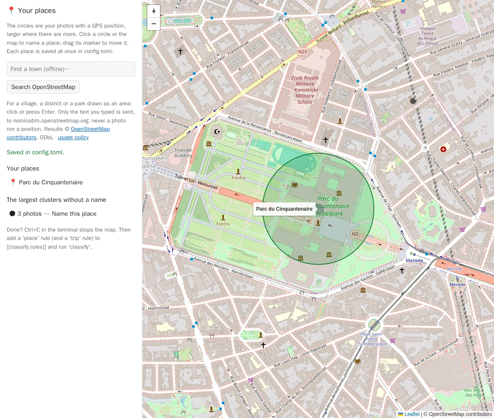

# `places`: name your places on a map

[Documentation](../README.md) › [Commands](../reference-commands.md) › `places` · 🇫🇷 [Français](../../fr/commands/places.md)

## In short

**Name the places that matter to you on a map (home, grandpa's, a village), so that `classify`
sorts your photos by place and by trip.**

Recent phones write **where** each photo was taken. `places` shows those positions on a map in
your browser, grouped in circles, and saves the places you name into `config.toml`, where the
`place` and `trip` rules of [`classify`](classify.md) use them.

**When**: before [`classify`](classify.md), once an audit run with the [cache](../reference-glossary.md#cache) has read the
positions; again whenever a new place matters.

**Try it**:

```powershell
docker run --rm -it `
  -p 127.0.0.1:8088:8088 `
  -v "C:\Photos:/data/c/Photos:ro" `
  -v media-hygiene-cache:/cache `
  -v "$HOME\media-hygiene\config:/config" `
  cavo789/media-hygiene places
```

## At a glance

| | |
|---|---|
| Your photos | 🔒 Never changed: the positions come from the cache. The photo folders, read-only (`:ro`), show the photos of a cluster; without them, the map works but shows no photo. |
| Needs | `/cache` (the positions the audits recorded, and the previews), `/config` (where the places are saved), your photo folders read-only, and `-p 127.0.0.1:8088:8088`. |
| Writes | `[[classify.places]]` entries in `config.toml`, keeping your comments and the rest of the file; also the folders' positions (`[[places.folders]]`), the names that are no town (`folder_town_ignore`), the clusters set aside (`[[places.ignored]]`) and the photos given a place by hand (`[[classify.place_photos]]`). Each change is read back from the file before the page shows it. |
| Undo | Delete a place on the map, or its lines in `config.toml`; **Restore** what you set aside; ✕ a photo given by hand in its place's editor. |
| With `mh` | `mh places`: your photo folders are mounted read-only and the port is published for you. |

## Run it

```powershell
docker run --rm -it -p 127.0.0.1:8088:8088 `
  -v "C:\Photos:/data/c/Photos:ro" `
  -v media-hygiene-cache:/cache `
  -v "$HOME\media-hygiene\config:/config" `
  cavo789/media-hygiene places
```

Ctrl+click the address it prints, `http://127.0.0.1:8088/`. Ctrl+C, or closing its tab, stops the map.



## On the map

- **The circles** are your photos with a GPS position, grouped by about 200 metres. The list on
  the left gives the largest clusters without a name first: home is usually the first one.
- **Click the number of photos** (for instance "🖼 11 photos", or "🎞 1 video" for a cluster of
  videos) on a line of that list: a **drawer** opens over the right side of the map, always at the
  same place, with the photos of the cluster (24 at most, and its videos by name) to recognise the
  place before naming it. **Name this place** sits at its top, above the photos. The photos are
  grouped by folder, under the folder's path (`C:\Photos\2014\Geer`, its own name in bold): a
  folder name often says the place or the event. Hover a photo to see where it was taken; click
  it to see it larger, with its full path (← and → for the others, Esc back to the grid). The
  line you clicked stays highlighted; click it again, ✕ or Esc to close the drawer.
- **Fold a list** by clicking its title: *Your places (10)* folds by itself from 8 places on,
  so that the clusters stay in reach; your browser remembers your choice. *Your places* is sorted
  by name, case and accents ignored, home (🏠) first; the file keeps its own order.
- **Folders named after a town, or placed** lists the folders whose name is a town's (`Douarnenez`,
  `Saint-Jean de Luz`) and that hold photos without GPS: *📁 Douarnenez — 37 photos without GPS*.
  Click one: the map goes to the town, a green pin marks its centre and the same drawer shows its
  photos, grouped by folder, with **Save this position**, **Forget its position** and **Not a
  town** at its top. Drag the pin where they were taken (the beach, not the town hall) and click
  **Save this position**: it goes into `config.toml` as `[[places.folders]]`, read back and shown with 📌.
  [`xmp`](xmp.md#a-position-from-the-folders-town) then writes that position into the photos'
  sidecars. **Forget its position** takes it out; **Not a town** adds the folder's name to
  `[classify] folder_town_ignore` (a folder `Martin` is a first name, not Martin in Slovakia).
  A saved folder renamed or moved since shows ⚠ *not found*: rename it back, or forget it.

  The list has two sub-lists, each with its count: **To place** (📁, open) and **Placed** (📌,
  folded; the folders not found, ⚠, at its top). Each is sorted by the name shown, case and
  accents ignored (*Écluse* among the E); saving a position moves the line from one to the other
  and flashes it, **Forget its position** moves it back. The folders set aside as *not a town*
  are in neither. **Type a name** in the box on top of the list to filter both sub-lists as you
  type (the name shown and the folder's path; the counts read *3 / 41*); Esc empties the box.
- **Any folder**, folded under the town folders, lists every folder of the index as
  [`browse`](browse.md) shows them (read from `/cache`, the disk is not walked): your mounted
  folders open, the others closed (▸ opens one). Each line counts the photos and videos without
  GPS of the folder and of its subfolders: *📁 Mariage Julie — 42 photos without GPS*; a folder
  whose photos all have GPS is greyed. Click one named after no town (a wedding, a holiday): the
  same drawer shows its photos without GPS and a green pin in the middle of the map; **click the
  map** or drag the pin where they were taken, then **Save this position**. It is saved as for a
  town folder (`[[places.folders]]`, read back, 📌) and moves to **Placed**; its subfolders get
  that position too, unless they have their own. The box on top filters the folders as you type
  (name or path, listed flat). A folder renamed or moved since the last audit is refused (run
  `audit` again, then place it under its new name); once saved, renamed or moved later (by you in
  Explorer, or by [`sort`](sort.md)), it shows ⚠ *not found* in **Placed**, and `xmp` says so.
- **✕ at the end of a line** sets it aside in one click, without a question (Restore undoes
  it):
  - on a cluster (*Not a place worth a name*: two children in a car), the cluster leaves the list
    and the map, and the next one moves up. It is saved as a circle of 150 metres around its middle
    (`[[places.ignored]]`, `radius_m` to change by hand): a later audit that moves the middle by a
    few metres still matches, and every cluster in that circle goes with it. **✕ Set this cluster
    aside** in its drawer does the same;
  - on a folder named after a town (*Léo* is the cat, not a town), its name goes into
    `[classify] folder_town_ignore`, as **Not a town** does in the drawer: the name is then never
    read as a town, in any folder. A folder with a saved position (📌) has no ✕: **Forget its
    position** stays in its drawer.

  The **Set aside from the map** list, folded, at the bottom, gives both, each with **Restore**.
  [`classify`](classify.md) does not read the clusters set aside: such a cluster is just unnamed
  (the town of a `trip` rule still names it).
- **Give these photos to…**, in the drawer of a cluster, when its photos were taken at a place
  you already named but their GPS says elsewhere (a phone indoors often records a position a few
  streets away): pick the place, the nearest first with its distance (*Geer — 1.4 km*). Every
  photo of the cluster is given to it, those of the drawer you untick excepted (one really taken
  in the village). Only these photos: no larger circle (it would name the whole village) and no
  second zone (a real photo taken at that spot would be named too). They are saved in
  `[[classify.place_photos]]` by their **content** (size and SHA-256, the host path only for you
  to read): moved or renamed since (`sort`, `undo`, a folder renamed in Explorer), they are still
  found; a photo edited since (new content) falls back to its GPS. The cluster's count drops (all
  given, it leaves the list); the place's label says *+ 3 photos placed by hand*, and its editor
  lists them, each with ✕ to take it back. Renaming the place keeps them; deleting it asks, and
  takes them with it.
- **A place is not a town.** It is for a spot the towns list does not know (home, the
  grandparents', the office): [`classify`](classify.md) already names the towns from the
  GeoNames list. Type a name like a town's within 10 km (*Blankenberge*; `[places] town_hint_km` in `config.toml`) and a hint says
  so under the name; the place shows ⓘ in *Your places*. It is only a hint, the save still
  works: keep such a place for exact borders (an OpenStreetMap area) or another name.
- **Click a circle, or anywhere**, to name a place; set its radius with the slider, drag its
  marker. Tick **Home** for your home: trips are measured from it.
- **Find a town** searches the towns shipped with the image, offline.
- **Search OpenStreetMap** finds a village, a district or a park with its outline: the photo then
  belongs to it when it was taken inside.
- **Save** writes the place into `config.toml` at once; its line flashes in *Your places*. Click
  a place to move, rename or delete it.

## Options

| Option | What it does |
|---|---|
| `--port PORT` | Port of the page, 8088 by default; publish the same one. |

## What leaves your computer

No position, no photo, no list of places. The photos of a cluster are shown by the tool itself,
from your folders; their previews stay in `/cache`. The map loads **tiles** (the areas you look at) from
the server of `[places] tiles`; **Search OpenStreetMap** sends the **text you typed**, on your
click only, to `[places] nominatim_url` (empty turns that search off). `classify` never goes
online.

## Good to know

- A place name becomes a folder name: two places cannot share one, and the characters Windows
  refuses are refused.
- The places do nothing on their own: add a `place` or a `trip` rule in `[[classify.rules]]`. A
  `trip` rule needs a place with `home = true`.
- Places can also be written by hand in `config.toml`, the latitude and longitude copied from any
  map.

## Go further

- [Sorting, step 9: places and trips from the GPS](../sort/09-places-from-gps.md)
- [Sorting, step 6: the rules](../sort/06-write-down-what-you-know.md)

## The built-in help

<details>
<summary><code>places --help</code></summary>

<!-- capture: help-places.txt -->
```text
 Usage: media-hygiene places [OPTIONS]

 🔒 Read-only: never changes your photos. Name your places on a map of where
 the photos were taken; saved into config.toml for the 'place' and 'trip'
 rules.

╭─ Options ────────────────────────────────────────────────────────────────────╮
│ --port          <int range> [x>=1]  Port of the page. docker run publishes   │
│                                     it under the same number on your         │
│                                     computer: -p 127.0.0.1:9000:9000 for     │
│                                     --port 9000. Default:  port in           │
│                                     config.toml, 8088.                       │
│ --help  -h                          Show this message and exit.              │
╰──────────────────────────────────────────────────────────────────────────────╯
```

</details>

---

← [All commands](../reference-commands.md) · [Documentation](../README.md)
