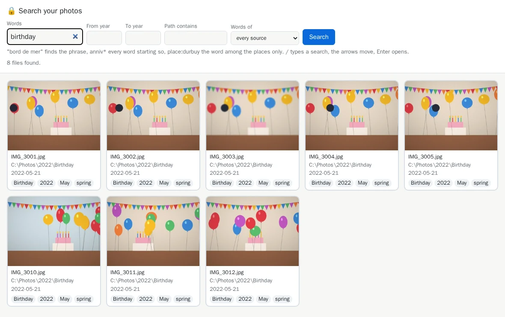

# Find in short: the whole path

[Documentation](../README.md) › Find in short · 🇫🇷 [Français](../../fr/find/quick-guide.md)

Find a photo by what you remember of it: a person, a place, a year, a word ("Chloé in the
mountains"), in your browser. One command per step, to paste into **PowerShell**. **Nothing
moves**: your photos stay where they are, sorted or not.

<div class="mh-path" markdown>

**The strict minimum**: three steps. The others are optional.

- [0 · Before you start](#0-before-you-start)
- [3 · Give your photos words](#3-give-your-photos-words)
- [4 · Find a photo](#4-find-a-photo-search)

</div>

Each step says what it risks: <span class="mh-badge mh-safe">🔒 Photos untouched</span>
<span class="mh-badge mh-undo">↩️ Can be undone</span>. <span class="mh-badge mh-ai">🤖 Local
AI</span> marks the only part that needs a vision model on your computer: without one, everything
else works.

## 0. Before you start

<span class="mh-badge mh-once">⏱ Once</span>

`search` finds what the audit has read. Write `mh` once ([clean in short, step
0](../clean/quick-guide.md#0-once-write-the-mh-command)), then audit your folders:

```powershell
mh audit
```

In a new terminal, load `mh` again: `. "$HOME\media-hygiene\mh.ps1"`. Better still, clean the
duplicates first ([clean in short](../clean/quick-guide.md)): otherwise each photo is found twice.

## 1. Name the people (optional)

<span class="mh-badge mh-optional">Optional</span> <span class="mh-badge mh-safe">🔒 Photos untouched</span>

To find someone's photos by name, name the faces once. No AI to install. Finding the faces takes
time the first time: measure first, then open the page.

```powershell
mh people --sample 200
mh people
```

Open `http://127.0.0.1:8088/`: faces that look alike are grouped, the largest groups first.
**Type a name** on a group, Enter: it is written into `config.toml`. Naming the ten largest groups
is often enough.


??? info "Details"

    The tool brings its own face models (39 MB, downloaded once). The faces stay in the cache,
    never sent; `mh people --forget` deletes them all. More: [people](../reference-people.md).

## 2. Name your places (optional)

<span class="mh-badge mh-optional">Optional</span> <span class="mh-badge mh-safe">🔒 Photos untouched</span>

Recent phones write where each photo was taken. Without anything to do, the photos already get the
name of the nearest town and its country. To find them by **your** names ("Home", "Grandpa's"),
name your places on a map:

```powershell
mh places
```

Open `http://127.0.0.1:8088/`, click a circle, name it, **Save**.


??? info "Details"

    Towns are named offline: no position leaves your computer. A whole village or park? **Search
    OpenStreetMap** takes its outline. More: [places and trips from the
    GPS](../sort/09-places-from-gps.md).

## 3. Give your photos words

<span class="mh-badge mh-safe">🔒 Photos untouched</span>

```powershell
mh tags
```

In a few seconds, each photo and video receives the words of its folders and name
(`2022/Durbuy - bears` gives `Durbuy`, `bears`), of its date (year, month, season, Christmas) and
of its place (your place, the nearest town and its country). They stay in the cache, never inside
your photos.

??? tip "🤖 With a local AI: what each photo shows"

    With [Ollama](https://ollama.com) and a vision model named in `[classify.ai]` of
    `config.toml` ([how](../sort/08-subjects-from-a-local-model.md)), the same command also adds
    what each photo **shows** ("mountain", "snow", "cake"). About 2 seconds per photo, so often a
    night or more: measure first.

    ```powershell
    mh tags --sample 20
    mh tags
    ```

    Ctrl+C stops, the next run resumes, the most recent first. Without a model, `tags` says so in
    one line and keeps to folders, names, dates and places. More: [tags](../reference-tags.md).

## 4. Find a photo: `search`

<span class="mh-badge mh-safe">🔒 Photos untouched</span>

```powershell
mh search
```

Open `http://127.0.0.1:8088/`: type what you remember, the grid shows the photos, the best first;
Enter enlarges one.



| You type | It finds |
|---|---|
| `Chloé mountain` | Chloé (step 1) on a photo where "mountain" comes from a folder or a name (`Mountain holidays`), or, 🤖 with a local AI, from what the photo shows. |
| `person:"Granny Jane"` | The name among the people only. |
| `snow 2008` | The snow of 2008: the year is a word of the date. |
| `place:durbuy` | The word among the places only. |
| `birth*`, `"seaside town"` | The start of a word, a phrase. |

??? info "Details"

    Filters beside the field: years, part of the path, one source of words. Without a browser,
    `mh search Chloé mountain` prints the first results as a table. More:
    [`search`](../commands/search.md).

## 5. Carry the words into other photo software (optional)

<span class="mh-badge mh-optional">Optional</span> <span class="mh-badge mh-undo">↩️ Can be undone</span>

You want the same words in digiKam, darktable, Lightroom or Immich? The first line shows what it
would write, the second writes an `.xmp` sidecar next to each photo (`IMG_1.jpg.xmp`):

```powershell
mh xmp
mh xmp --apply
```

??? info "Details"

    The photo itself is never modified; an `.xmp` already there is completed, never replaced. The
    names of people go in only if you add `person` to `[tags] xmp_sources`. `mh undo` removes what
    it wrote. More: [carry the words with the
    photos](../reference-tags.md#carry-the-words-with-the-photos-xmp).

## 6. Answer your own questions in Excel (optional)

<span class="mh-badge mh-optional">Optional</span> <span class="mh-badge mh-safe">🔒 Photos untouched</span>

```powershell
mh inventory
```

An `inventory.xlsx` workbook, in your reports: each photo and video with its date, camera,
position, size, quality words (*blurry*, *small*), exposure words (*dark*, *bright*) and its `tags`
words. Filter, sort, count.

??? info "Details"

    Read from the cache alone, in seconds. `--format csv` for a CSV file. More: [the inventory
    workbook](../reference-inventory.md).

## Later: new photos

`mh audit` (with `--people` to look for the faces of the new photos at the same time), then
`mh tags`: thanks to the cache, only the new photos are read. Lost? `mh status` says where you
are.

## You have seen it all

Each command of the search, and the step of this page that shows it:

| Command | Step | What it does |
|---|---|---|
| [`audit`](../commands/audit.md) | 0, Later | Reads your folders into the cache, without modifying anything. |
| [`people`](../commands/people.md) | 1 | Finds and names the faces; `--forget` deletes them. |
| [`places`](../commands/places.md) | 2 | Names your places on a map. |
| [`tags`](../commands/tags.md) | 3 | Gives words to each photo and video; 🤖 what they show, with a local AI only. |
| [`search`](../commands/search.md) | 4 | Finds a photo by a word, a place, a year, a person. |
| [`xmp`](../commands/xmp.md) | 5 | Writes the words into `.xmp` sidecars. |
| [`undo`](../commands/undo.md) | 5 | Removes the `.xmp` files written. |
| [`inventory`](../commands/inventory.md) | 6 | Each photo and video in an Excel workbook. |
| [`status`](../commands/status.md) | Later | Says where you are and the next step. |

To give your photos a tidy tree (`classify`, `sort`, `album`): **[sort in
short](../sort/quick-guide.md)**. To clean the duplicates: **[clean in
short](../clean/quick-guide.md)**. A word escapes you? [Words of this
guide](../reference-glossary.md). An error message? [Troubleshooting](../reference-troubleshooting.md).

??? note "Without `mh`: the full commands"

    For the ones that modify nothing (`audit`, `tags`, `inventory`, and `xmp` without
    `--apply`), read-only; add `-p 127.0.0.1:8088:8088` after `-it` for the ones that open a page
    (`people`, `places`, `search`):

    ```powershell
    docker run --rm -it `
      -v "C:\Photos:/data/c/Photos:ro" `
      -v media-hygiene-cache:/cache `
      -v "$HOME\media-hygiene\reports:/reports" `
      -v "$HOME\media-hygiene\config:/config" `
      cavo789/media-hygiene tags
    ```

    For `xmp --apply` and `undo`: `:ro` is gone, `/journal` and `/quarantine` are added:

    ```powershell
    docker run --rm -it `
      -v "C:\Photos:/data/c/Photos" `
      -v media-hygiene-cache:/cache `
      -v "$HOME\media-hygiene\reports:/reports" `
      -v "$HOME\media-hygiene\config:/config" `
      -v "$HOME\media-hygiene\journal:/journal" `
      -v "$HOME\media-hygiene\quarantine:/quarantine" `
      cavo789/media-hygiene xmp --apply
    ```

---

[Documentation](../README.md) · In detail: **[Tags](../reference-tags.md)**, **[People](../reference-people.md)** →
