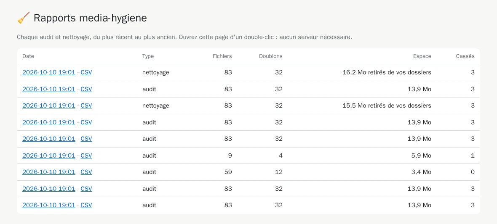
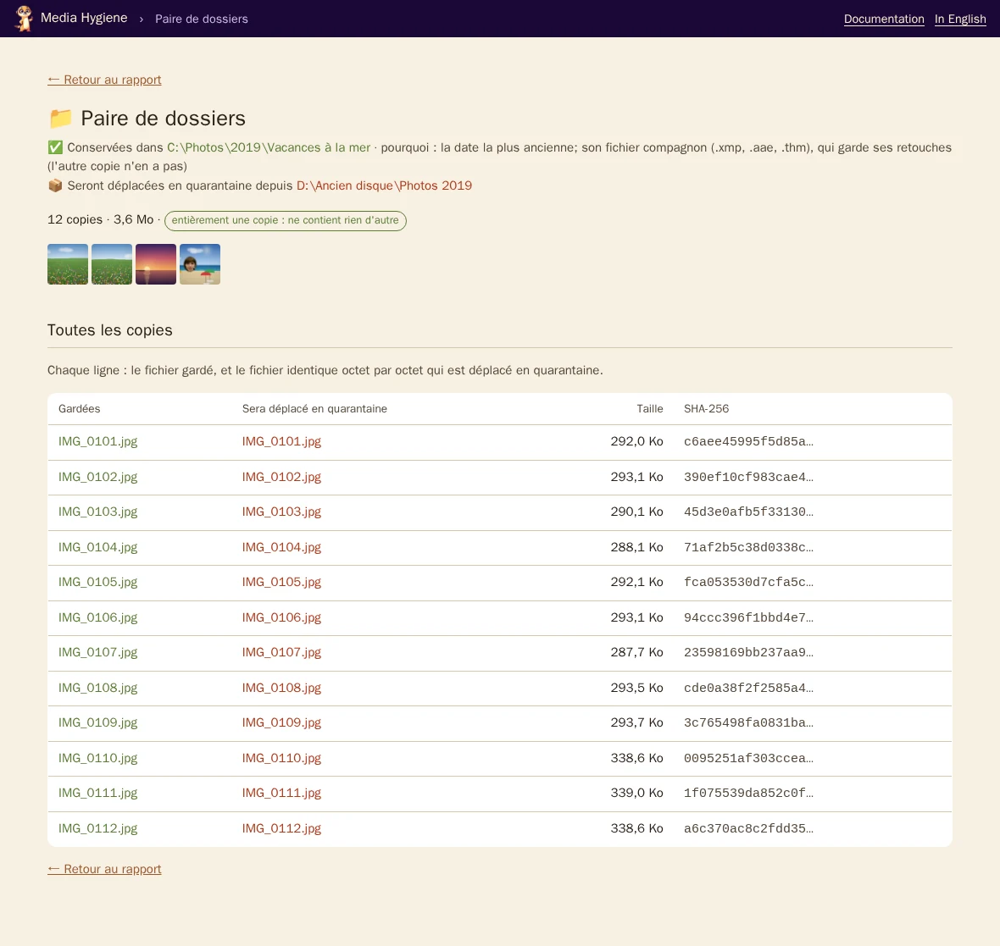
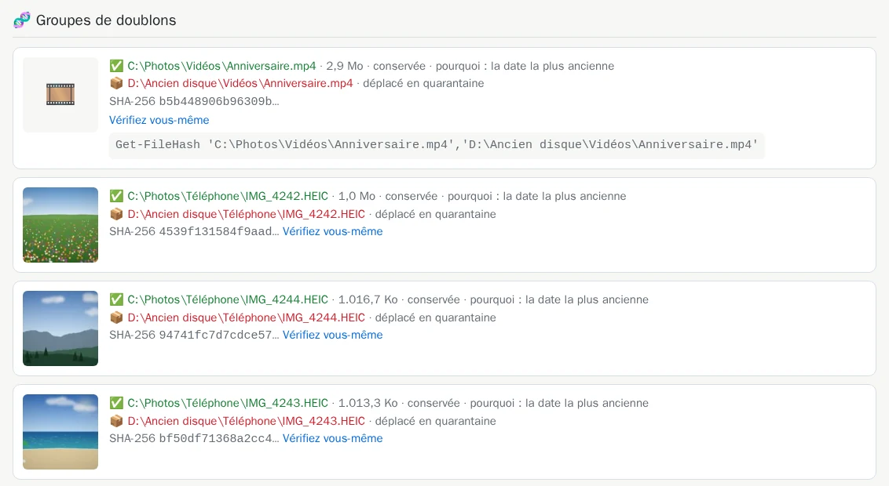
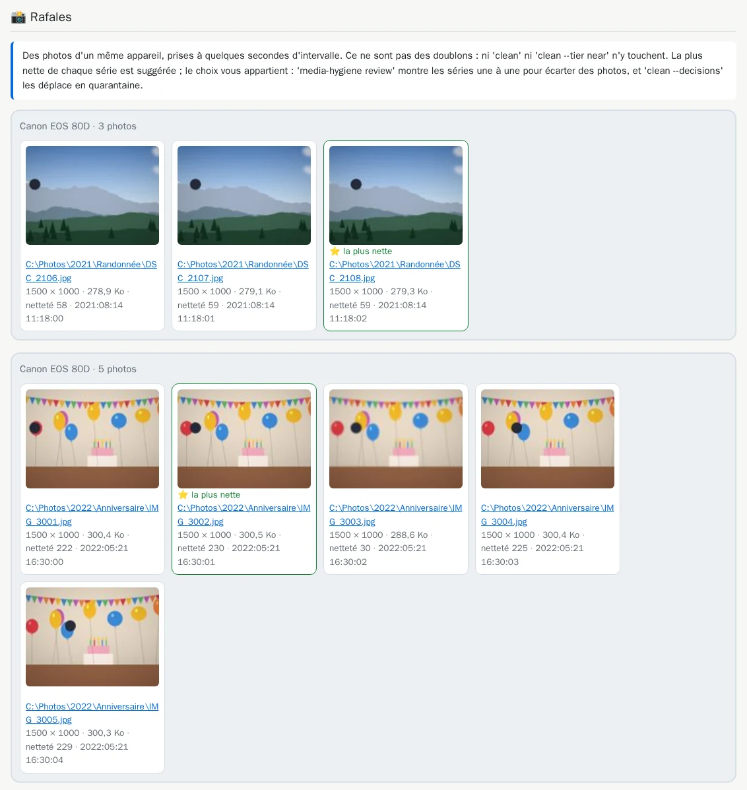
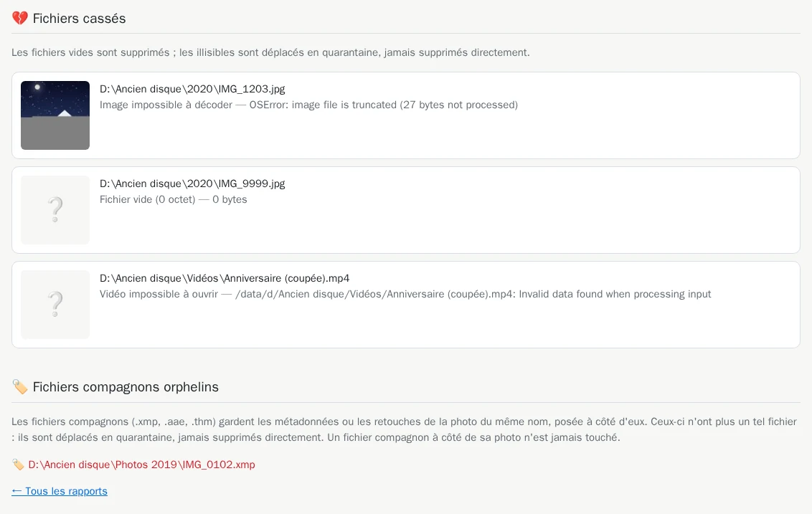

# 4. Le rapport HTML

[Documentation](../README.md) › Nettoyer, étape 4 sur 14 · 🇬🇧 [English](../../en/clean/04-html-report.md)

Le terminal donne les totaux et les paires de dossiers. Le rapport montre le reste : les images
elles-mêmes, chaque copie ligne par ligne, et la preuve qu'elles sont identiques. C'est une page
web qui s'ouvre dans votre navigateur, sans serveur ni connexion internet. Ses dates sont
affichées dans le fuseau horaire de votre ordinateur.

## Donner un dossier de rapports à l'outil

`mh` en monte déjà un, `$HOME\media-hygiene\reports`, créé la première fois ; la commande complète
le crée, puis le monte sur `/reports` :

```powershell
mh audit
```

<details>
<summary>Sans <code>mh</code> : la commande complète</summary>

```powershell
mkdir -Force "$HOME\media-hygiene\reports"
docker run --rm -it `
  -v "C:\Photos:/data/c/Photos:ro" `
  -v "D:\Ancien disque:/data/d/Ancien disque:ro" `
  -v media-hygiene-cache:/cache `
  -v "$HOME\media-hygiene\reports:/reports" `
  cavo789/media-hygiene --locale fr audit
```

</details>

`$HOME` est votre dossier personnel (`C:\Users\<vous>`) : les rapports arrivent dans
`C:\Users\<vous>\media-hygiene\reports`. Sans `mh`, créez le dossier **avant** le premier lancement : un
dossier que Docker crée lui-même appartient à l'administrateur, et l'outil ne pourrait pas y
écrire ([pourquoi](../reference-troubleshooting.md#dossiers-où-loutil-ne-peut-pas-écrire)).

À la fin de l'audit, une nouvelle ligne :

<!-- capture: audit.txt|Rapport HTML|. -->
```text
✅ Rapport HTML :
```

Avec Docker Desktop (PowerShell), l'outil connaît le dossier Windows derrière `/reports` et
affiche les chemins complets à la place ; dans Windows Terminal, Ctrl+clic les ouvre :

```text
✅ Rapport HTML : C:\Users\<vous>\media-hygiene\reports\20261003-181105-audit\report.html
```

Avec `--verbosity verbose`, une astuce 💡 nomme aussi `index.html`, qui liste tous les rapports.

## L'ouvrir

Avec `mh`, tapez `mh open` (l'audit finit par cette ligne) : votre navigateur ouvre `index.html`.
Sans lui, ouvrez `C:\Users\<vous>\media-hygiene\reports` dans l'Explorateur et double-cliquez
sur `index.html`. Il liste chaque audit et chaque nettoyage, du plus récent au plus ancien :



Cliquez sur une date pour ouvrir ce rapport. Chaque exécution a son propre dossier, nommé
d'après sa date et son type (`AAAAMMJJ-HHMMSS-audit`), qui contient `report.html`, les
vignettes et `plan.csv`, et `near.html` s'il y a des quasi-doublons. Un encadré *Sommaire* en
haut de `report.html` mène à chaque section.

## Le haut : les totaux


Les mêmes chiffres que dans le terminal, puis un rappel : un audit ne modifie rien, et chaque
copie listée est identique octet par octet à celle gardée.

## Les paires de dossiers : la vérification la plus rapide

Commencez ici. Chaque ligne est une paire de dossiers : celui qui garde ses copies (en vert),
celui qui les perd (en rouge), avec quelques images d'exemple, le nombre de fichiers et l'espace
libéré.


- **pourquoi :** la règle qui a choisi le dossier gardé ([les règles](05-choose-the-kept-copy.md)).
- Le badge **entièrement une copie : ne contient rien d'autre** signale un dossier sans rien à
  lui.
- **Votre décision** permet d'inverser une paire ou de ne pas y toucher : l'[étape 12](12-decide-pair-by-pair.md)
  l'explique. D'ici là, ignorez-la.

Cliquez sur le nombre de fichiers d'une paire pour voir chaque copie, ligne par ligne :



## Les groupes de fichiers identiques

Plus bas, un échantillon aléatoire de groupes de photos (les mêmes à chaque exécution), puis les
plus gros groupes d'abord. Chaque groupe montre la copie gardée ✅, les copies mises de côté 📦
(déplacées en quarantaine ; 🗑️ avec `--delete`), et l'empreinte SHA-256 qu'elles partagent.



**Vérifiez vous-même** donne une commande pour PowerShell. Collez-la : Windows calcule lui-même
l'empreinte de chaque copie, et elles sont toutes identiques. Vous n'avez pas à croire
media-hygiene sur parole.

## Quasi-doublons et rafales

Ces sections montrent côte à côte des images et des vidéos qui ne sont *pas* des fichiers
identiques. Il ne leur arrive rien, sauf si vous le demandez :

- **Quasi-doublons** : la même photo enregistrée à nouveau, plus petite ou recompressée
  ([étape 11](11-near-duplicates.md)).

  

- **Vidéos réencodées** : la même vidéo enregistrée à nouveau, plus petite ou recompressée,
  décrite par sa résolution, sa durée, son codec et sa taille, avec un lecteur ([étape 11](11-near-duplicates.md#les-vidéos-aussi--les-copies-réencodées)).

- **Rafales** : des photos prises à quelques secondes d'intervalle, la plus nette marquée ⭐
  ([étape 10](10-review-bursts.md)).

  

## Fichiers cassés et fichiers compagnons orphelins



Les fichiers vides seront supprimés ; les illisibles déplacés en quarantaine, jamais supprimés
directement. Les [fichiers compagnons](../reference-sidecars.md) restés sans leur photo sont aussi
déplacés en quarantaine.

## Chaque fichier dans un tableur : `plan.csv`

À côté de chaque rapport, `plan.csv` liste **chaque** fichier du plan, sans limite : groupe,
SHA-256, taille, action, chemin, dossier, date et la règle qui a choisi la copie gardée. Les
[quasi-doublons](11-near-duplicates.md) suivent, groupe par groupe, sans SHA-256 (ce ne sont pas
des fichiers identiques), la version gardée disant dans la dernière colonne si son groupe est sûr
ou à vérifier. Il s'ouvre directement dans Excel, accents compris (séparateur `;` en
français) :

<!-- capture: plan-csv.txt -->
```text
Groupe;SHA-256;Taille (octets);Action;Fichier;Dossier;Modifié (UTC);Détail;Niveau du quasi-doublon
1;b5b448906b96309b77624c6a2833c38e4f03c50b4aa7fbfd706938748e1fbf93;3009124;garder;C:\Photos\Vidéos\Anniversaire.mp4;C:\Photos\Vidéos;2022-05-21 16:35:00;la date la plus ancienne;
1;b5b448906b96309b77624c6a2833c38e4f03c50b4aa7fbfd706938748e1fbf93;3009124;déplacer en quarantaine;D:\Ancien disque\Vidéos\Anniversaire.mp4;D:\Ancien disque\Vidéos;2024-01-15 20:30:00;;
2;e0aa94df83c7edc7252a61e2d4ab4b275596554ddffdc109623b8492e3154a84;1073000;garder;C:\Photos\Téléphone\IMG_4242.HEIC;C:\Photos\Téléphone;2024-04-06 11:00:00;la date la plus ancienne;
2;e0aa94df83c7edc7252a61e2d4ab4b275596554ddffdc109623b8492e3154a84;1073000;déplacer en quarantaine;D:\Ancien disque\Téléphone\IMG_4242.HEIC;D:\Ancien disque\Téléphone;2024-08-02 20:30:00;;
3;9b999fe90fc44acf6f2c5fb9d89e830321cabb631ae2ea1ad97449e4b78324c8;1041095;garder;C:\Photos\Téléphone\IMG_4244.HEIC;C:\Photos\Téléphone;2024-04-06 12:22:00;la date la plus ancienne;
```

## Lister et ranger les rapports

`reports` liste les rapports et régénère `index.html` ; `reports --prune 10` garde les dix plus
récents et supprime les autres :

```powershell
mh reports
```

<details>
<summary>Sans <code>mh</code> : la commande complète</summary>

```powershell
docker run --rm -it -v "$HOME\media-hygiene\reports:/reports" cavo789/media-hygiene --locale fr reports
```

</details>

<!-- capture: reports.txt -->
```text
Rapports (du plus récent au plus ancien)
┏━━━━━━━━━━━━━━━━━━━━━━━┳━━━━━━━━━━━┳━━━━━━━━━━┳━━━━━━━━━━┳━━━━━━━━━┳━━━━━━━━┓
┃ Dossier               ┃ Type      ┃ Fichiers ┃ Doublons ┃ Espace  ┃ Cassés ┃
┡━━━━━━━━━━━━━━━━━━━━━━━╇━━━━━━━━━━━╇━━━━━━━━━━╇━━━━━━━━━━╇━━━━━━━━━╇━━━━━━━━┩
│ 20261025-084938-clean │ nettoyage │ 89       │ 32       │ 16,4 Mo │ 3      │
│ 20261025-084938-audit │ audit     │ 89       │ 32       │ 14,0 Mo │ 3      │
│ 20261025-084936-clean │ nettoyage │ 89       │ 32       │ 15,6 Mo │ 3      │
│ 20261025-084932-audit │ audit     │ 89       │ 32       │ 14,0 Mo │ 3      │
│ 20261025-084902-audit │ audit     │ 89       │ 32       │ 14,0 Mo │ 3      │
│ 20261025-084858-audit │ audit     │ 89       │ 32       │ 14,0 Mo │ 3      │
│ 20261025-084853-audit │ audit     │ 10       │ 4        │ 5,9 Mo  │ 1      │
│ 20261025-084852-audit │ audit     │ 65       │ 12       │ 3,4 Mo  │ 0      │
│ 20261025-084851-audit │ audit     │ 89       │ 32       │ 14,0 Mo │ 3      │
│ 20261025-084850-audit │ audit     │ 89       │ 32       │ 14,0 Mo │ 3      │
└───────────────────────┴───────────┴──────────┴──────────┴─────────┴────────┘
💡 Double-cliquez sur index.html dans le dossier monté sur /reports.
```

---

← [3. Plusieurs dossiers et disques](../start/03-several-folders.md) · [Documentation](../README.md) · Suivant : **[5. Choisir la copie gardée](05-choose-the-kept-copy.md)** →
