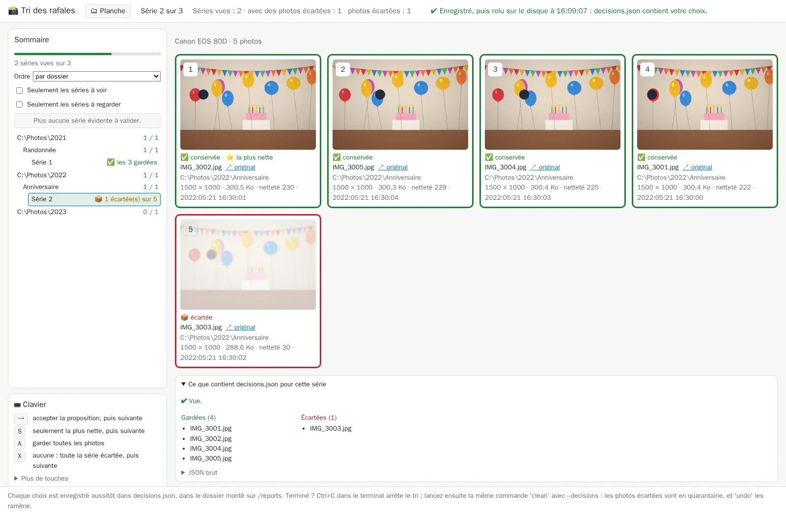

# 10. Trier les rafales dans le navigateur

[Documentation](../README.md) › Nettoyer, étape 10 sur 14 · 🇬🇧 [English](../../en/clean/10-review-bursts.md)

Les téléphones et appareils photo prennent des rafales : cinq, dix, vingt photos en quelques
secondes. La plupart se ressemblent, quelques-unes sont floues, une ou deux sont réussies. Les
trier par milliers, fichier par fichier, est fastidieux. `review` vous les montre **une série à
la fois**, en grand, dans votre navigateur, et vous choisissez au clavier.

## Qu'est-ce qu'une rafale ?

Des photos d'un même appareil, prises à quelques secondes d'intervalle, de la même scène. Ce ne
sont **pas** des doublons : chaque photo est différente, et vous seul·e savez lesquelles méritent
d'être gardées. L'outil ne décide donc jamais seul :

- l'audit liste les séries et marque la photo la plus nette ⭐, comme suggestion ;
- un simple `clean` n'y touche jamais ;
- seules les photos que **vous** écartez dans `review` sont déplacées, en quarantaine, jamais
  supprimées.

## Étape 1 : lancer le tri

`review` a besoin de vos dossiers (la lecture seule suffit : la page ne touche jamais une photo)
et du dossier des rapports, où il enregistre vos choix ; `mh` monte les deux, et ouvre le port de
la page :

```powershell
mh review
```

<details>
<summary>Sans <code>mh</code> : la commande complète</summary>

```powershell
docker run --rm -it -p 127.0.0.1:8088:8088 `
  -v "C:\Photos:/data/c/Photos:ro" `
  -v "D:\Ancien disque:/data/d/Ancien disque:ro" `
  -v media-hygiene-cache:/cache `
  -v "$HOME\media-hygiene\reports:/reports" `
  cavo789/media-hygiene --locale fr review
```

</details>

`mh` l'ajoute pour vous ; dans la commande complète, une nouveauté, sur la première ligne :

| Morceau | Ce qu'il veut dire |
|---|---|
| `-p 127.0.0.1:8088:8088` | Ouvre la page à votre navigateur. `127.0.0.1` : votre ordinateur seulement, personne d'autre sur le réseau. `8088`, deux fois : le même port sur votre ordinateur et dans le conteneur, pour que le tri connaisse son adresse et l'affiche. |

Le tri commence par un audit (rapide, grâce au cache), puis vous attend :

<!-- capture: review.txt|Tri prêt|127.0.0.1:8088:8088 -->
```text
✅ Tri prêt, ouvrez http://127.0.0.1:8088/ dans votre navigateur. Chaque
décision est enregistrée aussitôt dans decisions.json, dans le dossier monté sur
/reports. Ctrl+C arrête le tri.
💡 La page ne s'ouvre pas ? docker run doit publier le même port des deux côtés,
avec -p 127.0.0.1:8088:8088.
```

Laissez cette fenêtre ouverte : le tri tourne tant qu'elle reste ouverte.

## Étape 2 : ouvrir la page

Avec `mh review`, votre navigateur s'ouvre tout seul sur la page, dès que le tri est prêt. Avec
la commande complète, Ctrl+clic sur l'adresse affichée par le tri, `http://127.0.0.1:8088/`, ou
tapez-la dans votre navigateur.

Docker refuse de démarrer avec *port is already allocated* ? Un autre programme utilise 8088 :
choisissez un autre numéro, le même trois fois, par exemple `-p 127.0.0.1:9000:9000` et
`review --port 9000`.

## Étape 3 : lire la page

La première série s'affiche. Ici, la deuxième, un anniversaire : cinq photos prises à une
seconde d'intervalle.


- **En haut** : la série où vous êtes (*Série 2 sur 3*), combien de séries vous avez vues, et
  combien de photos vous avez écartées jusqu'ici, toutes séries confondues ; après quelques
  choix, *⏱ environ 2 h 10 restantes à votre rythme* (une longue pause compte deux minutes au
  plus).
- **Au-dessus des photos** : l'appareil et le nombre de photos, puis un bandeau en pointillés
  tant que vous n'avez pas choisi : il dit ce que passer à la suite enregistrera.
- **Chaque photo** : son numéro (la touche à presser), son état, son nom, un lien
  **↗ original**, son dossier, sa résolution, sa taille et sa **netteté**, et le moment de la
  prise de vue.
- **⭐ la plus nette** : toujours **la première photo**, encadrée en vert. Les autres suivent
  de la plus nette à la moins nette : les floues arrivent en dernier. Plus la netteté est
  haute, plus l'image est piquée ; elle ne mesure que le flou, pas un œil fermé : le choix
  reste le vôtre. Quand `people` a regardé **toutes** les photos d'une série et que la moitié au
  moins ont un visage, la ⭐ va à la photo dont les visages sont les plus nets (le moins net de
  ses visages principaux, ceux d'au moins la moitié de son plus grand), puis à l'image entière ;
  une photo sans visage passe après les autres, et une proposition dit *visages moins nets, à
  30 % du meilleur*. Sinon, comme ci-dessus. Les visages viennent de l'index : `review` ne lance
  jamais `people`.
- **📦 proposée à l'écart**, en pointillés rouges, avec la raison sous l'image :
  - *netteté à 13 % de la meilleure* : nettement moins nette que la plus nette de sa série
    (sous 35 % de celle-ci). Ici, la dernière, à 30 contre environ 225 pour les autres ;
  - *presque identique à la photo 2, qui est plus nette* : la même image encore, la photo 2
    est gardée ;
  - *surexposée* ou *sous-exposée à côté des autres* : bien plus claire ou plus sombre que le
    reste de la série, ou bien plus brûlée en blanc ou bouchée en noir.

  Les autres photos sont ⏳ *gardées si vous passez*. Les seuils sont dans
  [Bon à savoir](#bon-à-savoir) ; la raison ne s'affiche que sur la page, `decisions.json` ne
  contient que des noms.
- **↗ original** ouvre le fichier lui-même dans un nouvel onglet, intact, en pleine taille : ce
  que vous voyez est ce qui est sur votre disque, pas un rendu de la page.
- **À gauche, le sommaire** : toutes les séries, dossier par dossier, avec leur état dans
  `decisions.json` : ⏳ *à voir*, ✅ *les 3 gardées* (vert), 📦 *1 écartée sur 3* (orange),
  🗑 *série entière écartée* (rouge). Une barre montre combien de séries vous avez vues ; un
  clic sur une série l'ouvre, *Seulement les séries à voir* masque les autres, et *Seulement
  les séries à regarder* masque les [évidentes](#toutes-les-séries-évidentes-en-un-clic).
- **En dessous, le clavier** : les quatre touches qui font l'essentiel du travail (`→`, `S`,
  `A`, `X`), toujours en vue ; *Plus de touches* déplie les autres.
- **Sous les photos** : *Ce que contient decisions.json pour cette série*, les noms gardés et
  écartés (et, replié, le JSON brut).

## Étape 4 : accepter la proposition, ou la corriger

**Passer à la suite accepte ce qui est affiché.** `→`, `←` ou `N` sans choix enregistre la
série telle qu'elle est à l'écran : les photos proposées à l'écart sont écartées, les autres
gardées ; sans proposition, toutes les photos sont gardées. Avec des milliers de séries, vous
ne pressez une touche que là où la proposition est fausse. Un clic dans le sommaire ouvre
seulement une série : il n'enregistre rien. À votre première visite, une ligne bleue vous le
rappelle : *La proposition est déjà faite : → suffit quand elle vous convient* (le navigateur
s'en souvient, et elle disparaît à votre premier choix).

Pour corriger, pressez le numéro d'une photo : sur une photo proposée, `5` la reprend
(gardée) ; sur une autre, il l'écarte. Un clic sur une photo fait comme son numéro. À chaque
fois, la photo écartée pâlit et prend un cadre rouge plein, le compteur du haut augmente, et
*✔ Enregistré, puis relu sur le disque à 14:32:05* confirme que votre choix est déjà écrit :



Ce message est une **preuve**, pas une promesse : après chaque choix, le tri relit
`decisions.json` sur le disque, et le sommaire comme le cadre sous les photos montrent ce qu'il
y a trouvé. Si le fichier ne contient pas votre choix, un message rouge le dit.

## Étape 5 : aller plus vite

| Touche | Action |
|---|---|
| `→` ou espace | Série suivante (sans choix : comme affiché) |
| `←` | Série précédente (sans choix : comme affiché) |
| `N` | Série suivante à voir |
| `V` | Valider d'un coup toutes les séries évidentes (voir plus bas) |
| `1` … `9` | Écarter cette photo, ou la reprendre |
| `S` | Ne garder que la plus nette, puis passer à la série suivante |
| `A` | Garder toutes les photos de la série |
| `X` | Écarter toute la rafale, puis passer à la série suivante (`X` à nouveau les garde toutes) |
| `Z` ou ← Retour arrière | Annuler le dernier choix, et revenir à sa série |
| `C` | Comparer les photos à 100 % (`C` ou `Échap` ferme) |
| `P` | Planche ⇄ une série à la fois |

Sur un clavier AZERTY, les chiffres de la rangée du haut fonctionnent **sans** Maj.

### Toutes les séries évidentes en un clic

Une série est **évidente** quand sa proposition ne laisse rien à juger : toutes les photos sont
proposées à l'écart sauf la plus nette (et celles des dossiers protégés). Les autres sont **à
regarder** : au moins une photo diffère vraiment (une autre pose, un autre cadrage) et le
choix vous revient. Au démarrage, le tri les compte :

```text
4 000 séries à voir : 3 100 évidentes (un clic), 900 à regarder.
```

Le bouton **✔ Valider 3 100 séries évidentes (9 400 photos écartées)**, au-dessus
du sommaire, ou `V`, les enregistre toutes comme proposées, **en une seule écriture**, après
une confirmation qui donne les chiffres. La preuve est la même que pour une série : le
fichier est relu sur le disque, et le sommaire montre ce qu'il contient. Un seul `Z` annule
tout le lot. Cochez ensuite *Seulement les séries à regarder* : il ne reste que les séries qui
ont besoin de vous.

Rien ne change pour la sécurité : les photos écartées vont en quarantaine au
`clean --decisions`, `undo` les ramène, et les séries que vous n'avez pas vues restent
entières.

### D'autres façons d'aller plus vite

**La planche : huit séries par écran.** `P`, ou le bouton **🗂 Planche** à côté du titre,
montre les séries une par ligne, en petites images, la plus nette d'abord et les propositions
marquées. Vous ne corrigez que ce qui est faux : un clic sur une image l'écarte ou la reprend
(enregistré aussitôt), *✅ tout garder*, *⭐ seulement la plus nette* ou *🗑 ne rien garder*
décident d'une ligne entière. Survoler une image l'affiche en grand ; `Espace` épingle cet aperçu, qui reste affiché quand la
souris s'en va (`Espace` à nouveau le ferme). Puis `→` (ou **Page suivante →**) valide les
séries encore à voir de la page comme affichées, en une écriture, et ouvre la page suivante ;
`←` revient de la même façon, `N` ouvre la prochaine page qui contient une série à voir. Les
touches d'une série (`A`, `S`, `X`, chiffres, `C`, `Z`) agissent sur la ligne encadrée en
bleu : cliquez une ligne pour la choisir. **🖼 Une série** revient, sur la même série ; le
navigateur retient votre choix.

**Dégrossir d'abord** : la liste *Ordre* au-dessus du sommaire fixe l'ordre de `→`, `←` et
`N` : *par dossier* (l'arbre), *par date*, *plus grand écart de netteté d'abord* (les séries où
une photo est nettement plus floue viennent en tête, avec leur écart : *écart 87 %* ; celles
dont les photos se valent viennent en dernier), *espace libéré, le plus grand d'abord* (les
séries dont les photos écartées, ou proposées à l'écart, pèsent le plus) ou *à voir d'abord*. Le navigateur s'en
souvient ; l'ordre reste tel quel pendant le tri, pour qu'une série ne saute jamais ailleurs
sous vos yeux.

**Vérifier la netteté à 100 %** : les aperçus sont réduits et cachent un léger flou. `C` montre
les originaux de la série côte à côte, en taille réelle ; déplacez la souris sur l'un d'eux, la
même zone s'affiche dans tous. Les formats que votre navigateur ne sait pas afficher (RAW,
HEIC) ne sont pas comparés : ouvrez leur original.

**Tout un dossier d'un coup** : survolez un dossier du sommaire, puis **✔ valider**. Ses séries
encore à voir sont enregistrées comme si vous passiez à la suite (les propositions acceptées,
les autres photos gardées), après une confirmation qui dit combien de séries et de photos.
Pratique pour les dossiers dont les rafales ne vous intéressent pas ; `Z` l'annule d'un coup.

`X` écarte toutes les photos de la série : elles pâlissent, et un bandeau rouge rappelle que
toute la rafale part en quarantaine. Écarter les photos une à une s'arrête à la dernière, pour
qu'une série entière ne parte jamais par erreur : il faut `X`.

Une photo d'un [dossier protégé](05-choose-the-kept-copy.md#protéger-un-dossier) ne peut jamais
être écartée, ni proposée : `X` écarte les autres, et la protégée reste.

## Étape 6 : arrêter, et reprendre plus tard

`decisions.json`, dans votre dossier de rapports, est écrit **dès le début du tri** : il liste
toutes les séries, ⏳ *à voir*, et chaque choix le met à jour aussitôt. Arrêtez quand vous
voulez : **Ctrl+C** dans la fenêtre du tri, ou fermez simplement l'onglet. Le `review` suivant
relit le même fichier et ouvre la **première série encore à voir** : vous pouvez trier sur
plusieurs jours, puis nettoyer.

Le tri dit où se trouve le fichier, au démarrage, sur la page et à l'arrêt :

- avec Docker Desktop, en chemin Windows :
  `C:\Users\<vous>\media-hygiene\reports\decisions.json` ;
- sinon (un volume Docker, un hôte Linux), en *decisions.json, dans le dossier monté sur
  /reports* : le dossier donné après `-v` pour `/reports`.

Pour ouvrir ce dossier depuis PowerShell :

```powershell
explorer "$HOME\media-hygiene\reports"
```

Le fichier liste, série par série, son `status` (`todo` tant que vous ne l'avez pas vue, puis
`done`), les photos gardées et les photos écartées (une série gardée entière a une liste
`discarded` vide, une série écartée avec `X` une liste `kept` vide). Les accents s'affichent mal avec `type` dans PowerShell ? Le
fichier est bon : voir le [dépannage](../reference-troubleshooting.md#les-accents-saffichent-mal-avec-type-dans-powershell).
Celui de cet exemple :

<!-- capture: decisions.json -->
```json
{
  "version": 1,
  "report": "",
  "roots": [
    "C:\\Photos",
    "D:\\Ancien disque"
  ],
  "pairs": [],
  "bursts": [
    {
      "status": "done",
      "kept": [
        "C:\\Photos\\2021\\Randonnée\\DSC_2106.jpg",
        "C:\\Photos\\2021\\Randonnée\\DSC_2107.jpg",
        "C:\\Photos\\2021\\Randonnée\\DSC_2108.jpg"
      ],
      "discarded": []
    },
    {
      "status": "done",
      "kept": [
        "C:\\Photos\\2022\\Anniversaire\\IMG_3001.jpg",
        "C:\\Photos\\2022\\Anniversaire\\IMG_3002.jpg",
        "C:\\Photos\\2022\\Anniversaire\\IMG_3004.jpg",
        "C:\\Photos\\2022\\Anniversaire\\IMG_3005.jpg"
      ],
      "discarded": [
        "C:\\Photos\\2022\\Anniversaire\\IMG_3003.jpg"
      ]
    },
    {
      "status": "done",
      "kept": [
        "C:\\Photos\\2023\\Lac\\IMG_4001.jpg",
        "C:\\Photos\\2023\\Lac\\IMG_4003.jpg",
        "C:\\Photos\\2023\\Lac\\IMG_4004.jpg"
      ],
      "discarded": [
        "C:\\Photos\\2023\\Lac\\IMG_4002.jpg"
      ]
    }
  ],
  "near": [],
  "chosen": [],
  "unwanted": [],
  "gone": []
}
```

## Étape 7 : appliquer vos choix

**Ouverte depuis l'[accueil](../commands/home.md)** (`mh` seul, puis l'étape *Choisir les
meilleures photos de chaque rafale*) : dès qu'une photo est écartée, un bouton **Appliquer maintenant** apparaît dans la
barre du haut de la page, à côté des comptes. Il ferme la page et `mh` lance l'étape de l'accueil
qui applique vos choix, avec sa question habituelle, dans la fenêtre où `mh` tourne (PowerShell
sous Windows) ; puis l'accueil revient. Ouverte par `mh review` seul, pas de bouton : tapez la
commande ci-dessous.

La page elle-même ne déplace jamais rien. Une fois le tri fini, lancez votre commande `clean` de
l'[étape 8](08-clean.md) avec `--decisions` (seul, il lit `decisions.json`). Inutile d'avoir
tout trié : seules les séries vues déplacent quelque chose, celles encore à voir restent telles
quelles :

```powershell
mh clean --decisions
```

<details>
<summary>Sans <code>mh</code> : la commande complète</summary>

```powershell
docker run --rm -it `
  -v "C:\Photos:/data/c/Photos" `
  -v "D:\Ancien disque:/data/d/Ancien disque" `
  -v media-hygiene-cache:/cache `
  -v "$HOME\media-hygiene\reports:/reports" `
  -v "$HOME\media-hygiene\config:/config" `
  -v "$HOME\media-hygiene\journal:/journal" `
  -v "$HOME\media-hygiene\quarantine:/quarantine" `
  cavo789/media-hygiene --locale fr clean --decisions
```

</details>

Avant sa question, `clean` annonce les photos qu'il va déplacer :

<!-- capture: clean-near.txt|photos de rafale|. -->
```text
2 photos de rafale que vous avez écartées seront déplacées en quarantaine.
```

Les photos écartées sont **déplacées en quarantaine**, pas supprimées : ce ne sont pas des
copies, rien ne pourrait les reconstruire. `undo` les remet en place ; `purge` les supprime pour
de bon ([étape 9](09-undo-history-purge.md)).

Une fois le nettoyage fait, `decisions.json` a servi : il est **archivé**, jamais supprimé,
renommé `decisions.applied-<run>.json` à côté de lui-même (`<run>` est le numéro du nettoyage,
celui que prend `undo`). Le `review` suivant repart d'un fichier neuf. Vous avez changé d'avis
et lancé `undo` ? L'archive applique à nouveau les mêmes choix :
`clean --decisions decisions.applied-<run>.json`.

## Bon à savoir

- **Mêmes options pour `review` et `clean`** : donnez aux deux les mêmes `--prefer`, `--protect`
  et `--exclude` (ou gardez-les dans `config.toml`). Si une série a changé entre le tri et le
  nettoyage (un fichier ajouté, déplacé ou modifié), `clean` refuse le fichier plutôt que de
  deviner : refaites le tri.
- **Les propositions** viennent de `[review]` dans `config.toml`. Dans une rafale, toutes les
  photos montrent la même scène : les comparer a du sens ; `0` désactive chaque règle :
  - `propose_aside_below` (par défaut `0.35`) : une photo sous cette part de la netteté de la
    plus nette. Une photo à 616 à côté d'une à 1017 n'est pas proposée : c'est peut-être une
    autre pose ;
  - `identical_below` (par défaut `6`, sur 64) : une photo dont l'empreinte perceptuelle
    diffère de moins de bits que cela d'une photo plus nette gardée : deux fois la même image ;
  - `brightness_gap` (par défaut `60` niveaux de gris, sur 255) et `clipped_gap` (par défaut
    `0.25`) : une photo dont la luminosité moyenne s'écarte autant de celle des autres (et
    s'éloigne plus qu'elles d'un gris moyen : de deux photos, la bien exposée reste), ou dont
    la part de pixels brûlés en blanc ou bouchés en noir dépasse autant la leur.

  La plus nette n'est jamais proposée : au moins une photo reste toujours.
- **Les séries encore à voir** (`todo`) ne déplacent rien : `clean` dit seulement combien il en
  reste, et ne refuse jamais le fichier à cause d'elles.
- **Avant de déplacer une photo**, `clean` vérifie que c'est bien le fichier montré par le tri, et
  que les photos que vous avez gardées, s'il y en a, sont toujours là.
- **`review --decisions autre.json`** enregistre les choix dans un autre fichier du dossier des
  rapports.
- **`review --port 9000`** change le port ; publiez le même : `-p 127.0.0.1:9000:9000`.
- **Le même `decisions.json`** peut aussi contenir vos [décisions sur les paires de dossiers](12-decide-pair-by-pair.md) :
  `review` les conserve.

---

← [9. Annuler, historique, purge](09-undo-history-purge.md) · [Documentation](../README.md) · Suivant : **[11. Les quasi-doublons](11-near-duplicates.md)** →
