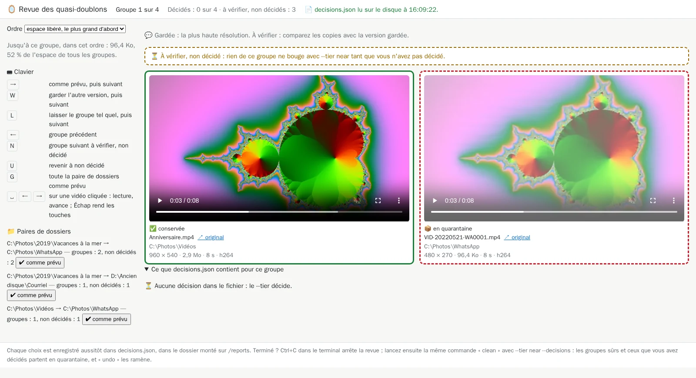

# 11. Les quasi-doublons

[Documentation](../README.md) › Nettoyer, étape 11 sur 13 · 🇬🇧 [English](../../en/clean/11-near-duplicates.md)

Certaines copies ne sont pas des fichiers identiques, et pourtant c'est la même image : la photo
envoyée par WhatsApp (plus petite), celle « réduite pour l'e-mail », une copie réenregistrée avec
une autre qualité, redressée, ou sans sa date. L'audit les trouve aussi, comme
**quasi-doublons**, et n'y touche pas, sauf si vous le demandez.

## Comment l'outil les reconnaît

Pendant qu'il vérifie que chaque photo est lisible, l'audit décrit aussi à quoi elle ressemble
(empreintes perceptuelles, netteté, date et appareil EXIF) et le garde dans le cache. Deux photos
ne sont des quasi-doublons que si **tous** les tests sont d'accord :

- des empreintes perceptuelles presque identiques ;
- la même forme (proportions) ;
- la même date de prise de vue, ou aucune date sur la plus petite copie ;
- les mêmes couleurs : les empreintes sont calculées en gris, alors les photos qu'elles trouvent
  semblables sont mesurées en couleur ; une version noir et blanc d'une photo en couleur est un
  choix, pas une copie.

Les images vides ou noires ne comptent jamais, et une photo d'une [rafale](10-review-bursts.md)
n'est jamais prise pour un quasi-doublon.

## Les vidéos aussi : les copies réencodées

Une vidéo partagée par une messagerie, convertie ou recompressée n'est pas non plus identique à
l'originale. Le premier audit décode quelques images de chaque vidéo (à 10, 30, 50, 70 et 90 %
de sa durée) et en calcule les empreintes comme pour les photos ; cela prend de quelques
dixièmes de seconde à quelques secondes par vidéo, et le cache garde le résultat : les audits
suivants ne décodent que les vidéos nouvelles ou modifiées. Deux vidéos ne sont des
quasi-doublons que si **tous** les tests sont d'accord :

- la même durée (à une demi-seconde près, ou 1 % d'une longue vidéo) ;
- la même forme (proportions) ;
- les images aux mêmes instants se ressemblent (une image peut différer, pour une coupe) ;
- la même date d'enregistrement, ou aucune date sur la copie ;
- les mêmes couleurs, comme pour les photos (une version noir et blanc n'est pas une copie).

Le rapport les liste dans leur propre section, *Vidéos réencodées*, avec la résolution, la
durée, le codec et la taille de chaque copie, et un lecteur : cliquez sur ▶ pour regarder
chacune dans le navigateur, ou sur le chemin pour l'ouvrir dans votre lecteur habituel. Le
résumé de l'audit les compte sur la ligne *Vidéos réencodées (déplacées seulement avec --tier near)*.
`clean --tier near` déplace les sûres en quarantaine avec les photos
([plus bas](#les-groupes-sûrs-et-ceux-à-vérifier)). Une vidéo que l'image ne sait pas décoder
(AV1, rare) n'est simplement pas comparée.

## Quelle version est gardée, et pourquoi

Pour les photos comme pour les vidéos :

1. la **plus haute résolution** ;
2. à résolution égale, un fichier **plus gros d'au moins 1 %** : c'est le moins compressé ;
3. des tailles plus proches ne disent rien de la qualité (deux exports d'un même clip, une copie
   dont seules les métadonnées ont changé) : les [règles habituelles](05-choose-the-kept-copy.md)
   choisissent, comme pour les fichiers identiques : un dossier protégé ou préféré, un nom ou un
   dossier choisi par quelqu'un, la date la plus ancienne… Un dossier ou un nom choisi par
   quelqu'un l'emporte sur `Novembre 2015\162.mp4`.

Chaque groupe du rapport commence par une ligne 💬 qui dit lequel a décidé, avec l'écart de
taille quand il est petit ; `plan.csv` le dit aussi. Une copie vidéo dont seules les métadonnées
ont été réécrites (une note posée dans Windows, une étiquette) est marquée 🟰 : exactement la
même image et le même son que la vidéo gardée, vérifiés par un SHA-256 des deux. Ces copies ne
sont pas pour autant des fichiers identiques : elles vont en quarantaine avec `--tier near`,
jamais supprimées.

## Les groupes sûrs, et ceux à vérifier

Sur une vraie collection, l'audit peut trouver des centaines de groupes. La plupart ne laissent
aucun doute ; quelques-uns méritent un coup d'œil. Chaque groupe reçoit donc un niveau :

- **sûr**, quand chaque copie qu'il déplace l'est, pour l'une de ces raisons :
  - 🟰 une vidéo avec exactement la même image et le même son que la gardée (seules ses
    métadonnées diffèrent) ;
  - les mêmes empreintes perceptuelles (distance 0) et le même appareil que la photo gardée ;
  - une copie plus petite dans un dossier de messagerie ou d'e-mail (`WhatsApp Images`,
    `Telegram`, `Signal`, `Email`, `Attachments`, `Pièces jointes`…), prise au même instant
    (même date EXIF) ; WhatsApp efface l'EXIF des photos qu'il envoie : une copie sans date
    EXIF compte alors si son nom est daté du même jour que la photo gardée
    (`IMG-20190712-WA0003.jpg`, `VID-20190712-WA0001.mp4`, les mêmes noms que lit `classify`) ;
- **à vérifier** : tous les autres groupes.

La ligne 💬 de chaque groupe le dit (*Sûr : empreintes identiques, du même appareil.* ou
*À vérifier : comparez les copies avec la version gardée.*), tout comme la colonne
*Niveau du quasi-doublon* de `plan.csv`. L'audit le résume dans son bloc *Ce que vous pouvez
faire* :

```text
👀 500 groupes de quasi-doublons : 480 sûrs, 20 à regarder (~10 min dans « review
--near ») ; « clean --tier near » déplace les sûrs.
```

L'effort ne compte que les groupes à regarder. `--tier near` déplace les groupes sûrs et ceux
que vous avez décidés ([plus bas](#décider-dans-le-navigateur--review---near)) ;
`--tier near-all` déplace tous les groupes, comme avant.

## Les regarder d'abord

La section *Quasi-doublons* du [rapport HTML](04-html-report.md) montre chaque groupe côte à côte,
avec la résolution, la taille et la netteté de chaque copie :


Comparez chaque copie avec celle gardée : cliquez sur une miniature ou son chemin pour ouvrir
l'original dans un nouvel onglet. Le résumé de l'audit les compte sur la ligne
*Quasi-doublons (déplacés seulement avec --tier near)*. La section liste **tous** les groupes,
quel que soit leur nombre, dans l'ordre qui rapporte le plus vite :

- les groupes **à vérifier** d'abord, puis les groupes **sûrs**, repliés (*✔️ 480 groupes
  sûrs : les afficher*) : rien à y regarder, sauf si vous le voulez ;
- dans chaque liste, l'**espace libéré, le plus grand d'abord** : quelques vidéos réencodées
  pèsent souvent plus que des centaines de photos réduites ;
- sous chaque groupe, une ligne 💾 donne l'espace que libèrent ses copies et le total cumulé :
  *1,2 Go libérés ; avec les groupes au-dessus : 90 % de l'espace*. Pressé ? Arrêtez-vous quand
  la part suffit.

`plan.csv` nomme aussi chaque fichier ([étape 4](04-html-report.md#chaque-fichier-dans-un-tableur--plancsv)) :
action *déplacer avec --tier near* pour un groupe sûr, *déplacer avec --tier near-all* pour un
groupe à vérifier, et le niveau dans la colonne *Niveau du quasi-doublon*.

## Décider dans le navigateur : `review --near`

Les groupes à vérifier se décident mieux un à un, au clavier, sur le même genre de page que les
[rafales](10-review-bursts.md). Ajoutez `--near` à la commande `review` de l'étape 10 :

```powershell
mh review --near
```

<details>
<summary>Sans <code>mh</code> : la commande complète</summary>

```powershell
docker run --rm -it -p 127.0.0.1:8088:8088 `
  -v "C:\Photos:/data/c/Photos:ro" `
  -v "D:\Ancien disque:/data/d/Ancien disque:ro" `
  -v media-hygiene-cache:/cache `
  -v "$HOME\media-hygiene\reports:/reports" `
  cavo789/media-hygiene --locale fr review --near
```

</details>

Elle dit ce qu'il y a à décider, puis vous attend, comme `review` :

<!-- capture: review-near.txt|quasi-doublons :|127.0.0.1:8088:8088 -->
```text
4 groupes de quasi-doublons : 1 sûr, 3 à vérifier (montrés d'abord).
✅ Tri prêt, ouvrez http://127.0.0.1:8088/ dans votre navigateur. Chaque
décision est enregistrée aussitôt dans decisions.json, dans le dossier monté sur
/reports. Ctrl+C arrête le tri.
💡 La page ne s'ouvre pas ? docker run doit publier le même port des deux côtés,
avec -p 127.0.0.1:8088:8088.
```

La page montre un groupe à la fois, la version gardée encadrée en vert, les copies en pointillés
rouges, avec la ligne 💬 :


Les touches :

| Touche | Ce qu'elle fait |
|---|---|
| `→` | comme prévu : les copies partent en quarantaine, puis le groupe suivant |
| `W` | garder l'autre version : la première copie reste, la version que l'audit gardait part (refusé quand elle est dans un dossier protégé) |
| `L` | laisser le groupe tel quel : rien n'en bouge |
| `←` / `N` | groupe précédent / groupe suivant à vérifier encore non décidé |
| `U` | revenir à non décidé : le `--tier` décide à nouveau |
| `G` | toute la paire de dossiers comme prévu |

Un groupe de vidéos réencodées montre les deux versions côte à côte, prêtes à être lues : sans
le son, rien n'est chargé au-delà de leur durée avant que vous lanciez la lecture, et vous
pouvez avancer dans chacune. Une fois une vidéo cliquée, la barre d'espace et les flèches la
lisent et s'y déplacent ; `Échap` rend les touches à la page. Un format que votre navigateur ne
sait pas lire (AVI, FLV…) garde seulement son lien *↗ original*.



**Décider une fois par paire de dossiers** : le panneau de gauche liste les paires de dossiers
(*le dossier de la version gardée → celui des copies*) avec leur nombre de groupes. *✔ comme
prévu* (ou `G` sur un groupe de cette paire) décide chaque groupe non décidé de la paire en une
seule écriture, après confirmation : *WhatsApp Images → DCIM — groupes non décidés : 312*.
Chaque groupe peut encore être décidé autrement.

La liste *Ordre* fixe l'ordre de `→`, `←` et `N` : *à vérifier d'abord*, *espace libéré, le
plus grand d'abord* ou *par paire de dossiers* ; en dessous, le total cumulé jusqu'au groupe
affiché (*Jusqu'à ce groupe, dans cet ordre : 3,4 Go, 90 % de l'espace de tous les groupes*).

Chaque choix est enregistré aussitôt dans `decisions.json`, sous la clé `near` (à côté des
paires de dossiers de l'[étape 12](12-decide-pair-by-pair.md) et des photos de rafale de
l'étape 10), puis relu depuis le disque : le panneau sous le groupe montre ce que contient le
fichier. Les groupes non décidés n'y sont pas : le `--tier` décide pour eux. Arrêtez avec
Ctrl+C ; rouverte sur les mêmes dossiers, la revue reprend, et un groupe décidé qui a changé
depuis redevient non décidé.

## Les déplacer : `clean --tier near` ou `--tier near-all`

- `clean --tier near` déplace les groupes **sûrs** et ceux que **vous avez décidés** avec
  `--decisions` (comme prévu, ou l'autre version gardée) ; un groupe laissé tel quel ne bouge
  jamais. Les groupes à vérifier encore non décidés restent en place, et `clean` dit combien.
- `clean --tier near-all` déplace **tous** les groupes, comme le rapport les montre ; vos
  décisions s'appliquent toujours.

Avant de les appliquer, `clean` vérifie vos décisions contre l'audit qu'il vient de faire : un
groupe décidé dont les fichiers ont changé depuis la revue, ou une inversion qui déplacerait un
fichier d'un dossier protégé, fait refuser tout le fichier. Des décisions dans le fichier sans
`--tier` near attendent : un simple `clean --decisions` le dit et n'en déplace aucune.

### La commande

Ajoutez le `--tier` à votre commande `clean` de l'[étape 8](08-clean.md). Ici, c'est
`--tier near-all`, tous les groupes comme le rapport les montre, combiné avec les décisions de
rafales de l'étape 10 ; chaque option fonctionne aussi seule :

```powershell
mh clean --tier near-all --decisions
```

<details>
<summary>Sans <code>mh</code> : la commande complète</summary>

```powershell
docker run --rm -it `
  -v "C:\Photos:/data/c/Photos" `
  -v "D:\Ancien disque:/data/d/Ancien disque" `
  -v media-hygiene-cache:/cache `
  -v "$HOME\media-hygiene\reports:/reports" `
  -v "$HOME\media-hygiene\config:/config" `
  -v "$HOME\media-hygiene\journal:/journal" `
  -v "$HOME\media-hygiene\quarantine:/quarantine" `
  cavo789/media-hygiene --locale fr clean --tier near-all --decisions
```

</details>

Avant de poser la question, `clean` écrit le rapport de cet audit-là et lie, sur une ligne qui
commence par 👀, sa page `near.html` : les quasi-doublons et les vidéos réencodées seuls, sans
les rafales auxquelles `--tier near` ne touche jamais. Regardez-la avant de répondre. Rien n'est
écrit quand rien n'est demandé (`--yes`).

La question mentionne maintenant les quasi-doublons :

<!-- capture: clean-near.txt|re:^2 |❓ -->
```text
2 photos de rafale que vous avez écartées seront déplacées en quarantaine.
1 fichier compagnon orphelin (.xmp, .aae, .thm) sera déplacé en quarantaine.
❓ Déplacer 32 copies en double (14,0 Mo) et 4 quasi-doublons en quarantaine et
traiter 3 fichiers cassés ? [o/N] o
```

<!-- capture: clean-near.txt|re:^─+ Nettoyage| -->
```text
────────────────────────────────── Nettoyage ───────────────────────────────────
Nettoyage 20261014-204122
┌───────────────────────────┬─────────┐
│ Fichiers traités          │      42 │
│ Taille                    │ 16,4 Mo │
│ Déplacés en quarantaine   │      41 │
│ Ignorés (laissés intacts) │       0 │
│ En échec                  │       0 │
│ Durée                     │     0 s │
└───────────────────────────┴─────────┘
✅ Rapport HTML : /reports/20261014-204122-clean/report.html
📦 decisions.json est appliqué : archivé sous
decisions.applied-20261014-204122.json, dans le dossier monté sur /reports, le
prochain 'review' repart de zéro.
💡 Après un undo, 'media-hygiene clean --decisions
decisions.applied-20261014-204122.json' l'applique à nouveau.
💡 Vous changez d'avis ? 'media-hygiene undo 20261014-204122' restaure tout :
docker run --rm -it `
  -v "C:\Photos:/data/c/Photos" `
  -v "D:\Ancien disque:/data/d/Ancien disque" `
  -v "$HOME\media-hygiene\config:/config" `
  -v "media-hygiene-cache:/cache" `
  -v "$HOME\media-hygiene\reports:/reports" `
  -v "$HOME\media-hygiene\journal:/journal" `
  -v "$HOME\media-hygiene\quarantine:/quarantine" `
  cavo789/media-hygiene --locale fr undo 20261014-204122
👉 Et maintenant : une fois vérifié, 'purge' libère la place des fichiers mis de
côté.
docker run --rm -it `
  -v "C:\Photos:/data/c/Photos" `
  -v "D:\Ancien disque:/data/d/Ancien disque" `
  -v "$HOME\media-hygiene\config:/config" `
  -v "media-hygiene-cache:/cache" `
  -v "$HOME\media-hygiene\reports:/reports" `
  -v "$HOME\media-hygiene\journal:/journal" `
  -v "$HOME\media-hygiene\quarantine:/quarantine" `
  cavo789/media-hygiene --locale fr purge 20261014-204122
💡 Ouvrez index.html dans le dossier monté sur /reports : il liste tous les
rapports.
```

Les quasi-doublons sont **déplacés en quarantaine**, jamais supprimés : ils ne sont pas
identiques à la photo gardée, rien ne pourrait donc les reconstruire. La quarantaine contient
maintenant, sous le dossier de ce nettoyage, les quasi-doublons, les photos de rafale écartées,
les fichiers illisibles et le fichier compagnon orphelin :

<!-- capture: quarantine.txt -->
```text
./20261014-204122/c/Photos/2019/Nouveau dossier/IMG_0105 - Copie.jpg
./20261014-204122/c/Photos/2019/Nouveau dossier/IMG_0106 - Copie.jpg
./20261014-204122/c/Photos/2019/Nouveau dossier/IMG_0107 - Copie.jpg
./20261014-204122/c/Photos/2019/Vacances à la mer/IMG_0101 (1).jpg
./20261014-204122/c/Photos/2022/Anniversaire/IMG_3003.jpg
./20261014-204122/c/Photos/2023/Lac/IMG_4002.jpg
./20261014-204122/c/Photos/Ancien téléphone/IMG_0101.jpg
./20261014-204122/c/Photos/Ancien téléphone/IMG_0102.jpg
./20261014-204122/c/Photos/Ancien téléphone/IMG_0103.jpg
./20261014-204122/c/Photos/Ancien téléphone/IMG_0104.jpg
./20261014-204122/c/Photos/Ancien téléphone/IMG_0105.jpg
./20261014-204122/c/Photos/Ancien téléphone/IMG_0106.jpg
./20261014-204122/c/Photos/Ancien téléphone/IMG_0107.jpg
./20261014-204122/c/Photos/Ancien téléphone/IMG_0108.jpg
./20261014-204122/c/Photos/WhatsApp/IMG-20190712-WA0003.jpg
./20261014-204122/c/Photos/WhatsApp/IMG-20190712-WA0005.jpg
./20261014-204122/c/Photos/WhatsApp/VID-20220521-WA0001.mp4
./20261014-204122/d/Ancien disque/2020/IMG_1203.jpg
./20261014-204122/d/Ancien disque/Courriel/IMG_0110 petite.jpg
./20261014-204122/d/Ancien disque/Noël 2020/IMG_1201.jpg
./20261014-204122/d/Ancien disque/Noël 2020/IMG_1202.jpg
./20261014-204122/d/Ancien disque/Noël 2020/IMG_1203.jpg
./20261014-204122/d/Ancien disque/Noël 2020/IMG_1204.jpg
./20261014-204122/d/Ancien disque/Photos 2019/IMG_0101.jpg
./20261014-204122/d/Ancien disque/Photos 2019/IMG_0102.jpg
./20261014-204122/d/Ancien disque/Photos 2019/IMG_0102.xmp
./20261014-204122/d/Ancien disque/Photos 2019/IMG_0103.jpg
./20261014-204122/d/Ancien disque/Photos 2019/IMG_0104.jpg
./20261014-204122/d/Ancien disque/Photos 2019/IMG_0105.jpg
./20261014-204122/d/Ancien disque/Photos 2019/IMG_0106.jpg
./20261014-204122/d/Ancien disque/Photos 2019/IMG_0107.jpg
./20261014-204122/d/Ancien disque/Photos 2019/IMG_0108.jpg
./20261014-204122/d/Ancien disque/Photos 2019/IMG_0109.jpg
./20261014-204122/d/Ancien disque/Photos 2019/IMG_0110.jpg
./20261014-204122/d/Ancien disque/Photos 2019/IMG_0111.jpg
./20261014-204122/d/Ancien disque/Photos 2019/IMG_0112.jpg
./20261014-204122/d/Ancien disque/Téléphone/IMG_4242.HEIC
./20261014-204122/d/Ancien disque/Téléphone/IMG_4243.HEIC
./20261014-204122/d/Ancien disque/Téléphone/IMG_4244.HEIC
./20261014-204122/d/Ancien disque/Vidéos/Anniversaire (coupée).mp4
./20261014-204122/d/Ancien disque/Vidéos/Anniversaire.mp4
```

Avant de déplacer chaque copie, `clean` vérifie que la photo gardée existe toujours et que la
copie est bien le fichier vu par l'audit. `undo` les remet en place ; `purge` les supprime pour
de bon ([étape 9](09-undo-history-purge.md)).

---

← [10. Trier les rafales dans le navigateur](10-review-bursts.md) · [Documentation](../README.md) · Suivant : **[12. Décider paire par paire](12-decide-pair-by-pair.md)** →
