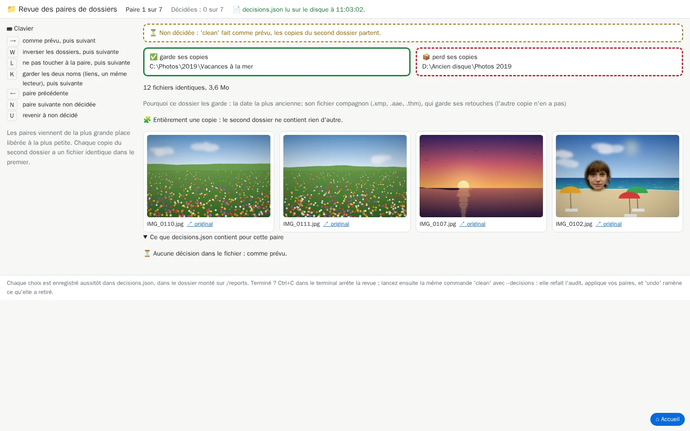
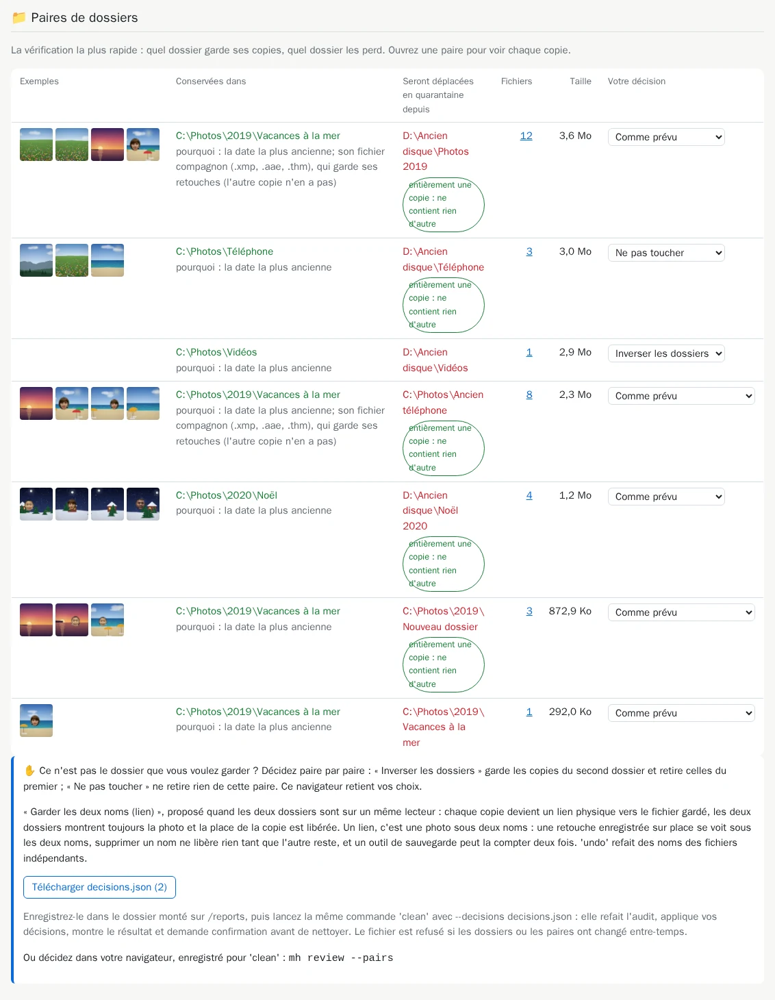

# 12. Décider paire par paire

[Documentation](../README.md) › Nettoyer, étape 12 sur 14 · 🇬🇧 [English](../../en/clean/12-decide-pair-by-pair.md)

[`--prefer`](05-choose-the-kept-copy.md) change le choix pour tout un dossier, partout. Parfois,
vous n'êtes en désaccord qu'avec une seule paire : garder l'autre côté, ne pas toucher à cette
paire, ou garder les deux dossiers entiers tout en libérant la place. Vous décidez paire par
paire, dans votre navigateur.

| Choix | Ce que `clean` fera de cette paire |
|---|---|
| Comme prévu | Garder les copies du premier dossier, mettre de côté celles du second. |
| Inverser les dossiers | Garder les copies du **second** dossier, mettre de côté celles du premier. |
| Ne pas toucher | Ne rien toucher de cette paire. |
| Garder les deux noms (lien) | Chaque copie du second dossier devient un **lien physique** vers son fichier du premier : les deux dossiers montrent toujours la photo, la place de la copie est libérée. Proposé seulement quand les deux dossiers sont sur le même lecteur. [Détails](#garder-les-deux-noms--un-lien) |

## Étape 1 : ouvrir les paires dans le navigateur

```powershell
mh review --pairs
```

(sans `mh` : la commande `docker run … -p 127.0.0.1:8088:8088 … review --pairs` de
[`review`](../commands/review.md#lancer))

Il fait d'abord l'audit, puis affiche le nombre de paires et *✅ Tri prêt, ouvrez
http://127.0.0.1:8088/ dans votre navigateur* :

<!-- capture: review-pairs.txt|paire|127.0.0.1:8088:8088 -->
```text
7 paires de dossiers, la plus grande place libérée d'abord ; déjà décidées : 0.
✅ Tri prêt, ouvrez http://127.0.0.1:8088/ dans votre navigateur. Chaque
décision est enregistrée aussitôt dans decisions.json, dans le dossier monté sur
/reports. Ctrl+C arrête le tri.
💡 La page ne s'ouvre pas ? docker run doit publier le même port des deux côtés,
avec -p 127.0.0.1:8088:8088.
```



La page montre une paire à la fois, de la plus grande place libérée à la plus petite : le dossier
qui garde ses copies encadré en vert, celui qui les perd en pointillés rouges, le nombre de
fichiers identiques, pourquoi le premier dossier les garde, *Entièrement une copie* quand le
second dossier ne contient rien d'autre, et quelques photos d'exemple (↗ ouvre l'original).

| Touche | Ce qu'elle fait |
|---|---|
| `→` | Comme prévu, puis la paire suivante |
| `W` | Inverser les dossiers, puis la paire suivante (pas proposé pour un dossier protégé, ni pour les copies d'un même dossier) |
| `L` | Ne pas toucher à la paire, puis la paire suivante |
| `K` | Garder les deux noms (liens), puis la paire suivante (seulement pour deux dossiers d'un même lecteur, le premier non protégé) |
| `←` / `N` | Paire précédente / paire suivante non décidée |
| `U` | Revenir à « non décidée » |

Chaque choix est enregistré aussitôt dans `decisions.json` (dans votre dossier de rapports), puis
relu sur le disque et affiché : *✔ Enregistré, puis relu sur le disque à 14:32:05*. Arrêtez
quand vous voulez avec Ctrl+C : le `review --pairs` suivant s'ouvre sur la première paire non
décidée.

## Étape 2 : nettoyer avec vos décisions

Lancez votre commande `clean` de l'[étape 8](08-clean.md) avec `--decisions` : seul, il lit
`decisions.json` dans le dossier des rapports (un autre fichier : `--decisions autre.json`) :

```powershell
mh clean --decisions
```

(avec la même partie `docker run … -v …` qu'à l'étape 8)

La page elle-même ne supprime jamais rien. `clean` refait l'audit, applique vos décisions, montre
les paires de dossiers qui en résultent, et demande confirmation avant de nettoyer, avec toutes
les protections : comparaison octet par octet, journal, `undo`. Une fois le nettoyage fait, le
fichier est archivé sous `decisions.applied-<run>.json`, à côté de lui-même : après un `undo`,
`--decisions` avec ce nom l'applique à nouveau.

## Hors ligne : depuis le rapport

Un rapport ouvert seul, sans que l'outil tourne, permet aussi de décider. Dans le tableau
*Paires de dossiers* d'un rapport d'**audit**, chaque paire a une liste *Votre décision*. Ici, les
vidéos ne sont pas touchées et la paire `Ancien téléphone` est inversée :



Votre navigateur retient vos choix, même si vous fermez la page. Cliquez sur **Télécharger
decisions.json** ; le nombre entre parenthèses compte vos décisions. Enregistrez le fichier dans
votre dossier de rapports (`C:\Users\<vous>\media-hygiene\reports`), à côté d'`index.html`, puis
lancez le `clean` de l'étape 2.

## Garder les deux noms : un lien

Pour deux dossiers qui ont tous deux un sens (`Best of 2019` et `2019\07`), *Garder les deux noms
(lien)* libère la place des copies sans vider aucun des deux dossiers. `clean` compare chaque copie
octet par octet avec le fichier gardé, comme avant de la mettre de côté, puis met à sa place un
**lien physique** : un second nom du fichier gardé. Le nom de la copie ne manque jamais, même si
le nettoyage est interrompu : il porte la copie, puis le lien. Chacun est écrit dans le journal.

Un lien, c'est **une photo sous deux noms** :

- une retouche enregistrée sur place (un logiciel de retouche qui écrit dans le fichier) se voit
  sous les deux noms ;
- supprimer un nom ne libère rien tant que l'autre reste ;
- un outil de sauvegarde peut compter la photo deux fois.

Pas proposé quand les deux dossiers sont sur deux lecteurs (un lien physique ne peut pas les
relier ; refusé aussi par `clean`, et dit), ni quand le premier dossier est protégé (une retouche
par l'autre nom le modifierait). L'audit suivant voit les deux noms comme un seul fichier et le dit
(*accessible par deux chemins*). `undo` refait de chaque nom un fichier indépendant : une copie de
la photo, avec sa propre date.

## Quand le fichier est refusé

Par sécurité, `clean` refuse le fichier plutôt que de deviner quand :

- d'autres dossiers sont montés que pour le rapport ;
- une paire décidée n'existe plus (des fichiers ont changé depuis le rapport) : refaites l'audit,
  décidez à nouveau ;
- une inversion mettrait de côté les copies d'un dossier protégé ;
- une paire qui garde les deux noms (liens) est sur deux lecteurs, ou son premier dossier est
  protégé.

## Un seul fichier pour tout

Le même `decisions.json` peut contenir les paires de dossiers, les photos de rafale de
l'[étape 10](10-review-bursts.md) **et** les groupes de quasi-doublons de
l'[étape 11](11-near-duplicates.md#décider-dans-le-navigateur--review---near) : `review`,
`review --near` et `review --pairs` conservent ce que le fichier contient déjà, et un seul
`clean --tier near --decisions` applique les trois.

---

← [11. Les quasi-doublons](11-near-duplicates.md) · [Documentation](../README.md) · Suivant : **[13. Un second avis](13-second-opinion.md)** →
