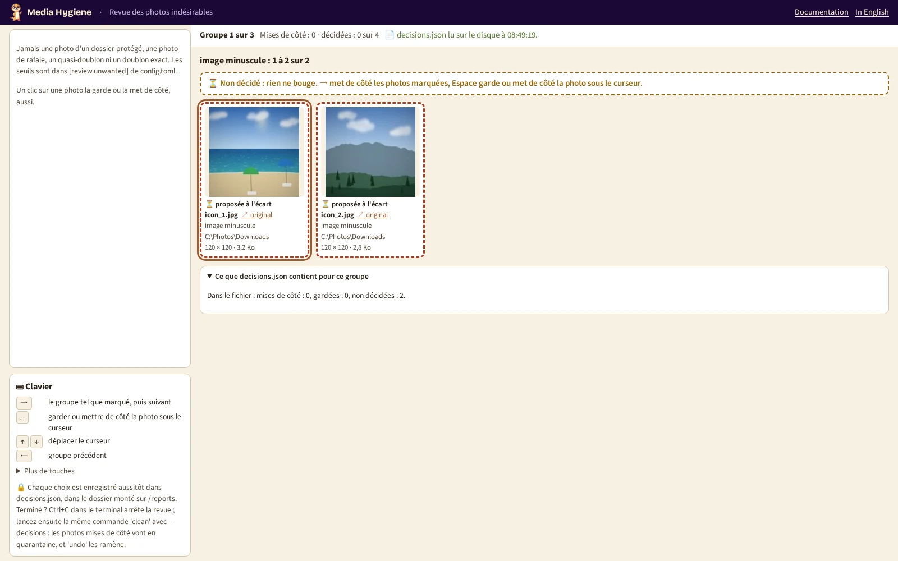

# 14. Les photos indésirables

[Documentation](../README.md) › Nettoyer, étape 14 sur 14 · 🇬🇧 [English](../../en/clean/14-unwanted-photos.md)

Au-delà des doublons, une collection garde des photos dont personne ne veut : icônes et
vignettes, captures d'écran, une photo prise dans la poche (toute noire), une photo bougée.
`review --junk` vous montre les plus probablement indésirables, un groupe par raison. **Rien
n'est mis de côté tant que vous ne le dites pas** : vous regardez, vous choisissez, et
`clean --decisions` déplace ce que vous avez mis de côté en quarantaine, où `undo` le retrouve.

## Les raisons

Chaque photo est montrée pour une seule raison, la première qui s'applique, dans cet ordre :

| Raison | Ce que cela veut dire | Réglage de `[review.unwanted]` |
|---|---|---|
| Capture d'écran ou document | Un nom de capture d'écran, ou une image PNG ou minuscule sans aucune trace d'appareil photo : le même test que `kind = "screenshot"` de `classify`. | `screenshots = true` |
| Image minuscule | Moins de 0,16 mégapixel (400 × 400 pixels) : icônes, autocollants, vignettes. | `tiny_megapixels = 0.16` |
| Presque noire | Luminosité moyenne sous 25 (sur 255), avec au moins 70 % des pixels noirs. | `dark_mean = 25`, `dark_share = 0.7` |
| Presque blanche | Luminosité moyenne au-dessus de 230, avec au moins 70 % des pixels blancs. | `white_mean = 230`, `white_share = 0.7` |
| Parmi les plus floues | Netteté parmi les 2 % les moins nettes de **vos propres** photos : le seuil suit vos appareils. | `blur_percentile = 2` |

Jamais listées : une photo d'un [dossier protégé](05-choose-the-kept-copy.md), une photo de
rafale (l'[étape 10](10-review-bursts.md) s'en charge), un quasi-doublon
([étape 11](11-near-duplicates.md)) ou l'autre copie d'un doublon exact. Les vidéos ne sont pas
listées.

Chaque seuil est un réglage de `config.toml` ([étape 7](07-configuration-file.md)) ; `0` (ou
`false`) désactive sa raison :

```toml
[review.unwanted]
tiny_megapixels = 0.16
screenshots = true
dark_mean = 25
dark_share = 0.7
white_mean = 230
white_share = 0.7
blur_percentile = 2
```

## Étape 1 : ouvrir la page

```powershell
mh review --junk
```

(sans `mh` : la commande `docker run … -p 127.0.0.1:8088:8088 … review --junk` de
[`review`](../commands/review.md#lancer))

Il fait d'abord l'audit, puis compte les photos par raison et affiche *✅ Tri prêt, ouvrez
http://127.0.0.1:8088/ dans votre navigateur* :

<!-- capture: review-junk.txt|semblent indésirables|127.0.0.1:8088:8088 -->
```text
4 photos semblent indésirables (image minuscule: 2, presque noire: 1, capture
d'écran ou document: 1) ; rien n'est mis de côté sans vous.
✅ Tri prêt, ouvrez http://127.0.0.1:8088/ dans votre navigateur. Chaque
décision est enregistrée aussitôt dans decisions.json, dans le dossier monté sur
/reports. Ctrl+C arrête le tri.
💡 La page ne s'ouvre pas ? docker run doit publier le même port des deux côtés,
avec -p 127.0.0.1:8088:8088.
```



## Étape 2 : choisir

La page montre un groupe à la fois, la raison qui a le plus de photos d'abord (une raison de
milliers de photos vient par pages de 40). Chaque photo est **proposée** à l'écart (pointillés
rouges) tant que vous ne décidez pas ; la raison est écrite sous chacune.

| Touche | Ce qu'elle fait |
|---|---|
| `→` | Le groupe tel que marqué : les photos encore proposées partent à l'écart, puis le groupe suivant |
| `Espace` | Garder, ou mettre de côté, la photo encadrée |
| `↑` / `↓` | Déplacer le cadre |
| `Suppr` | Mettre de côté les photos choisies : un clic en choisit une, Ctrl+clic, Maj+clic, un rectangle, Ctrl+A, I comme dans [`browse`](../commands/browse.md) |
| Entrée ou un double clic | Voir la photo en grand (`Suppr` l'y met de côté, `⌫` la reprend) |
| `←` / `N` | Groupe précédent / groupe suivant non décidé |
| `U` | Tout le groupe revient à « non décidé » |

Chaque choix est enregistré aussitôt dans `decisions.json`, puis relu sur le disque et affiché.
Arrêtez quand vous voulez avec Ctrl+C : le `review --junk` suivant s'ouvre sur le premier
groupe non décidé.

## Étape 3 : nettoyer avec vos décisions

```powershell
mh clean --decisions
```

(avec la même partie `docker run … -v …` qu'à l'[étape 8](08-clean.md))

`clean` refait l'audit et ne déplace en quarantaine **que** les photos que vous avez mises de
côté, chacune seulement si c'est encore exactement le fichier que vous avez vu (même taille,
même date). Les photos gardées restent, et restent gardées la prochaine fois que vous ouvrez la
page. `history` les compte à part (*Dont indésirables*), `undo` les ramène, et seul `purge`
efface la quarantaine.

Le même `decisions.json` contient les choix des autres tris : `review --junk` les conserve.

---

← [13. Un second avis](13-second-opinion.md) · [Documentation](../README.md)
