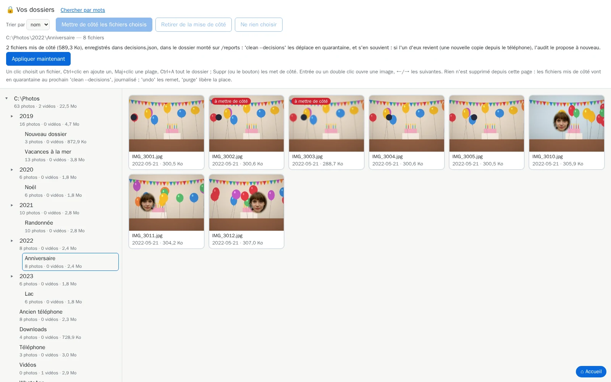

# `browse` : parcourir vos dossiers et mettre des photos de côté

[Documentation](../README.md) › [Commandes](../reference-commands.md) › `browse` · 🇬🇧 [English](../../en/commands/browse.md)

## En bref

**Parcourir vos dossiers comme dans l'Explorateur, et mettre de côté les photos dont vous ne
voulez plus.**

`browse` ouvre votre photothèque dans votre navigateur : l'arborescence de vos dossiers à gauche
(chacun avec son nombre de photos et de vidéos et sa taille), les photos et vidéos du dossier
choisi à droite. Choisissez-en et mettez-les de côté : le prochain
[`clean --decisions`](clean.md) les déplace en quarantaine, journalisé et annulable. Supprimer
dans l'Explorateur ne laisse aucune trace ; ici, chaque retrait peut être annulé.

> **Une seule page désormais** : `browse` ouvre [`search`](search.md) avec ses dossiers ouverts
> (`/browse` est la même page). Tout ce qui suit s'y trouve : l'arbre sous *Dans un dossier* (un
> clic liste le dossier et ses sous-dossiers), *⚖ Fichiers les plus lourds*, **Trier par**
> (*débit* compris) et **Afficher**.

**Quand** : après un [`audit`](audit.md) : la page montre ce que l'audit a lu. Pas besoin de
[`tags`](tags.md).

**Essayer** :

```powershell
docker run --rm -it `
  -p 127.0.0.1:8088:8088 `
  -v "C:\Photos:/data/c/Photos:ro" `
  -v media-hygiene-cache:/[cache](../reference-glossary.md#cache) `
  -v "$HOME\media-hygiene\reports:/reports" `
  -v "$HOME\media-hygiene\config:/config" `
  cavo789/media-hygiene --locale fr browse
```

## D'un coup d'œil

| | |
|---|---|
| Vos photos | 🔒 Rien ne bouge sans votre GO (l'onglet 🔎 trie les fichiers d'une règle vérifiés là, [`search`](search.md#faire-dune-période-une-règle)), noté au journal : `undo` les remet. `mh browse` les monte accessibles en écriture ; montées en `:ro`, la page reste en lecture seule. |
| Il faut | `/cache` (les fichiers du dernier audit), vos dossiers (pour montrer les photos), `/reports` (pour garder ce que vous mettez de côté), et `-p 127.0.0.1:8088:8088` pour la page. |
| Écrit | Les petits aperçus de la grille, dans le cache ; les photos mises de côté, dans `decisions.json` des rapports ; vos albums, dans `albums.json` à côté. |
| Annuler | Rien à annuler dans la page : [`clean --decisions`](clean.md) déplace les photos mises de côté, [`undo`](undo.md) les remet. |
| Avec `mh` | `mh browse`. |

## Lancer

```powershell
mh browse
```

Votre navigateur s'ouvre sur la page (sinon : `http://127.0.0.1:8088/`).



- **La barre au-dessus de la grille** : le dossier affiché, combien de fichiers il contient et
  ce qui est mis de côté, avec **Trier par**, **Afficher** et le champ d'album. Dès qu'un fichier est choisi,
  elle montre quoi faire du choix : **✕** ne rien choisir, **Mettre de côté les fichiers
  choisis**, **Inverser la sélection**.
- **L'arborescence** : vos dossiers montés, ouverts ; les dossiers en dessous, fermés (▸ en ouvre
  un). Cliquez un dossier : ses photos et vidéos apparaissent, triées par nom, par date ou par
  taille, la plus grande d'abord (**Trier par** ; *débit* sert aux fichiers les plus lourds, ci-dessous :
  un dossier se trie alors par taille). **Afficher** garde les photos ou les vidéos
  seulement : les vidéos lourdes d'un dossier viennent en tête avec *Vidéos* et *taille*. Ctrl+A,
  Maj+clic et ← → ne portent que sur les fichiers affichés. Les deux choix sont gardés, dans ce
  navigateur, pour le dossier suivant.
- **⚖ Fichiers les plus lourds**, au-dessus des dossiers : les fichiers les plus lourds de tous
  les dossiers montés, les vidéos d'abord (**Afficher** le change), 200 à la fois (**En montrer
  plus** en ajoute autant). La barre dit ce que pèse la liste : *200 fichiers, 61,4 Go, 25 % de
  votre photothèque*. Chaque vignette donne son dossier et, pour une vidéo, sa durée, son débit,
  son codec et sa taille en pixels : `12 min · 12.7 Mb/s · mjpeg · 1280×720`. **Trier par**
  *débit* met en tête les vidéos les moins bien compressées pour leur durée (anciens appareils,
  MJPEG) : celles qui gagnent le plus une fois allégées. Mettre de côté, la visionneuse et les
  touches marchent comme dans un dossier.
- **Regarder** : Entrée ou un double clic montre une image en grand, une vidéo se lit ; ← et →
  passent à la précédente et à la suivante, comme dans l'application Photos ; Échap ferme.
  **Suppr met de côté celle qui est montrée, puis la suivante s'ouvre** : triez un dossier sans
  quitter la vue en grand. L'enregistrement est d'abord relu ; la photo montrée porte l'étiquette
  rouge *à mettre de côté*. En grand, aussi :

  | Touche | Ce qu'elle fait |
  |---|---|
  | Début, Fin | le premier ou le dernier fichier |
  | Retour arrière | reprendre celle qui est montrée de ce qui est mis de côté |
  | Espace | lire ou mettre en pause une vidéo |
  | **F** | plein écran (F à nouveau, ou Échap, pour en sortir) |
  | I | sa date, sa taille et son dossier, sous l'image (dans la grille, I inverse la sélection) |
  | A | l'ajouter à l'album tapé dans **Album** |
  | ? | toutes les touches de la vue en grand, sous l'image |

  Une ligne sous l'image rappelle les touches principales ; le panneau sous l'arborescence les
  liste toutes. **👤 Mettre une personne de côté**, à côté du lien vers l'original, trouve toutes
  les photos de quelqu'un depuis celle qui est montrée : voir
  [`people`](people.md#depuis-nimporte-quelle-page--mettre-une-personne-de-côté).
- **Choisir** : un clic choisit un fichier ; la case ☑ de chaque vignette (ou Ctrl+clic) en
  ajoute ou en retire un ; Maj+clic choisit tous les fichiers depuis le dernier cliqué ; un
  rectangle tiré à la souris sur la grille choisit ce qu'il touche, sur plusieurs lignes (avec
  Ctrl, il s'ajoute au choix) ; Ctrl+A tout le dossier. **Inverser la sélection** (ou I) choisit
  les autres : quand un dossier contient surtout des ratés, choisissez les bonnes, inversez,
  puis Suppr. Les touches sont rappelées sous l'arborescence, toujours visibles, avec la ligne
  🔒 qui rappelle que rien ne bouge sans votre GO.
- **Mettre de côté** : Suppr, ou **Mettre de côté les fichiers choisis**. Le choix est enregistré
  aussitôt dans `decisions.json` de vos rapports, relu sur le disque et affiché avec son nombre et
  sa taille : *37 fichiers mis de côté (412 Mo), enregistrés dans … : 'clean --decisions' les
  déplace en quarantaine, et s'en souvient : si l'un d'eux revient (une nouvelle copie depuis le
  téléphone), l'audit le propose à nouveau.* (Voir [Ce que vous avez mis de côté reste de côté](../clean/09-undo-history-purge.md#ce-que-vous-avez-mis-de-côté-reste-de-côté).)
  Ces fichiers portent une étiquette rouge *à mettre de côté* ; dès que l'un d'eux est choisi,
  **Retirer de la mise de côté** apparaît dans la barre et en retire les fichiers choisis.
- **🔎 Mots**, l'onglet au-dessus de l'arborescence, ouvre la page [`search`](search.md), sur le même serveur : ce que vous y
  mettez de côté va dans le même fichier.
- **➕ Ajouter à l'album** met les photos choisies dans l'album tapé dans **Album**, à part de la
  mise de côté ; **📺 Partager sur la télé** donne la commande qui le montre. Voir
  [Mettre des photos dans un album](search.md#mettre-des-photos-dans-un-album).

Ctrl+C, ou fermer son onglet, arrête la page ; quand des fichiers sont mis de côté, `browse` propose l'étape suivante :

```powershell
mh clean --decisions
```

Il dit combien de fichiers et d'octets partent (à part des doublons), demande, puis les déplace en
quarantaine, journalisé : `mh undo` les remet, `mh purge` libère la place.

**Ouverte depuis l'[accueil](home.md)** (`mh` seul, puis l'étape *Parcourir vos dossiers*) : dès
que quelque chose est mis de côté, un bouton **Appliquer maintenant** apparaît dans la barre, à
côté de la ligne enregistrée. `mh` lance alors l'étape de l'accueil qui applique vos choix
(`mh clean --decisions`, avec `--tier near` si vous avez aussi revu des quasi-doublons), avec sa
question habituelle, dans la fenêtre où `mh` tourne (PowerShell sous Windows) ; la page reste
ouverte, puis affiche *Terminé* (ou le code sur lequel il s'est arrêté) et montre de nouveau le
dossier sans les fichiers déplacés. Ouverte par
`mh browse` seul, pas de bouton : tapez la commande ci-dessus. Le bouton demande un `mh` écrit
par cette version (`mh update` le réécrit).

## Options

| Option | Rôle |
|---|---|
| `--port PORT` | Port de la page, 8088 par défaut ; publiez le même. |

## Bon à savoir

- **Ouverte depuis la page d'accueil** (`mh` seul) : la page s'ouvre aussitôt, dans le même onglet,
  servie par la page d'accueil elle-même : aucun autre conteneur ne démarre, l'index reste ouvert
  pour la session. *⌂ Retour à l'accueil* est un simple lien (le bouton Précédent du navigateur
  marche aussi). Tapée seule (`mh browse`), elle démarre toujours sa propre page.
- Rien n'est supprimé depuis la page, et rien ne bouge avant `clean --decisions`. Un fichier
  modifié depuis votre choix est laissé en place et listé dans le rapport du nettoyage ; un
  fichier d'un dossier protégé fait refuser tout le fichier, comme partout.
- La page liste ce que le dernier [`audit`](audit.md) a lu : relancez-le pour voir les nouveaux
  fichiers.
- Sans `/reports` (ou avec un dossier où l'outil ne peut pas écrire), mettre de côté dit pourquoi
  et n'enregistre rien ; regarder fonctionne toujours.
- Une vidéo montre ses premières images dans la grille quand votre navigateur sait lire son
  format (MP4, MOV) ; les autres affichent « Pas d'aperçu » et s'ouvrent en original.

## Aller plus loin

- [Retrouver en bref](../find/quick-guide.md)
- [`search` : mettre de côté les photos trouvées par un mot, une personne, une
  année](search.md#mettre-des-photos-de-côté)

## L'aide intégrée

<details>
<summary><code>browse --help</code></summary>

<!-- capture: help-browse.txt -->
```text
 Utilisation : media-hygiene browse [OPTIONS]

 🔒 Lecture seule : ne modifie jamais vos photos. Parcourir vos dossiers dans
 votre navigateur, comme dans l'Explorateur, et mettre des photos de côté ;
 'clean --decisions' les déplace ensuite.

╭─ Options ────────────────────────────────────────────────────────────────────╮
│ --port          <int range> [x>=1]  Port de la page. docker run le publie    │
│                                     sous le même numéro sur votre            │
│                                     ordinateur, par exemple -p               │
│                                     127.0.0.1:9000:9000 pour --port 9000.    │
│                                     Par défaut :  port dans config.toml,     │
│                                     8088.                                    │
│ --help  -h                          Affiche ce message et quitte.            │
╰──────────────────────────────────────────────────────────────────────────────╯
```

</details>

---

← [Toutes les commandes](../reference-commands.md) · [Documentation](../README.md)
