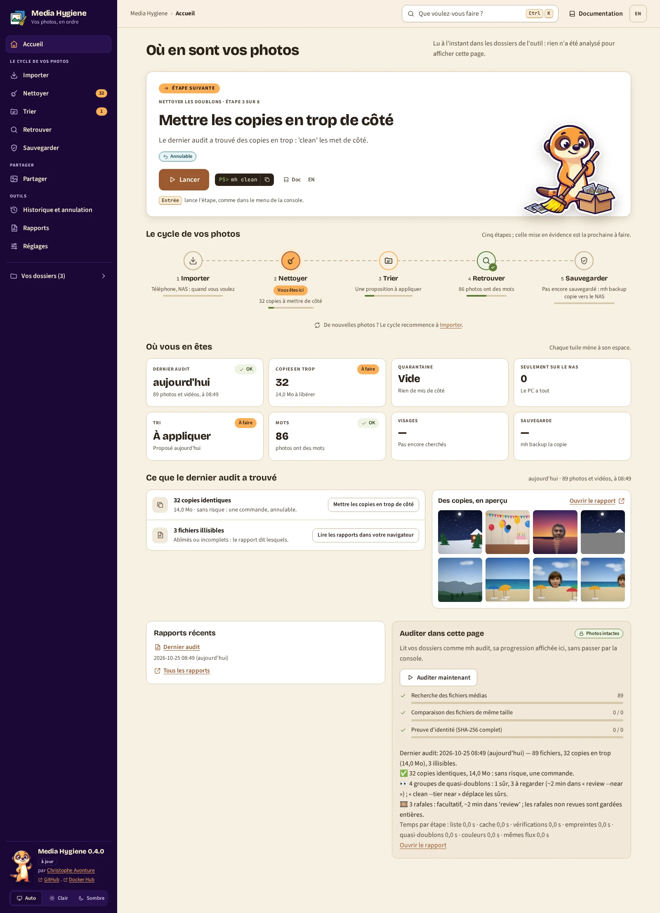

# `home` : la page d'accueil, dans votre navigateur

[Documentation](../README.md) › [Commandes](../reference-commands.md) › `home` · 🇬🇧 [English](../../en/commands/home.md)

## En bref

**Une page dans votre navigateur : où en sont vos photos, l'étape suivante en un gros bouton,
chaque action de l'outil à un clic ou à <kbd>Ctrl</kbd>+<kbd>K</kbd>.**

`home` montre dans votre navigateur ce que [`status`](status.md) et [`menu`](menu.md) montrent
dans le terminal, rangé comme le cycle de vos photos : **Importer** (un téléphone, votre NAS ou
un ancien disque), **Nettoyer**, **Trier**, **Retrouver**, **Sauvegarder** (prévu) ; puis, à part du cycle, **Partager**
(vos photos sur la télé : [`slideshow`](slideshow.md), un dossier ou un
[album](search.md#mettre-des-photos-dans-un-album)) et trois outils : **Historique et annulation**,
**Rapports**, **Réglages**. Chaque espace a sa page : son
parcours, numéroté, puis « Pour aller plus loin ». Chaque action montre sa commande `mh`, à
copier, et mène à son chapitre de cette documentation. La page peut aussi lancer l'audit
elle-même, sa progression affichée dans la page.

**Quand** : chaque fois que vous préférez cliquer plutôt que taper, ou que vous ne savez plus
quelle est la suite.

**Essayer** :

```powershell
docker run --rm -it `
  -p 127.0.0.1:8088:8088 `
  -v "C:\Photos:/data/c/Photos:ro" `
  -v media-hygiene-cache:/[cache](../reference-glossary.md#cache) `
  -v "$HOME\media-hygiene\reports:/reports" `
  -v "$HOME\media-hygiene\journal:/journal" `
  -v "$HOME\media-hygiene\quarantine:/quarantine" `
  -v "$HOME\media-hygiene\config:/config" `
  cavo789/media-hygiene home
```



## D'un coup d'œil

| | |
|---|---|
| Vos photos | 🔒 Rien ne bouge sans votre GO sur une page (review-sort, search), noté au journal : `undo` le remet. `mh home` les monte accessibles en écriture, avec `/journal` ; l'audit lancé depuis la page ne fait que les lire. |
| Il faut | Les dossiers de l'outil (`/reports`, `/journal`, `/quarantine`, `/cache`), comme pour `status` ; vos dossiers pour l'audit ; `-p 127.0.0.1:8088:8088` pour la page. |
| Écrit | Rien par elle-même ; l'audit lancé depuis la page écrit son cache et son rapport, comme `audit` ; la [page des albums](#vos-albums-sur-le-téléphone) ne change que `albums.json`. |
| Annuler | Rien à annuler ; chaque étape garde sa propre annulation. |
| Avec `mh` | `mh home`. |

## Ce que montre la page

- **Le menu de gauche** : les cinq étapes du cycle, **Partager** (un but, pas une étape : sans numéro) et les outils, chacun avec son compte (*9*
  copies à mettre de côté, *214* fichiers que seul le NAS garde), *Vos dossiers* (chacun trouvé
  ou non), la version (*0.5.0 disponible* quand une plus récente est publiée,
  [`mh update`](launcher.md#une-nouvelle-version--mh-update)) et le choix du thème.
- **La barre du haut** : *Que voulez-vous faire ?* (la palette), **Annuler la dernière
  exécution** tant qu'une exécution est annulable, et **Documentation** : le chapitre de la page
  où vous êtes, et son jumeau anglais.
- **L'étape suivante** : pourquoi, ce qu'elle risque en mots (*Annulable*), le bouton qui la
  lance et sa commande : *le dernier audit a trouvé des copies en trop : 'clean' les met de
  côté*, **mh clean**. Son bouton a le focus à l'ouverture : <kbd>Entrée</kbd> la lance, comme
  dans `mh menu`. Quand tout est appliqué, la page le dit.
- **Le cycle de vos photos** : les cinq étapes, la prochaine mise en évidence (*Vous êtes ici*),
  chacune avec une ligne (*9 copies à mettre de côté*, *Une proposition à appliquer*) et le
  nombre d'étapes faites de son parcours.
- **Où vous en êtes** : une tuile par fait (le dernier audit, les copies en trop, la
  quarantaine, les fichiers seulement sur le NAS, le tri, les mots, les visages), chacune mène à
  son espace.
- **Ce que le dernier audit a trouvé** : chaque constat avec son bouton (*9 copies
  identiques* : **Mettre les copies en trop de côté** ; *3 fichiers illisibles* : le rapport), et
  quelques aperçus de son rapport. Avant tout audit : trois choses à savoir (rien ne bouge sans
  vous, tout ce qui bouge s'annule, une seule chose est définitive).
- **Rapports récents**, et **Auditer dans cette page** 🔒 : **Auditer maintenant** lit vos
  dossiers comme `mh audit`, avec les mêmes réglages. Chaque étape s'affiche avec ses comptes au
  fil de l'eau ; à la fin, les chiffres de l'audit, le temps de chaque étape, *Ce que vous
  pouvez faire*, et un lien vers le nouveau rapport. Un audit à la fois ; **Arrêter l'audit**
  l'arrête entre deux fichiers : le cache garde ce qu'il a lu, et l'audit suivant repart de là.
- **Une page par espace** : son parcours, numéroté, puis « Pour aller plus loin » en cartes.
  Chaque action dit ce qu'elle risque (🔒 *Photos intactes*, ↩️ *Annulable*, ⚠️ *Définitif*),
  *Facultatif*, *Windows*, *IA locale* (🤖), *Prévu* ; **Fait** quand les dossiers de l'outil le
  prouvent ; quand elle ne peut pas encore tourner, pourquoi à la place de son texte (*Rien à
  annuler pour l'instant.*). *Historique et annulation* montre l'exécution encore annulable et
  la quarantaine par exécution ; *Réglages* vos dossiers, la mise à jour, Windows, l'IA locale,
  la vie privée, les actions avancées et *À propos*.

Ouverte par un clic droit sur un dossier (ou `mh --photos "E:\Dossier"`), la page nomme ce
dossier en premier : *Cette page analyse aussi : E:\Dossier* ; l'audit de la page et chaque
étape lancée depuis elle l'analysent aussi.

## Lancer une étape

La page ne modifie jamais vos photos elle-même. Ce que fait le bouton d'une étape dépend du `mh`
qui a ouvert la page :

- **`mh` seul** (et donc le raccourci du Bureau et le clic droit d'un dossier) lance les étapes
  de la page : **Lancer** (ou le gros bouton) confie l'étape à `mh`, dans la fenêtre où `mh`
  tourne (PowerShell sous Windows), avec les dossiers dont l'étape a besoin. Avec les rapports
  dans un dossier de votre disque (le cas par défaut), la page **reste ouverte** pendant qu'une
  étape tourne dans cette fenêtre : *mh clean s'exécute dans la fenêtre PowerShell de mh (dans
  la barre des tâches) : répondez-y s'il vous demande quelque chose. Cette page reste ouverte
  et montre le résultat à la fin* ; puis *mh clean : terminée.* et la page montre son nouvel
  état, sans se recharger. *search* et *browse* s'ouvrent aussitôt dans ce même onglet,
  servies par la page d'accueil elle-même ; une étape qui ouvre une autre page à elle (review,
  people…) ferme celle-ci entre-temps : *Retour à l'accueil* la ramène. Une deuxième étape demandée pendant
  qu'une autre tourne attend : *Une étape tourne dans la fenêtre de mh : attendez sa fin.*
  Sinon (rapports dans un volume nommé, un `mh` plus ancien), la page se ferme et revient
  d'elle-même après l'étape. Dans les deux cas, la page dit aussitôt, en gras, *Passez maintenant à la fenêtre PowerShell de mh (dans la barre des
  tâches) (Alt+Tab, ou son bouton dans la barre des tâches) : mh peut vous y demander quelque
  chose*. `mh` fait aussi sonner la cloche du terminal et joue le son de Windows, souvent
  inaudible (haut-parleurs coupés). Ce qui se voit : Windows Terminal fait clignoter son bouton
  dans la barre des tâches sur cette cloche une fois ses paramètres réglés (par défaut, le son
  seulement) : *Paramètres* → *Ouvrir le fichier JSON*, puis `"bellStyle": "taskbar"` dans
  `profiles` → `defaults` (`["audible", "taskbar"]` pour garder le son). Avec la console
  classique, `mh` ramène aussi sa fenêtre au premier plan quand Windows le permet (une fenêtre
  réduite reste réduite). Après 30
  secondes elle ajoute *Rien ne bouge ? Regardez la fenêtre PowerShell de mh (dans la
  barre des tâches) (Alt+Tab)*. L'étape choisie arrive à `mh` par `.mh-step.json` de votre dossier
  des rapports, comme les mots d'un formulaire ci-dessous : `mh` les lance aussitôt (il lançait
  d'abord `mh menu` dans un conteneur à lui, 2 s par clic). Avec des rapports dans un volume
  nommé, c'est le code de sortie de la commande, `20 + n` pour l'étape `n` de `mh menu`.
  L'onglet montre la page suivante dès que son serveur répond. Ctrl+C pendant une
  étape (ou sur une page qu'elle a ouverte) rend l'invite : la page d'accueil ne revient pas,
  et aucune autre étape ne se lance.
- **Une étape qui prend des mots** (le nom d'un album, le dossier de votre NAS,
  un dossier à retirer, combien de rapports garder) : **Compléter** ouvre son formulaire,
  l'exemple déjà rempli. Le serveur vérifie chaque valeur et dit pourquoi il en refuse une (*pas
  de guillemet double*, *aucun caractère de contrôle*, *elle ne peut pas commencer par '-'*, *un
  dossier tel que l'Explorateur le montre*) ; puis il écrit les mots dans `.mh-step.json` de
  votre dossier des rapports et s'arrête avec `199`. `mh` lit ce fichier une fois, le retire, et
  lance ces mots : `Noël 2025` reste un seul mot. Avec des rapports dans un volume nommé, ou un
  `mh` plus ancien, la page donne la commande à copier à la place.
- **⚠️ Définitif** (`purge`, `clean --delete`, `phone --free`) : la page demande d'abord ; `mh`
  redemande dans sa fenêtre avant de toucher quoi que ce soit.
- **Sinon** (`mh home` tapé, un `mh` plus ancien, ou `docker run` seul) : le bouton copie la
  commande (*Commande copiée*) et la page continue ; arrêtez-la avec Ctrl+C dans la fenêtre où
  `mh` tourne, collez-y la commande (clic droit) et appuyez sur Entrée. Quand le navigateur
  refuse de copier (une adresse autre que `127.0.0.1` ou `localhost`), la commande est
  sélectionnée : faites Ctrl+C.

Chaque autre page ([`review`](review.md), [`review-sort`](review-sort.md),
[`places`](places.md), [`search`](search.md), [`browse`](browse.md), [`people`](people.md))
prend l'allure et le thème de la page d'accueil, sous une barre : **Documentation** ouvre le
chapitre de cette page, à côté de son jumeau anglais (*In English*). Quand la page d'accueil l'a
ouverte, la page s'affiche dans **le même onglet** (pas de nouvel onglet), et **⌂ Retour à
l'accueil** la ferme (ce que vous y avez décidé est déjà enregistré) et ramène cet onglet à la
page d'accueil, sur l'espace que vous aviez quitté (*Nettoyage*, *Tri*…). Fermer l'onglet, au
contraire, arrête la page et `mh` avec elle : l'invite revient.

La documentation elle-même est dans l'image : chaque lien **Doc** et **Documentation** de ces
pages ouvre son chapitre servi par l'outil, avec la même allure, hors ligne, et écrit pour la
version que vous utilisez (le site peut déjà décrire une version plus récente). Sa barre latérale
liste chaque chapitre, sa barre du haut passe à l'autre langue (**EN**), chaque page liste ses
sections et se termine sur la précédente et la suivante. Les liens qu'affiche le terminal, et
les rapports HTML ouverts depuis le disque, mènent toujours au
[site](https://cavo789.github.io/media-hygiene/) : aucune page de l'outil n'y répond.

## Depuis un téléphone du Wi-Fi de la maison : `mh --lan`

Dans Windows PowerShell, `mh --lan` ouvre la page d'accueil comme `mh` seul, et laisse un
téléphone **du même Wi-Fi** l'ouvrir aussi, jusqu'à l'arrêt de `mh` :

1. `mh` trouve l'adresse du PC sur le réseau de la maison (*192.168.1.20*) et dit *La page
   d'accueil s'ouvre aussi aux téléphones du réseau de la maison*. Windows peut demander si
   **Docker Desktop** peut accepter des connexions : autorisez-le sur les **réseaux privés**
   seulement.
2. La page du PC montre, dans sa barre latérale, *Sur votre téléphone* : l'adresse, un **code**
   de 8 chiffres et son **QR code** (la fenêtre de `mh` dit la même adresse et le même code).
3. Sur le téléphone, scannez le QR code, ou ouvrez l'adresse et tapez le code : la page d'accueil
   s'ouvre. Le téléphone reste appairé (un cookie) jusqu'à l'arrêt de `mh`, même après les
   étapes lancées sur le PC.

Depuis le téléphone : 🔒 la page, où vous en êtes, les rapports, l'**audit** lancé par la page et
[vos albums](#vos-albums-sur-le-téléphone).
Toute autre étape reste sur le PC (*Lancez cette étape sur le PC*) : ses questions sont posées
dans la fenêtre de `mh`, que personne ne voit depuis le canapé.

L'étape *Montrer vos photos sur la télé*, choisie sur le PC, ouvre aussi le [diaporama](slideshow.md)
au réseau de la maison : le téléphone déjà appairé recharge sa page et obtient la télécommande du
diaporama.

| | |
|---|---|
| Qui | Un appareil du même Wi-Fi **avec le code** ; 5 codes erronés ferment l'appairage jusqu'à l'arrêt de `mh`. |
| Où | L'adresse privée du PC seulement (`10.x`, `172.16–31.x`, `192.168.x`) : jamais toutes les interfaces, jamais Internet ; `mh` n'ouvre aucun port sur votre box. |
| Comment | HTTP simple sur le réseau de la maison, comme décidé : aucun avertissement de certificat sur le téléphone ; le code et le cookie circulent en clair sur votre Wi-Fi, pour cette fois seulement. |
| La fois suivante | Un nouveau `mh --lan`, un nouveau code : l'ancien téléphone doit s'appairer à nouveau. |

Le téléphone n'ouvre pas la page ? Windows considère le réseau comme **public** (`mh` le dit) :
passez-le en privé dans *Paramètres › Réseau et Internet*. `mh --lan` ne fonctionne que dans
Windows PowerShell pour l'instant.

## Vos albums, sur le téléphone

À la maison, montrez un album à la famille **sur votre propre téléphone**, sans la télé :
appairez-le une fois avec `mh --lan` (ci-dessus), puis touchez **Ouvrir les albums** sur sa page
d'accueil (ou, sur le PC, *Partager › Vos albums*). Les proches regardent votre écran et
n'appairent rien.

- **La liste** : chaque [album](search.md#mettre-des-photos-dans-un-album), sa couverture, ses
  dates, son lieu et combien de photos il contient.
- **Un album**, comme le montrent les grandes applications de photos : une **couverture** (la
  photo la plus nette du premier jour), le nom de l'album, ses dates et son lieu (nommé hors
  ligne, d'après le GPS des photos), puis une **mosaïque** groupée par jour, *lundi 10 juillet
  2023 · Héraklion*.
- **Un toucher** ouvre la photo en plein écran ; **un glissement** passe à la suivante ou à la
  précédente ; **un toucher** (ou le *Retour* du téléphone) la ferme. Les photos suivantes sont
  chargées d'avance.
- **Les vidéos** se lisent sur place, comme sur la télé : le H.264 tel quel ; un autre format
  (HEVC, AVI) est signalé, jamais converti.
- **➖ Retirer de l'album**, **➕ Ajouter à un album** (un nouveau nom le crée) : seul
  `albums.json` change, relu et affiché ; aucune photo n'est copiée, déplacée ni touchée.

| | |
|---|---|
| Vos photos | 🔒 Seulement lues. Le téléphone reçoit des images à sa taille (1440 pixels au plus, gardées dans `/cache`), jamais un original. |
| Ce que le téléphone atteint | Les albums et **leurs** fichiers seulement : aucune autre photo de votre bibliothèque, quelle que soit l'adresse tapée. |
| Où | Le Wi-Fi de la maison seulement, tant que `mh` tourne sur le PC (dit sur la page). |

## Le clavier, la palette, le thème

| Touche | Ce qu'elle fait |
|---|---|
| <kbd>Entrée</kbd> | À l'ouverture, lance l'étape suivante : son bouton a le focus. |
| <kbd>Ctrl</kbd>+<kbd>K</kbd> ou <kbd>/</kbd> | *Que voulez-vous faire ?* : chaque action et chaque espace, trouvés par des mots de tous les jours (*téléphone*, *NAS*, *annuler*), puis les sections de la documentation (ouvertes dans un nouvel onglet) ; <kbd>↑</kbd> <kbd>↓</kbd> choisissent, <kbd>Entrée</kbd> lance. |
| <kbd>↑</kbd> <kbd>↓</kbd> | Dans le menu de gauche, d'un espace à l'autre (un seul arrêt de <kbd>Tab</kbd> pour tout le menu). |
| <kbd>?</kbd> | Les touches. |
| <kbd>Échap</kbd> | Ferme ce qui est ouvert. |

Un parcours au clavier seul : <kbd>Tab</kbd> une fois montre *Aller au contenu* ;
<kbd>Entrée</kbd> dessus saute le menu de gauche. <kbd>Maj</kbd>+<kbd>Tab</kbd> revient au menu,
<kbd>↓</kbd> jusqu'à *Nettoyer*, <kbd>Entrée</kbd> ouvre sa page. <kbd>Ctrl</kbd>+<kbd>K</kbd>,
tapez *téléphone*, <kbd>Entrée</kbd> : l'étape du téléphone se lance. Rechargez la page :
<kbd>Entrée</kbd> lance l'étape suivante. Le contour du focus ne s'affiche qu'au clavier ; les
messages passagers sont lus par les lecteurs d'écran.

Le thème suit Windows (clair ou sombre) ; **Auto**, **Clair** et **Sombre** en bas du menu de
gauche choisissent pour ce navigateur. Les animations s'arrêtent quand Windows demande moins de
mouvement. Les polices et les images viennent de l'image elle-même : la page ne demande rien à
aucun autre site.

## Options

| Option | Rôle |
|---|---|
| `--port PORT` | Port de la page, 8088 par défaut ; publiez le même. |

## Bon à savoir

- La page ne répond qu'à `127.0.0.1` ou `localhost` (et, sous `mh --lan`, à l'adresse du PC pour
  un téléphone appairé), et seulement à ses propres boutons : un autre site ne peut pas choisir
  une étape à votre place.
- Fermer l'onglet de la page, ou Ctrl+C dans le terminal arrête la
  page et rend l'invite ; un audit en cours s'arrête entre deux fichiers. Un onglet fermé est vu
  une dizaine de secondes plus tard (*L'onglet de la page d'accueil a été fermé : la page d'accueil
  s'est arrêtée.*) ; un rechargement, ou un onglet laissé en arrière-plan, ne l'arrête jamais.
- Les étapes sont relues dans les dossiers de l'outil à chaque chargement de la page : ce
  qu'une autre fenêtre a fait apparaît au rechargement suivant. Un bouton d'une page dessinée
  avant un tel changement est refusé (*Les étapes ont changé depuis l'affichage de la page*) et
  la page remontre les étapes.
- `config.toml` est relu quand vous le modifiez, y compris pour le prochain audit lancé depuis la
  page. Une faute de frappe qui le rend illisible est signalée en haut de la page (*…config.toml
  ne peut pas être lu : … Les derniers bons réglages restent jusqu'à sa correction.*) ; la ligne
  disparaît une fois le fichier corrigé.
- Si la page s'arrête de façon inattendue (un bug, Docker à court de mémoire), `mh` la relance
  tout seul (*La page d'accueil s'est arrêtée de façon inattendue : relancée.*) ; un second arrêt
  dans la minute rend l'invite.

## Aller plus loin

- [`menu` : les mêmes étapes dans le terminal](menu.md)
- [`status` : où vous en êtes, en une seconde](status.md)

## L'aide intégrée

<details>
<summary><code>home --help</code></summary>

<!-- capture: help-home.txt -->
```text
 Utilisation : media-hygiene home [OPTIONS]

 🔒 Lecture seule : ne modifie jamais vos photos. La page d'accueil dans votre
 navigateur : où vous en êtes, l'étape suivante en un bouton, toutes les étapes
 des guides, les rapports.

╭─ Options ────────────────────────────────────────────────────────────────────╮
│ --port          <int range> [x>=1]  Port de la page. docker run le publie    │
│                                     sous le même numéro sur votre            │
│                                     ordinateur, par exemple -p               │
│                                     127.0.0.1:9000:9000 pour --port 9000.    │
│                                     Par défaut :  port dans config.toml,     │
│                                     8088.                                    │
│ --help  -h                          Affiche ce message et quitte.            │
╰──────────────────────────────────────────────────────────────────────────────╯
```

</details>

---

← [Toutes les commandes](../reference-commands.md) · [Documentation](../README.md)
