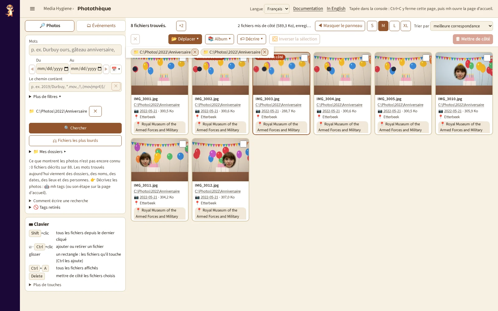

# `library` : retrouver une photo par ses mots

[Documentation](../README.md) › [Commandes](../reference-commands.md) › `library` · 🇬🇧 [English](../../en/commands/library.md)

## Que cherchez-vous ?

- 📱 [Trouver une photo depuis le téléphone : quoi taper](#ce-que-vous-pouvez-taper)
- 🖼 [Mettre des photos dans un album](#mettre-des-photos-dans-un-album)
- 📂 [Parcourir vos dossiers](#parcourir-vos-dossiers)
- 💻 [Je suis sur le PC et je pars de zéro](#lancer)

## En bref

**Retrouver une photo par ce dont vous vous souvenez : un mot, un lieu, une année, une
personne.** Cette page est la **Photothèque**, autrefois appelée `search` ; ce nom marche toujours.

`library` retrouve des photos par les mots que [`tags`](tags.md) leur a donnés et les noms donnés
dans [`people`](people.md), dans une page de votre navigateur : un champ, une grille des photos
trouvées, les meilleures d'abord, chacune avec son dossier, sa date et ses mots. Avec des mots
après la commande, il affiche à la place les premiers résultats en tableau. Les photos choisies
dans la page peuvent être **mises de côté** : le prochain [`clean --decisions`](clean.md) les
déplace en quarantaine, journalisé et annulable.

**Quand** : après [`tags`](tags.md) (et [`people`](people.md) pour les noms) ; à nouveau une
fois les nouvelles photos passées par `tags`.

**Essayer** :

```powershell
docker run --rm -it `
  -p 127.0.0.1:8088:8088 `
  -v "C:\Photos:/data/c/Photos:ro" `
  -v media-hygiene-cache:/[cache](../reference-glossary.md#cache) `
  -v "$HOME\media-hygiene\reports:/reports" `
  -v "$HOME\media-hygiene\config:/config" `
  cavo789/media-hygiene --locale fr search
```

## D'un coup d'œil

| | |
|---|---|
| Vos photos | 🔒 Rien ne bouge sans votre GO : *J'ai vérifié : trier ces N fichiers* déplace les fichiers d'une règle vérifiés sur la page, notés au journal ; `undo` les remet. `mh library` les monte accessibles en écriture, avec `/journal` ; montées en `:ro`, la page reste en lecture seule et le GO est refusé. |
| Il faut | `/cache` (les mots de `tags`), vos dossiers (pour montrer les photos), et `-p 127.0.0.1:8088:8088` pour la page ; `/reports` pour mettre des photos de côté. |
| Écrit | Les petits aperçus de la grille, dans le cache ; les photos mises de côté, dans `decisions.json` des rapports ; vos albums, dans `albums.json` à côté. |
| Annuler | Rien à annuler dans la page : [`clean --decisions`](clean.md) déplace les photos mises de côté, [`undo`](undo.md) les remet. |
| Avec `mh` | `mh library`, `mh library durbuy ours`. |

## Lancer

```powershell
docker run --rm -it -p 127.0.0.1:8088:8088 `
  -v "C:\Photos:/data/c/Photos:ro" `
  -v media-hygiene-cache:/cache `
  -v "$HOME\media-hygiene\reports:/reports" `
  -v "$HOME\media-hygiene\config:/config" `
  cavo789/media-hygiene --locale fr search
```

Ouvrez <http://127.0.0.1:8088/>. La page montre le champ de recherche et ses filtres (une période, une partie du chemin, les mots
d'une seule source) dans la colonne de gauche, les touches ⌨ en dessous, une seule barre au-dessus
de la grille, puis les photos trouvées. **🔎 Mots** vient d'abord, **📁 Dossiers** ensuite : il
ouvre [vos dossiers](#parcourir-vos-dossiers). Ctrl+C, ou fermer son onglet, arrête la page.

**Chemin contient** prend une partie du chemin, sans tenir compte des majuscules. `*` remplace
n'importe quels caractères et `?` un seul : `*.mov` trouve tous les fichiers `.mov` (`.MOV`
aussi). Entre deux barres obliques, c'est une expression régulière : `/\.(mov|mp4)$/`. Tout le
reste est lu tel quel : `Vacances (2019)` ou `a+b` n'ont pas besoin d'échappement. Une expression
régulière invalide est signalée sous le champ. Un clic dans le champ vide liste vos dossiers,
les plus récents d'abord (2026/2026-10 avant 2026/2026-09) avec leur nombre de fichiers ; taper réduit la liste. ↓/↑ s'y
déplacent, Entrée (ou un clic) choisit un dossier et lance la recherche, Échap la ferme. La liste
n'est qu'une aide : `*.mp4` ou une expression régulière sont toujours cherchés tels quels.

- **⚖ Fichiers les plus lourds** (au-dessus des dossiers) : tous les dossiers, sans mot, les
  vidéos d'abord sauf si **Afficher** dit autre chose, les plus grosses d'abord — ou **Trier par :
  débit**, les vidéos les moins bien compressées pour leur durée (les meilleures à alléger avec
  [`shrink`](shrink.md)). La vignette d'une vidéo dit sa durée, son débit et son codec. Arrivé au
  bas de la grille, les fichiers suivants se chargent d'eux-mêmes.
- **📁 Mes dossiers ▸** : une ligne sous le formulaire ; un clic ouvre l'arbre de vos dossiers
  par-dessus la page (rien en dessous ne bouge), Échap le ferme. Un clic limite la recherche à ce dossier et en dessous, **sans taper de
  mot** : des mots vides listent tout le dossier ; ✕ à côté de son nom recherche à nouveau dans
  tous les dossiers.
  Chaque dossier montre son rôle (🛡️ protégé, ⭐ préféré, 💾 sauvegarde, 🚫 exclu ; survolez
  pour ce qu'il veut dire) ; **⋯** à côté d'un dossier, *Rôle de ce dossier*, lui en donne un ou
  aucun. Le choix est écrit dans `[folders]` de `config.toml` (vos commentaires gardés), relu sur
  le disque et affiché ; un rôle en conflit avec un autre (une sauvegarde dans un dossier
  protégé, un dossier protégé dans un dossier exclu ou l'inverse) est refusé avec la raison. Relancez l'audit ensuite : ses propositions suivaient les
  anciens rôles. Un dossier avec un rôle renommé ou supprimé dans l'Explorateur est listé sous
  l'arbre, avec **Supprimer** ; renommé, et le prochain audit pas encore lancé, le dossier qui
  contient maintenant les mêmes fichiers est retrouvé dans le cache et proposé : **Porter le rôle
  sur …** y déplace le rôle (deux tels dossiers : les deux sont proposés).

- **Chercher** : tapez les mots, puis Entrée ; les touches vont alors à la grille, `/` revient au
  champ. *Comment écrire une recherche* rappelle les expressions ("bord de mer"), les débuts de
  mots (anniv\*) et les mots d'une seule source (place:durbuy).
- **Suivre un mot** : un clic sur un mot sous une photo (*Mechelen*, *2026*, le nom d'une
  personne) le cherche comme expression dans toutes les sources, les filtres vidés : d'une photo à
  toutes les autres qui ont ce mot. Il ne choisit jamais la photo. **Ctrl+clic** ajoute plutôt le
  mot à la recherche, les autres filtres gardés : *Manon*, puis Ctrl+clic sur *2015*.
- **Suivre un jour ou un dossier** : un clic sur le jour ou le dossier d'une photo, sous elle ou
  dans la grande vue, montre les fichiers de ce jour (*Du* et *Au* le prennent) ou de ce dossier
  (*Le chemin contient*). Le bouton **Précédent** du navigateur (Alt+←) rend la recherche d'avant
  chacun de ces clics. **Maj+clic** sur un second jour cherche du jour
  cliqué avant à celui-ci (remis dans l'ordre) : un week-end, un voyage, une fête après minuit.
- **Choisir**, comme sur toute page de photos : un clic choisit un fichier ; la case ☑ (ou Ctrl+clic) en
  ajoute ou en retire un ; Maj+clic choisit tous les fichiers depuis le dernier cliqué ; un
  rectangle tracé à la souris choisit ce qu'il touche (avec Ctrl, il ajoute) ; Ctrl+A tous les
  fichiers affichés, puis **Choisir les N fichiers trouvés** dans la barre prend tous les fichiers
  que la recherche trouve, pas seulement les 240 affichés ; **🔀 Inverser la sélection** (ou I)
  choisit les autres.
- **La barre** a deux lignes qui ne bougent jamais, quoi qu'on choisisse ou trouve : en haut, où
  vous en êtes (le nombre, puis chaque filtre actif en pastille — un mot, la période, le chemin,
  le dossier, *pas encore*, 📷 — dont la **✕** le retire et relance la recherche ; celles qui
  ne tiennent pas se replient en **+N**, un clic les liste sous la barre), **📺 Sur la télé**, **Trier par** et la taille des vignettes **S**
  (les photos seules), **M**, **L** (tous les mots), gardée pour ce navigateur ; en dessous, que
  faire des fichiers choisis — grisé tant qu'aucun ne l'est : d'abord
  **📂 Déplacer vers un événement…** (plein : l'action principale), **🗓 Déplacer vers leur mois…**, **🔀 Inverser**, deux petits panneaux, **🏷 Décrire** (étiquette,
  date, lieu) et **📚 Album**, puis, tout à droite comme sur chaque page de vignettes,
  **🗑 Mettre de côté** en rouge et **✅ Appliquer**. Pointez un bouton pour son
  nom complet et sa touche. **✅ Appliquer** le rappelle aussi : 🔒 rien ne bouge sans votre GO ;
  chaque déplacement est journalisé, `undo` le défait. Un fichier mis de côté compte comme
  disparu pour toute action sauf *Reprendre* : choisi avec les autres (Ctrl+A, Maj, le
  rectangle), il reste hors de l'album, du partage, de la TV et du déplacement vers un
  événement, et la réponse le dit (*3 fichiers mis de côté ignorés*). Il quitte aussi les albums où il était
  (leur page, leur TV, `slideshow --album`), et les photos d'un événement envoyées ailleurs
  depuis 🗂 *Événements* le laissent en place ; de même pour une photo écartée dans la revue
  des rafales. Sur une vignette, le nom, le dossier et la
  légende tiennent sur une ligne chacun (pointez-les pour le texte entier), les mots sur deux
  lignes puis *+N*.
- **⌨ Clavier** : le panneau liste les gestes principaux ; **Plus de touches** s'ouvre par-dessus
  la page (Échap le ferme), le formulaire au-dessus ne quitte donc jamais l'écran.
- **Regarder** : Entrée ou un double clic montre la photo en grand (avec un lien vers
  l'original) ; ← → (sur un téléphone, un glissement) la précédente ou la suivante pas mise de côté, Suppr la met de côté puis montre la précédente (la suivante au début), F
  plein écran, ? toutes les touches, Échap la ferme. **👤 Mettre une personne de côté** trouve
  toutes les photos de quelqu'un depuis celle qui est montrée
  ([`people`](people.md#depuis-nimporte-quelle-page--mettre-une-personne-de-côté)).

- **Une période** : *Du* et *Au* sont des calendriers, un jour chacun, inclus ; un seul est une
  période d'un jour. Le jour est celui de la prise de vue, tel que `classify` le date. *Du*
  choisi, *Au* prend le même jour s'il est vide ou plus tôt. À côté, le menu **📅 ▾** cherche
  **📍 Aujourd'hui**, **🗓️ Mois** (ce mois-ci), **📆 Année** (cette année) ; **✕ Effacer** vide les
  deux. **◀ ▶** de part et d'autre déplacent la période de sa propre durée, puis cherchent :
  un jour → la veille ou le lendemain, un mois du 📅 → le mois d'avant ou d'après (grisés tant
  que les deux dates sont vides). **🔍 Chercher** reste en vue au bas du formulaire.
- **Trier par**, dans la barre comme sur la [vue des dossiers](#parcourir-vos-dossiers) :
  *meilleure correspondance* (par défaut ; la plus récente d'abord sans mots), *nom*, *date* (la
  plus ancienne d'abord), *taille* (la plus grande d'abord) ou *durée, la plus courte d'abord* (les
  vidéos par durée, les photos ensuite : les vidéos ratées d'une ou deux secondes viennent en premier) ; **Afficher**, dans la colonne de
  gauche, garde **📷** les photos ou **🎬** les vidéos seulement. La recherche trie et filtre avant de montrer ses premiers fichiers :
  *Afficher : vidéos*, *Trier par : taille* donne les plus grosses vidéos trouvées. Chaque vignette
  dit sa date et sa taille.
- **🗑 mis de côté**, le quatrième choix d'**Afficher** (ou un clic sur le compteur *🗑 N mis de
  côté* de la barre) : la même grille liste seulement les fichiers mis de côté, avant que
  `clean --decisions` les envoie en quarantaine. Choisissez-en un ou plusieurs, puis *Retirer de
  la mise de côté* les remet : le fichier de décisions est relu sur le disque avant que le
  compteur change, et les vignettes restent en place. **✕** à côté de 🗑 quitte cette vue.
- **Quelle date** : `📷 2023-07-14` est le jour où la photo a été **prise**, écrit dans la photo
  elle-même (EXIF *DateTimeOriginal* ; la date d'enregistrement d'une vidéo) : c'est elle que
  *Du*, *Au* et les années trouvent. Ce n'est pas la *Date de modification* que l'Explorateur
  Windows montre par défaut : pointez la date pour voir les deux, avec l'heure de la prise.
  L'Explorateur montre la date de prise dans **Propriétés › Détails › Prise de vue** du fichier,
  ou en colonne *Prise de vue* (clic droit sur les en-têtes de colonnes). Un fichier qui ne la
  dit pas (un scan, une capture d'écran) affiche *pas de date de prise* : une recherche par date
  ne le trouve pas.
- **L'EXIF de la photo** : dans la grande vue, **I** liste ce que la photo dit d'elle-même :
  quand elle a été prise, l'appareil, l'objectif, l'exposition, sa taille en pixels et sa
  position GPS, avec la ville la plus proche et son pays (*Bruxelles, Belgique*, trouvés hors ligne :
  aucune position ne quitte votre PC). En lecture seule : la photo n'est jamais modifiée.
- **La durée d'une vidéo** est dans le coin de son aperçu, comme sur les sites de vidéos :
  `▶ 1:45`. Sous 3 secondes, le badge est rouge : un clip si court vaut rarement d'être gardé (le
  mettre de côté reste votre choix).
- **Triées** : *Tout*, *pas encore* ou *triées* (année, puis année-mois), lu
  dans les dossiers seuls ([la convention](../sort/04-classify.md#la-convention--année-mois-événement)) :
  une photo dans `2009\2009-11\…` est triée, où que soit cette paire de dossiers et quoi qui l'y
  ait mise. *Pas encore*, puis choisir et **📂 Déplacer vers un événement…** : la page
  devient le moyen de trier ce qui reste, dossier après dossier.

Sans navigateur (WSL, un script), donnez les mots : `search durbuy ours` affiche les 20 premiers
fichiers en tableau.

## Les événements du dernier classify

L'onglet **🗂 Événements**, en haut de la colonne de gauche à côté de **🔎 Photos**, n'a besoin
d'aucun [`classify`](classify.md) : il regroupe **les fichiers pas encore triés** de la période
de la recherche (*Du* / *Au* ; aucune : toutes les dates) selon le moment de la prise de vue, un
nouvel événement là où aucune photo n'a été prise pendant le plus long écart de `classify`
(18 heures par défaut), sans règles ni IA. *Pas encore trié* veut dire exactement le *Pas encore*
de la recherche : ni dans un dossier `AAAA\AAAA-MM\<nom>`, ni directement dans
`AAAA\AAAA-MM`, quoi qui l'y ait mis ; un fichier que
vous triez quitte la liste à la recherche suivante. Cliquez un événement : ses photos remplissent
la grille (jamais celles de l'onglet Photos : en cas d'erreur la grille reste vide et la barre dit
pourquoi) ; choisissez-les, puis **📂 Déplacer vers un événement…** ou **🗓 Déplacer vers leur mois…** les déplace. L'adresse `/events` ouvre la page
sur cet onglet ; ← et → passent d'un onglet à l'autre quand l'un d'eux a le focus.

**La fiche d'un événement** dit d'abord, en une phrase, où vont ses fichiers : *Ces 10
fichiers iront dans C:\Photos\2019\2019-07\Juillet* (celui de vos dossiers qui en contient le
plus, sous l'année et le mois du plus ancien ; les fichiers mis de côté ne sont jamais comptés ni
déplacés). Puis trois boutons :

- **Trier ici maintenant** les y déplace, noté au journal (`undo` les remet), puis montre
  l'événement suivant à décider ;
- **Un autre dossier…** ouvre la boîte **📂 Déplacer vers un événement…** de la barre sur les
  photos choisies, ou sur tout l'événement quand aucune ne l'est : un autre nom, un dossier
  source décoché. Pour laisser certaines photos où elles sont, choisissez seulement les autres
  (ou mettez-les de côté) ;
- **Ne pas trier cet événement** : ses fichiers restent où ils sont, l'événement compté comme
  décidé (⏸ dans la liste), enregistré par identifiant de contenu dans `events/left.toml` et
  relu. Passer un événement avec → n'est pas ceci : un événement passé reste à décider.

**Annuler mon choix** s'affiche dès qu'un choix est enregistré : l'événement est de nouveau à
décider. *📌 Retenir comme règle*, un lien sous les boutons, ouvre la boîte des règles sur les
jours de l'événement (il ne déplace rien).

| Touche | Ce qu'elle fait |
|---|---|
| **N** / **P**, **U** | événement suivant ou précédent (passé : il reste à décider), suivant à décider |
| **M** | *Trier ici maintenant* |
| **O** | *Un autre dossier…* |
| **Maj+S** | *Ne pas trier cet événement* |
| **T** | *Annuler mon choix* |
| **Suppr**, **⌫** | mettre de côté les photos choisies, les en ressortir (comme sur toute page de photos) |

**📌 Vos règles** liste chaque règle de `config.toml` avec les fichiers qu'elle a décidés :
retirez celles qui ne décident rien, changez une règle de nom de dossier en dates.

**📐 Où et comment trier** choisit, sur vos photos, ce que propose le prochain `classify` : le dossier
qui reçoit l'arborescence (`[classify] target` ; vide : chaque dossier est trié sur place) et sa forme,
*Année / Année-mois / Événement* ou *Année / Mois seulement*, chacune avec l'arborescence qu'elle donne
(d'après votre dernier `classify`, sinon d'après les dates de vos photos, sans le nom des événements).
Les fichiers dont le tri est moins sûr restent où ils sont, sauf si vous choisissez aussi une forme pour
eux. Enregistré dans `config.toml` (vos commentaires gardés), relu et affiché ; rien ne bouge. Une forme
à vous reste proposée. *Trier ici maintenant* et *Déplacer vers un événement…* appliquent ces deux choix
tout de suite : les fichiers vont sous ce dossier (vide : sous le leur), dans cette forme, et toujours
dans un dossier au nom de l'événement, même avec *Année / Mois seul* : vous l'avez nommé.

Le **⋯** d'un dossier (📁 Mes dossiers) ajoute, à côté de son rôle, *Jamais trié* (`[classify] leave`) et
le nom de la personne dont il contient les photos (`person_folders`) : le nom du dossier doit le contenir.
Un dossier laissé de côté puis renommé dans l'Explorateur est listé comme disparu, avec *Supprimer*, dans
la boîte ci-dessus.

## Déplacer des photos vers leur mois, sans événement

Certaines photos n'ont pas d'événement qui vaille un nom. Choisissez-les, sur l'onglet 🔎 Photos
ou 🗂 Événements, puis **🗓 Déplacer vers leur mois…** : aucun nom demandé, aucun dossier
d'événement. **Chaque photo va dans son propre mois** (*C:\Photos\2016\2016-07*), alors qu'un
événement prend pour toutes le mois de la plus ancienne, sous
le dossier choisi dans **📐 Où et comment trier** ou la racine de la photo. Un fichier directement dans son mois compte comme trié : il
quitte *Pas encore trié*. La boîte montre d'abord les photos mois par mois, avec celles qui
restent, et le bouton dit combien partent :

- une photo **sans date** reste où elle est, jamais devinée, et le résultat la compte ;
- une photo **déjà dans son mois** est comptée, pas déplacée. Une photo dans un événement de ce
  mois (*2016\2016-07\Kermesse*) ne l'est pas : elle sort de l'événement, puisque vous l'avez choisie.

Le déplacement est journalisé et relu : `undo` les remet en place. 🔒 Rien ne bouge avant
**Déplacer ces N fichiers maintenant**.

## Déplacer des photos vers un événement, sans règle

Pour un événement unique, une règle n'est pas nécessaire : cherchez ses jours (ou des mots),
**choisissez** les photos (comme partout : clic, Ctrl, Maj, un rectangle, Ctrl+A), puis
**📂 Déplacer vers un événement…** dans la barre. Tapez le nom de l'événement, ou choisissez un
de vos dossiers d'événement que le champ liste (ceux déjà dans le mois où vont les photos,
les sous-dossiers écrits `France\Morzine`) ; `\` crée aussi des sous-dossiers d'un nouveau nom. La
ligne en dessous montre le dossier créé, tel que l'Explorateur le montrera, sous l'année
et le mois de la plus ancienne photo choisie (*→ C:\Photos\2009\2009-11\Anniversaire de Tom*,
[la convention](../sort/04-classify.md#la-convention--année-mois-événement)). Le nom proposé est
celui de **votre dossier qui contient le plus de photos choisies** : ses photos vont dans le
dossier du même nom sous la convention, jamais dans un second à côté. Quand toutes les photos
choisies viennent d'un seul dossier au vrai nom (*Anniversaire Chloé*, pas *Juin 2012*), ce nom
est proposé, même s'il nomme une personne ou couvre plusieurs jours.

Avant le déplacement, les photos sont listées **par dossier source**, une case chacun, avec leur
nombre. Un dossier que vous avez nommé d'après un **autre** événement (`Saint Nicolas 2009` : un
nom, une soirée) est **décoché** : ses photos restent où elles sont, sauf si vous le cochez. Un
dossier de dates, le dossier d'un membre de la famille, le `DCIM` d'un téléphone sont cochés.
**Déplacer ces N fichiers maintenant** déplace exactement ceux cochés, noté au journal, vérifié à
leur nouvelle place, dit tel que relu (*'mh undo …' les remet*). Rien d'autre n'est écrit : aucune
règle dans `config.toml`, aucun événement dans `events/`, le prochain `classify` les trouve à leur
place. Seulement si vous cochez **Aussi le retenir comme événement (events/)**, décochée à chaque
ouverture (un rangement n'est pas un événement), l'événement est retenu aussi : son nom, ses jours
et ses appareils, relus et montrés après le déplacement. `undo` remet les fichiers mais garde cet
événement : retirez-le de `events/` à la main. Les photos ajoutées depuis le dernier `classify`
(un téléphone importé, puis audité) sont déplacées aussi : pas besoin d'un nouveau `classify`.

## Faire d'une période une règle

Une fois une période cherchée, **📌 En faire une règle** ouvre, à côté de la grille, la boîte de
*Retenir comme règle* de l'onglet Événements, remplie avec la période : tapez son nom
et son dossier (*Garder mes dossiers en dessous* est coché). Pendant que vous tapez, la grille montre
**les photos que la règle prendrait, chacune avec l'endroit où elle irait**
(*→ 2017\Fêtes\Mariages\Mariage d'Hervé et Magda*), calculé par le moteur de `classify` avec vos
règles et celle tapée (rien n'est écrit, rien ne bouge) ; puis les photos de ces jours qu'elle
laisse à une autre règle (une capture d'écran, une photo d'un autre événement), grisées, et dites
en mots au-dessus de la grille (*30 photos de ces jours restent avec la règle 'Anniversaire de Tom
2009'*). En les voyant, corrigez les jours (seulement le 5 août) ou le dossier, puis
**Enregistrer la règle** : elle est écrite dans `events/<année>.toml` (l'année où elle commence ;
`config.toml` reste tel que vous l'avez écrit), appliquée au-dessus de *Dossiers existants*, relue sur le disque et affichée. Le prochain `classify` l'applique.

**Mettre à jour une règle…**, dans la même boîte, liste les règles de dates de `config.toml`, la
plus récente d'abord : en choisir une remplit la boîte, et l'enregistrer la remplace sur place (sa
place dans la liste, qui décide, est gardée). Échap ou *Annuler* ferme la boîte et remontre la
recherche.

Un fichier que la recherche ne connaît pas encore (aucun mot : lancez une fois
`mh tags --no-describe`) manque à la grille.

**Les trier maintenant, petit à petit.** Une fois vérifiées, **J'ai vérifié : trier ces N
fichiers** déplace exactement les photos que la règle prend, chacune vers le dossier affiché.
Pour en laisser de côté, choisissez-les et appuyez sur **Laisser les fichiers choisis où ils
sont** (grisées, barrées). Quand les photos viennent de plusieurs dossiers, elles sont listées par
dossier source, une case chacun, un dossier que vous avez nommé d'après un autre événement
décoché. **Dès qu'une photo est laissée de côté, *Enregistrer la règle* est désactivé** : une
sélection avec des exceptions est un déplacement, pas une règle (enregistrée, la règle les
reprendrait à chaque `classify`) ; la boîte dit combien ont été laissées. La page ne demande
rien d'abord : elle les écrit comme vos choix du dernier passage de `classify`
(`sort-decisions.json`) et lance `sort` limité à ces fichiers : noté au journal, vérifié à leur
nouvelle place, dit tel que relu sur le disque (*14 déplacés, 14 vérifiés à leur nouvelle place
(passage …) : 'mh undo …' les remet*) ; les vignettes montrent ensuite leur nouvelle place, et
un bandeau offre **↶ Annuler** pendant 8 secondes : la page lance elle-même `mh undo` de ce
passage et dit combien de fichiers elle a retrouvés à leur place. *Appliquer maintenant* sur
cette page offre la même annulation une fois son étape terminée. Une
photo que le dernier `classify` ne connaît pas (ajoutée depuis) est laissée en place et comptée :
relancez `classify`. Rien ne bouge sans ce GO.

*Ces dossiers sont montés en lecture seule* : votre `mh` a été écrit avant que les pages puissent
trier (il les monte en `:ro`). Tapez une fois `mh update` : il réécrit `mh`, depuis votre image,
avec les mêmes dossiers.

## Parcourir vos dossiers

**📁 Dossiers**, en haut de la colonne de gauche, ouvre la page sur vos dossiers, comme dans
l'Explorateur (l'ancienne commande `browse` ne faisait que cela ; `/browse` ouvre toujours la
même page).



- **L'arborescence** : vos dossiers montés, ouverts ; les dossiers en dessous, fermés (▸ en ouvre
  un). Cliquez un dossier : ses photos et vidéos apparaissent, triées par nom, par date ou par
  taille, la plus grande d'abord (**Trier par**). **Afficher** garde les photos ou les vidéos
  seulement. Les deux choix sont gardés, dans ce navigateur, pour le dossier suivant.
- **⚖ Fichiers les plus lourds**, au-dessus des dossiers : les fichiers les plus lourds de tous
  les dossiers montés, les vidéos d'abord, 200 à la fois (**En montrer plus** en ajoute autant).
  La barre dit ce que pèse la liste : *200 fichiers, 61,4 Go, 25 % de votre photothèque*.
  **Trier par** *débit* met en tête les vidéos les moins bien compressées pour leur durée
  (anciens appareils, MJPEG) : celles qui gagnent le plus une fois allégées.
- Regarder, choisir et mettre de côté marchent comme partout sur cette page ; ouverte depuis la
  [page d'accueil](home.md), **Appliquer maintenant** lance `clean --decisions` pour vous.

## Mettre des photos de côté

Pour retirer toutes les photos de quelqu'un, la page
[`people`](people.md#retirer-toutes-les-photos-de-quelquun) le fait depuis son groupe de visages.
Pour celles d'un évènement, ou tout autre choix : cherchez-les (`person:"Anne"`, une année, un
mot), choisissez-les (Ctrl+A, puis **Choisir les N fichiers trouvés** : tous les fichiers que la
recherche trouve, pas seulement les 240 affichés), puis Suppr ou **🗑 Mettre de côté**.

- Rien n'est supprimé depuis la page. Le choix est enregistré aussitôt dans `decisions.json` de
  vos rapports, relu sur le disque et affiché avec son nombre et sa taille : *37 fichiers mis de
  côté (412 Mo), enregistrés dans … : 'clean --decisions' les déplace en quarantaine, et s'en
  souvient : si l'un d'eux revient (une nouvelle copie depuis le téléphone), l'audit le propose à
  nouveau.* Les photos
  mises de côté portent une étiquette rouge *à mettre de côté*.
- **Retirer de la mise de côté**, affiché dès qu'un fichier choisi est mis de côté, en retire les
  fichiers choisis.
- Quand vous arrêtez la page, `library` propose l'étape suivante : `mh clean --decisions`. Il
  demande d'abord combien de fichiers et d'octets partent (à part des doublons), les déplace en
  quarantaine, journalisé ; [`undo`](undo.md) les remet, [`purge`](purge.md) libère la place.
- Un fichier modifié depuis votre choix (autre taille ou date) est laissé en place et listé dans
  le rapport du nettoyage ; un fichier d'un dossier protégé fait refuser tout le fichier, comme
  partout.
- Le même `decisions.json` garde ce que [`review`](review.md) a décidé : les deux sont gardés, et
  un seul `clean --decisions` applique tout.

## Un mauvais nom sous une photo

Le nom d'une personne sous une photo porte une **×** : cliquez-la quand cette personne n'est pas
sur la photo. Les visages de la photo qui ont donné ce nom vont dans la liste `rejected` de la
personne (dans son fichier sous `/config/people/`, relié depuis `config.toml`), exactement comme
la × de la page [`people`](people.md) ; un visage que vous aviez confirmé quitte aussi ses
`faces`. Le fichier est relu et la barre dit ce qu'il contient maintenant (*Enregistré dans
config.toml, relu : 1 visage de cette photo n'est pas Chloé.*), avec **Remettre** pour annuler.
La × ne choisit jamais la photo, et la carte reste à sa place. La grande vue montre les mêmes
noms, avec la même ×, sous ses informations (`I`).

`W` dans la grande vue ouvre **Pourquoi ce nom ?** : le visage
de la photo découpé et entouré sur la photo entière (utile quand elle compte plusieurs visages), comment il a reçu le nom (*confirmé par vous*, ou *proche d'un visage que
vous avez confirmé*, avec ce visage, son fichier et le score face à `[people] similarity`), et la
personne suivante quand elle est proche aussi. **Oui, c'est …** confirme ce visage, **Pas …**
retire le nom de ce visage seulement ; les deux sont enregistrés, relus et dits de la même façon.
Échap ferme le panneau et laisse la grande vue ouverte. Comment lire le score :
[Les personnes](../reference-people.md#les-retrouver--library).

Seule cette photo perd le nom dans cette recherche. Les autres photos nommées parce qu'elles
ressemblent à un visage que vous venez de retirer gardent le leur jusqu'à ce que vous le leur
retiriez aussi ; `classify`, l'inventaire et les fichiers XMP relisent les noms à leur prochaine
exécution. Sans `/config` accessible en écriture, rien n'est enregistré et la barre dit pourquoi.

## Donner un mot à vous à des photos

Certains mots, aucun nom de fichier ni modèle ne les donnera jamais : *anniversaire Léa*,
*premier jour d'école*. Choisissez les photos (les mêmes gestes que partout : clic, Ctrl, Maj, un
rectangle, Ctrl+A), puis **🏷 Étiqueter…** dans la barre. Tapez le mot, ou choisissez-en un déjà
donné dans la liste sous le champ, puis **Les étiqueter**. Le mot est une décision à vous, comme
un nom ou un lieu : il est gardé dans vos réglages, jamais dans le cache, et rien de recalculé ne
le perd. Chaque mot a son fichier, `/config/tags/<mot>.toml`
(`C:\Users\<vous>\media-hygiene\config\tags\` sous Windows), relié depuis `config.toml` par une
entrée `[[tags.hand]]` ; chaque photo y est écrite par son chemin et un identifiant de son
contenu. Le fichier est relu et la barre dit ce qu'il contient (*« anniversaire Léa » donné à
12 photos, relu sur le disque.*) ; les cartes montrent le mot tout de suite, et la recherche le
trouve (`hand:anniversaire`).

Un mot tapé à la main sous une photo a une **×**, sur sa carte et dans les détails de la grande
vue (`I`) : cliquez-la pour retirer le mot de cette photo, enregistré et relu de la même façon. Un
mot qui ne reste sur aucune photo s'en va, avec son fichier.

Les chemins suivent vos photos : `sort`, `undo`, la quarantaine et **📂 Déplacer vers un événement…** les
réécrivent aussitôt ; un dossier renommé dans l'Explorateur est retrouvé par l'identifiant de
contenu à la fin du prochain `audit`. [`xmp`](xmp.md) écrit ces mots dans les fichiers `.xmp` avec
les autres (`hand` dans `[tags] xmp_sources`, actif par défaut). Sans `/config` accessible en
écriture, rien n'est enregistré et la barre dit pourquoi.

## Les photos sans date ou sans lieu

**Sans** dans la colonne de gauche garde les fichiers dont l'index ne connaît ni la date (📅) ni la
position (📍) ; les vignettes arrivent **groupées** par dossier, puis par noms proches (`IMG_00…`),
chaque groupe avec **Choisir ce groupe**. Les autres gestes restent les mêmes.

**📅 Date…** dans la barre propose le jour que dit le nom du dossier et les jours des photos
voisines ; choisissez-en un ou tapez-en un autre, puis **Écrire ce jour**. Le jour va dans le fichier
`.xmp` de chaque photo (`photoshop:DateCreated`), jamais dans la photo, journalisé comme
[`xmp`](xmp.md) : `mh undo <run>`, donné dans la ligne, l'annule. Les fichiers `.xmp` sont relus : la
barre dit combien contiennent le jour, les vignettes le montrent et le compte baisse. Une photo qui
a sa propre date, dans un dossier protégé, ou avec une date d'une autre application est laissée, et
c'est dit. Ce jour compte partout : *Déplacer vers un événement…* l'utilise aussitôt, `classify` à son
prochain passage, puis `sort`. Il suit la photo tant que son `.xmp` est à côté d'elle (`sort` déplace
les deux ; dans l'Explorateur, déplacez les deux).

**Lieu** dans la colonne de gauche liste vos lieux avec leur nombre de photos : une photo est dans
un lieu par son GPS (le cercle ou la zone dessinés sur [`places`](places.md)) ou parce que vous l'y
avez mise. **📍 Lieu…** dans la barre écrit les photos choisies dans `/config/places/<nom>.toml`,
relit le fichier et dit combien il en contient. Une photo déjà là par son GPS n'est pas écrite ; une
photo d'un autre lieu le quitte ; des copies identiques comptent pour une seule photo, par leur
contenu. Un nouveau lieu se dessine sur [`places`](places.md). Un mot comme `place:Durbuy` suit au
prochain [`tags`](tags.md).

Une fois le lieu donné, la boîte propose les autres photos du même jour et du même dossier, quand
certaines n'ont ni position ni lieu. **Les voir** les montre en vignettes, toutes choisies : retirez
les exceptions, puis **📍 Lieu…**, le même lieu déjà choisi. Rien n'est placé sans cela ; **Non** les
laisse telles quelles. Une photo sans jour connu n'est liée à rien et ne propose rien.

## Mettre des photos dans un album

Pour montrer des photos à d'autres (sur la télé avec [`slideshow`](slideshow.md)), rassemblez-les
dans un **album** : une liste nommée, *Crète 2023*, de photos de n'importe quels dossiers. Ouvrez
le panneau **📚 Album** de la barre, tapez son nom (les albums déjà faits sont proposés), choisissez
les photos (ou **Choisir les N fichiers trouvés**), puis **➕ Ajouter à l'album**. L'album nommé
s'affiche ensuite sur le bouton, et **➕** à côté ajoute d'autres photos en un clic ; le panneau offre
aussi **📺 Partager sur la télé** et **📨 Préparer l'envoi**.

- Un album est une liste de références, rien d'autre : aucune photo n'est copiée, déplacée ni
  modifiée. Il est enregistré aussitôt dans `albums.json` de vos rapports, à côté de
  `decisions.json` (pas dans le cache : supprimer le cache garde vos albums), relu sur le disque et
  affiché : *Crète 2023 : 42 fichiers, enregistrés dans …. Seul ce fichier a changé : aucune photo
  n'a été copiée ni déplacée.*
- Ce n'est **pas** la mise de côté : *Mettre de côté* prépare un retrait, *Ajouter à l'album* un
  partage. Aucun des deux ne touche jamais la liste de l'autre.
- **Où vont les dossiers d'album** se règle sur [la page des albums](album.md#depuis-la-page-des-albums).
- **Retirer de l'album** retire les photos choisies de l'album tapé ; un album laissé vide est
  supprimé.
- **Album** dans la colonne de gauche, une fois un album tapé : *Dans l'album* ne montre que ses
  fichiers, *Pas dans l'album* les autres ; dans les deux cas, un fichier déjà dedans affiche
  **✓ dans l'album** sur sa vignette, l'ajout en double se voit (ajouter deux fois ne change rien de
  toute façon). *Choisir les N trouvés* n'est pas proposé avec ces filtres : les boutons agissent
  sur les vignettes affichées.
- **➕ Ajouter des photos** d'un album ouvert sur la [page des albums](../reference-albums.md)
  ouvre cette page avec l'album tapé, la période autour de ses dates et **← l'album** pour y
  revenir.
- Une photo déplacée depuis, par [`sort`](sort.md), par [`undo`](undo.md), ou dans un dossier
  renommé dans l'Explorateur (une fois qu'un audit l'a vu), est retrouvée par son contenu :
  l'album la suit. Une photo introuvable (supprimée, ou en quarantaine) reste dans l'album, listée
  comme manquante, jusqu'à ce qu'elle revienne.
- **📺 Partager sur la télé** donne la commande qui montre l'album tapé, copiée pour vous :
  arrêtez la page, puis `mh slideshow --album "Crète 2023" --lan` ([`slideshow`](slideshow.md)).
  Pour montrer des photos une fois, pas besoin d'album : **📺 Sur la télé** dans la barre (search
  ouvert depuis la page d'accueil) montre les fichiers choisis, ou tous ceux trouvés quand rien
  n'est choisi (3000 au plus), et ouvre la télécommande.
- **📨 Préparer pour l'envoi** donne la commande qui prépare l'album pour un mail : des copies
  réduites sans la position GPS, un dossier et un zip, `mh share --album "Crète 2023"`
  ([`share`](share.md)). Avec des photos choisies, pas d'album à créer avant : elles sont
  ajoutées à l'album tapé ou, si le champ est vide, à un seul album *Dernier envoi*, remplacé à
  chaque envoi.
- Au plus 3 000 photos ajoutées d'un coup : affinez une recherche qui en trouve plus.

Un album peut aussi devenir un dossier de l'Explorateur : [`album "Crète 2023"`](album.md) le
crée, en seconds noms (liens physiques), sans copie.

## Ce que vous pouvez taper

| Vous tapez | Il trouve |
|---|---|
| `Durbuy ours` | Les photos qui ont les deux mots, quelle que soit leur source. |
| `noel`, `gateau` | `Noël`, `gâteau` : la casse et les accents ne comptent pas. |
| `bougies` | `bougie` aussi : les mots sont gardés au singulier. |
| `anniv*` | Chaque mot qui commence ainsi. |
| `"bord de mer"` | L'expression, ses mots dans cet ordre. |
| `place:durbuy` | Le mot parmi les lieux seulement ; aussi `vision`, `caption`, `folder`, `name` (le nom du fichier), `date`, `person`. |
| `anniversaire` | Aussi `Anniversaire Léa.mp4` : les mots d'un nom de fichier choisi comptent aussi (`IMG_1234` n'en donne aucun). |
| `neige 2008` | L'année est un mot de la date : la neige de 2008. |
| `Papy dans le jardin` | Une phrase : les petits mots s'en vont (`dans`, `le`, les mots vides de `[tags]`, comme dans l'index), et un nom qu'une personne porte sur une photo est cherché parmi les personnes : lu `Papy (personne) + jardin`, dit sous la recherche. Une expression entre guillemets est gardée telle quelle. |
| `Chloé montagne` | Les photos de Chloé avec « montagne » venu de n'importe quelle source, une fois son groupe nommé dans [`people`](people.md). |
| `person:chloe`, `person:"Mamie Jeanne"` | Le nom parmi les personnes seulement. Un nom que personne ne porte encore est signalé en une ligne. |
| `un chat sur un canapé` | Après [`tags --meaning`](tags.md) : les photos qui le montrent d'abord, même sans aucun de ces mots ([recherche par le sens](../reference-tags.md#retrouver-une-photo-par-ce-quelle-montre----meaning)). |
| `Chloé cuisine` | Après `tags --meaning` : les photos de Chloé seulement, les cuisines d'abord. |

## D'où vient chaque mot

Son préfixe devant un mot limite la recherche à une source : `place:durbuy`, `folder:durbuy`,
`name:anniv*`. Une source qui n'a encore aucun mot affiche *— aucun pour l'instant* dans
*Comment écrire une recherche*.

| Source | Préfixe | Ce qu'elle contient |
|---|---|---|
| toutes les sources | | N'importe laquelle (par défaut). |
| vus par le modèle | `vision:` | Les mots que le modèle de vision a donnés à ce que montre la photo (🤖 [`tags`](tags.md)). |
| la phrase du modèle | `caption:` | Sa phrase entière : pour une expression entre guillemets. |
| dossier | `folder:` | Les mots parlants des noms des dossiers. |
| nom du fichier | `name:` | Les mots d'un nom choisi par quelqu'un (aucun pour `IMG_1234`). |
| nom d'une copie retirée | `former:` | Les dossiers et le nom qu'avait un doublon avant que [`clean`](clean.md) ne le retire, gardés sur la copie restée. |
| date | `date:` | L'année, le mois, la saison et les fêtes de la date de prise de vue. |
| lieu | `place:` | La ville et vos propres lieux où la photo a été prise. |
| personne | `person:` | Les noms donnés aux visages sur la page [`people`](people.md). |
| description Google Photos | `takeout:` | La description tapée dans Google Photos (un export Takeout). |
| tapé à la main | `hand:` | Les mots que vous avez donnés aux photos avec **🏷 Étiqueter…**, gardés dans vos réglages. |

## Conseils pour retrouver une photo

Tant que presque aucune photo n'est décrite, une ligne sous le champ le dit : *Ce que montrent
les photos n'est pas encore connu : 0 fichiers décrits sur 44 488…*, avec l'étape qui y remédie
(🤖 `tags`). Avant `tags`, une recherche ne trouve que les mots des dossiers, des noms, des
dates, des lieux et des personnes.

| Recherché | Ne trouve rien parce que | Essayez plutôt |
|---|---|---|
| `un vieil homme` | **Chaque mot doit être trouvé** : `un` et `vieil` et `homme` ; un petit mot compte aussi. | `homme`, puis moins de mots. |
| `vieil homme`, `grand-mère`, `femme` | **Le modèle n'écrit jamais d'âge, de sexe ni de lien de parenté** : pour les personnes, il n'écrit que *adulte*, *enfant*, *bébé* ou *groupe*. | `person:` et le nom de la personne (nommée sur la page [`people`](people.md)), ou `enfant`. |
| `un vieil homme dans un jardin` | **Une phrase entière demande la recherche par le sens** (`tags --meaning`) ; sans elle, des mots seulement. | `jardin` ; ou lancez une fois 🤖 `tags --meaning` : les phrases marchent alors. |
| `plage` pendant un `tags` | **Les mots du modèle arrivent dans la recherche à la fin du run** (ou après un seul Ctrl+C, qui écrit ceux des photos déjà décrites). | Attendez la fin de `tags`, ou un Ctrl+C. |

Rien trouvé ? Moins de mots, le début d'un mot (`anniv*`), le préfixe d'une autre source (`folder:`), ou
la recherche par le sens. La page garde ces conseils courts, dans *Comment écrire une
recherche*.

## Options

| Option | Rôle |
|---|---|
| `MOTS` | Les mots à trouver, affichés en tableau au lieu d'ouvrir la page. |
| `--limit N` | Avec des mots : combien de fichiers le tableau liste au plus (20 par défaut). |
| `--folder DOSSIER` | Sans mots : la page s'ouvre sur ce dossier, comme *Chemin contient* le prend (un dossier que `status` liste comme restant à trier). |
| `--port PORT` | Port de la page, 8088 par défaut ; publiez le même. |

## Bon à savoir

- **Pendant un `tags`**, une photo décrite il y a un instant apparaît à une recherche une
  vingtaine de secondes plus tard (la page relit les nouveaux mots au plus aussi souvent pendant
  que le modèle écrit ; un déplacement fait depuis la page elle-même apparaît aussitôt).
- **Ouverte depuis la page d'accueil** (`mh` seul) : la page s'ouvre aussitôt, dans le même onglet,
  servie par la page d'accueil elle-même : aucun autre conteneur ne démarre, l'index reste ouvert
  pour la session. *⌂ Retour à l'accueil* est un simple lien (le bouton Précédent du navigateur
  marche aussi). Tapée seule (`mh library`), elle démarre toujours sa propre page.
- Sans `/reports` (ou avec un dossier où l'outil ne peut pas écrire), **🗑 Mettre de côté** dit
  pourquoi et n'enregistre rien ; la recherche elle-même fonctionne.
- La recherche ne lit que le cache : relancez [`audit`](audit.md) puis [`tags`](tags.md) pour
  trouver les nouvelles photos.
- Sans `/cache`, ou avec un cache qu'aucun audit n'a encore rempli, il s'arrête et dit pourquoi.
- **Par le sens** : une fois que [`tags --meaning`](tags.md) a donné leurs vecteurs aux photos,
  la recherche les classe aussi par ce qu'elles montrent, et le dit au lancement (*Recherche par
  le sens : 52 318 photos peuvent être trouvées par ce qu'elles montrent.*). Le modèle est lu
  dans le cache, jamais téléchargé par `library`.
- Les noms des personnes viennent des visages du cache et des noms de `config.toml`, à chaque
  lancement : montez aussi `/config` pour les trouver. Rien d'autre à lancer après avoir nommé un
  groupe.

## Pour aller plus loin

- [Retrouver en bref](../find/quick-guide.md)
- [Les tags : retrouver une photo par ses mots](../reference-tags.md#retrouver-une-photo-par-ses-mots--library)

## L'aide intégrée

<details>
<summary><code>search --help</code></summary>

<!-- capture: help-library.txt -->
```text
 Utilisation : media-hygiene library [OPTIONS] [words]...

 🔒 Lecture seule : ne modifie jamais vos photos. Retrouver des photos par
 leurs mots dans votre navigateur (ou en tableau) : les mots que 'tags' leur a
 donnés.

╭─ Arguments ──────────────────────────────────────────────────────────────────╮
│   words      <str>  Mots à trouver, affichés en tableau au lieu d'ouvrir la  │
│                     page : "bord de mer" une expression, anniv* un début de  │
│                     mot, place:durbuy parmi les lieux seulement (aussi       │
│                     vision, caption, folder, name, date, person).            │
╰──────────────────────────────────────────────────────────────────────────────╯
╭─ Options ────────────────────────────────────────────────────────────────────╮
│ --limit          <int range> [x>=1]  Nombre maximal de fichiers listés dans  │
│                                      le tableau. Par défaut : 20.            │
│ --port           <int range> [x>=1]  Port de la page. docker run le publie   │
│                                      sous le même numéro sur votre           │
│                                      ordinateur, par exemple -p              │
│                                      127.0.0.1:9000:9000 pour --port 9000.   │
│                                      Par défaut :  port dans config.toml,    │
│                                      8088.                                   │
│ --help   -h                          Affiche ce message et quitte.           │
╰──────────────────────────────────────────────────────────────────────────────╯
```

</details>

---

← [Toutes les commandes](../reference-commands.md) · [Documentation](../README.md)
